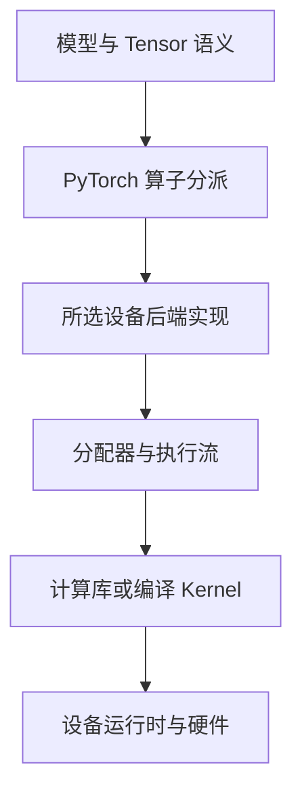

# PyTorch 后端选择与 CUDA torch-npu 适配

PyTorch 提供统一的张量与模型编程方式，但统一的接口不表示统一的硬件实现。`x @ w` 看起来相同，CPU、NVIDIA CUDA 和昇腾 NPU 仍使用不同的分配、任务提交、Kernel 与通信路径。

本篇解释从模型语义到设备后端的边界。PyTorch 接口参考当前稳定文档；TorchNPU 采用独立配套矩阵，不要求所有平台都使用同一个“最新 PyTorch”。

## 1. Tensor 不只是一个数组

Tensor 除了值，还携带 Shape、dtype、布局、设备和梯度等属性。这些信息参与选择执行实现。

```text
数学语义：矩阵相乘
Tensor 属性：float32 / 形状 / 布局 / cuda:0 或 npu:0
执行实现：目标设备支持的算子与计算路径
```

仅改变进程的默认设备，不会自动搬迁已经创建的全部 Tensor。模型参数与输入也必须位于操作支持的设备组合；跨设备复制、同设备计算和分布式通信是三种不同动作。

## 2. Dispatcher 怎样选择实现

Dispatcher 是 PyTorch 的算子分派机制。它不只根据一个设备字符串查表，还要协调 Autograd、设备、布局等分派状态；具体算子可能继续调用组合实现或下层库。



对于 CUDA，路径可能使用 CUDA 库、原生或生成 Kernel；对于昇腾，TorchNPU 将相关算子与设备机制连接到 CANN。图是职责概览，不表示所有算子调用一个共同的固定函数栈。

`PrivateUse1` 是 PyTorch 为树外设备后端提供的集成扩展点之一。注册一个设备名称，还远远不等于完整后端：需要算子实现、设备管理、内存分配、拷贝、执行流，以及与梯度、编译等机制的配套。参见 [PrivateUse1 集成说明](https://docs.pytorch.org/tutorials/advanced/privateuseone.html)。

## 3. torch-npu 与 PyTorch 如何配合

`torch-npu` 是发行包名称，`torch_npu` 是导入模块；两种拼写分别出现在包管理和 Python 代码中，不是两个无关的软件。

较新 TorchNPU 支持自动注册，但显式 `import torch_npu` 仍有助于明确初始化意图，并兼容需要显式导入的相应版本。具体版本和初始化规则以 [TorchNPU 仓库](https://github.com/Ascend/pytorch)为准。

不能只安装任意版本 torch-npu 来适配任意 PyTorch。Python ABI、CPU 架构、框架 API/ABI、CANN、Driver 和芯片能力都要配套；vLLM-Ascend 等引擎还增加自己的支持范围。

| 可以复用的上层内容 | 仍需验证的设备相关内容 |
| --- | --- |
| 部分模型结构、权重与数学表达 | 算子、dtype、布局和动态 Shape |
| 部分训练循环和服务代码 | 设备 API、同步与内存分配器行为 |
| 通用 Python 工程组织 | CUDA 扩展、Triton 或专用融合 Kernel |
| 部分分布式语义 | NCCL/HCCL、通信后端与硬件路径 |

## 4. 内存分配与数据搬运

框架分配器管理 Tensor 所需设备存储，并可能缓存已申请的内存。Tensor 生命周期结束，不一定立刻使设备管理工具看到的占用下降；缓存也不意味着这些内存正在被高强度访问。

将 CPU Tensor 转到设备涉及拷贝语义和可能的同步；在设备上创建 Tensor 则从目标设备分配。模型迁移不能只搜 `.cuda()` 替换 `.npu()`，还应检查在函数内部新建的 Tensor、随机数、索引与工作区是否落在正确设备。

不同设备的分配器配置不是通用旋钮。CUDA 的分配配置与 NPU 的分配配置，需要分别按对应版本解释，不能通过相同的环境变量名称猜测语义。

## 5. 一次有限的功能验证

验证程序只进行一次 2×2 float32 矩阵运算、同步、拷回与结果校验。它会初始化计算环境并使用少量设备资源，**不是纯只读检查，也不是压测、完整模型验收或性能基准**。

在已获授权且可使用的测试设备上，下载仓库中的 [backend_probe.py 源码](https://github.com/newswitch/newswitch.github.io/blob/main/examples/accelerator-runtime/backend_probe.py)，按当前进程可见编号明确选择：

```bash
python backend_probe.py --device cuda:0
# 昇腾环境单独执行，不要求同一个 Python 同时安装两种设备后端
python backend_probe.py --device npu:0
# 只验证 CPU 路径时
python backend_probe.py --device cpu
```

程序核心是：

```python
left = torch.tensor([[1.0, 2.0], [3.0, 4.0]], dtype=torch.float32, device=device)
right = torch.tensor([[5.0, 6.0], [7.0, 8.0]], dtype=torch.float32, device=device)
result = left @ right
# 设备后端显式同步后，再拷回 CPU 校验
```

CUDA 成功时的预期输出：

```json
{"device": "cuda:0", "result": [[19.0, 22.0], [43.0, 50.0]], "status": "passed"}
```

NPU 成功时设备字段为 `npu:0`，CPU 为 `cpu`；这些是程序的预期结果，不是本文在目标硬件上获得的实测记录。程序不在设备不可用时自动回退 CPU，否则“验证通过”会掩盖真正没有使用加速器的问题。

选择的编号必须属于当前进程获分配范围。程序不会申请 Kubernetes 资源，也不改变设备切分、驱动、Runtime 或容器权限。

## 6. 为什么算对一次仍不等于模型适配完成

这个结果只覆盖相应设备上的小矩阵路径。实际模型还可能使用 BF16/FP16、量化、不同维度与布局、Attention、自定义扩展、图模式和集合通信；它们都可能选择另一种实现。

因此至少区分三层验证：

1. 基础功能：指定设备确实执行，结果正确；
2. 模型覆盖：所需算子、输入分布、精度与并行方式可用；
3. 业务表现：在相同 SLO 和流量条件下，内存、错误与有效吞吐满足要求。

某个 CUDA 融合扩展只有 GPU 二进制时，改 Tensor 设备并不会生成 NPU 版本。需要更换实现、使用相应框架适配，或在明确评估后重写。

## 7. 编译后端与设备后端不是同一个选择

设备后端回答 Tensor 在哪里、相应算子如何运行；`torch.compile` 的编译后端回答如何处理捕获到的图。两者会相互配合，但不是同一个注册入口，也不保证各设备共享相同编译器和 Kernel。

Eager 成功、编译模式失败时，应检查编译后端支持、图中断、动态输入、自定义算子和缓存；不要仅靠 `is_available()` 判断编译路径已经满足要求。通用 `torch.accelerator` 接口也有版本与后端支持范围，不能假定旧环境中的全部设备接口都已被它覆盖。

## 8. 同步与通信的迁移边界

CUDA 与 CANN 都有异步执行能力，但流、事件、图和调试开关的细节并非同一套 ABI。迁移时要重建依赖，而不是只消除导入错误。错误可能在后续同步处出现，需关联首个设备错误与调用顺序。

分布式通信还要区分框架进程组和物理连接：NCCL、HCCL 是各自生态的重要通信组件，后端选择、Rank 设备映射及网络都需要验证。普通 Tensor 算子成功不证明多进程通信已经可用。

## 9. 练习与答案

**问题一：把 Tensor 的设备改为 npu，是否会自动翻译已有 CUDA 扩展？**

答案：不会。张量语义可以由目标后端重新实现，但现有 CUDA 二进制和 Kernel 仍是设备相关产物，必须提供目标设备支持的实现。

**问题二：为什么后端注册名称成功，还不等于已支持整个 PyTorch？**

答案：后端还需要设备管理、分配、拷贝、算子、流，以及梯度和编译等集成。名字存在不证明实际功能覆盖。

**问题三：最小矩阵运算成功，是否说明 BF16 Attention 和 HCCL 都正常？**

答案：不能。它们属于不同输入类型、算子或通信路径，需要分别覆盖；小矩阵测试不替代模型与多卡验证。

**问题四：验证程序为什么不在 NPU 不可用时悄悄回退 CPU？**

答案：验证目标是确认指定设备可执行。自动回退会把“CPU 算对”误报为“NPU 可用”，丢失关键证据。

## 10. 官方参考与延伸阅读

- [PyTorch PrivateUse1 后端集成](https://docs.pytorch.org/tutorials/advanced/privateuseone.html)
- [PyTorch CUDA 语义](https://docs.pytorch.org/docs/stable/notes/cuda.html)
- [PyTorch accelerator 接口](https://docs.pytorch.org/docs/stable/accelerator.html)
- [TorchNPU 项目与兼容说明](https://github.com/Ascend/pytorch)
- [CUDA 软件栈](../../gpu/cuda/02-CUDA软件栈运行库与计算调用链.md)
- [CANN 软件栈](../../gpu/ascend-npu/04-CANN软件栈组件与计算调用链.md)
- [AI 运行环境命令参考库](./commands/00-AI运行环境命令参考库.md)
