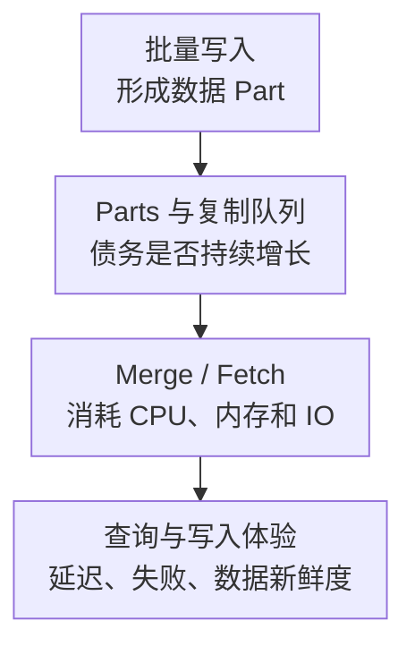

# ClickHouse 核心监控指标采集与告警

ClickHouse 的吞吐依赖批量、列式扫描和后台合并。监控既要看到查询是否及时完成，也要看到写入是否不断制造小 Part、后台债务是否积累，以及复制与存储是否限制了后续能力。查询很快，不代表数据已及时到达；插入成功，也不代表所有副本都已追平。

本文以 **ClickHouse v25.8.1.5101-lts 原生 Prometheus writer**为教学契约，不是生产版本推荐。标签沿用[监控指标地图](../../../../sre/observability/01-主流组件监控指标地图.md)，`job="clickhouse"`，额外 target 标签 `clickhouse_cluster` 标识数据库集群，必要时加入 `shard,replica`。一个进程只由一条权威采集路径贡献。

## 1. 查询、写入与后台债务



图表示资源与债务的影响关系，不是每个 SELECT 都等待 Merge 完成。Merge 数量为 0 可以是没有任务，也可能是任务被限制或无法执行，必须同时看 Parts、队列、资源与日志。

## 2. 接入与来源分层

原生配置片段可设置独立监控端口，以下端口只是示例：

```xml
<clickhouse>
  <prometheus>
    <endpoint>/metrics</endpoint>
    <port>9363</port>
    <metrics>true</metrics>
    <events>true</events>
    <asynchronous_metrics>true</asynchronous_metrics>
  </prometheus>
</clickhouse>
```

限制监听网络；需要 TLS/认证时按环境配置代理或安全入口，不假设所有 HTTP 接口共享用户权限。读取 System 表的自定义采集账户也要限制查询和资源预算。

| 来源 | 原生前缀与类型 | 解释方式 |
| --- | --- | --- |
| ProfileEvents | `ClickHouseProfileEvents_`，Counter | 自进程启动累计发生量，通常用 `rate` |
| CurrentMetrics | `ClickHouseMetrics_`，Gauge | 当前活动、并发与跟踪内存 |
| AsynchronousMetrics | `ClickHouseAsyncMetrics_`，Gauge | 后台周期采样，可能有更新延迟 |
| System 表 | SQL 结果，不自动等于原生 Prometheus 指标 | 表/分区/副本诊断，可按预算增加自定义 collector |

名称区分大小写。Counter 没有 `_total` 后缀也可以是 Counter；不要因异步指标名字像累计值就自行改用 `rate`。按原始端点的 TYPE 和源码确定契约。

## 3. 核心指标卡片

| 问题 | 指标或来源 | 单位与边界 |
| --- | --- | --- |
| 查询到达 | `ClickHouseProfileEvents_Query` | C，查询次；排除部分解析/限额拒绝，可能包含内部查询，不等于业务 HTTP 请求 |
| 查询失败 | `ClickHouseProfileEvents_FailedQuery` | C，失败次；与 Query 不应未经核对就作业务错误率分子/分母 |
| 查询累计耗时 | `ClickHouseProfileEvents_QueryTimeMicroseconds` | C，微秒；不是秒，更不是 P99 |
| 当前并发 | `ClickHouseMetrics_Query` | G，正在执行查询数；不自动包含应用连接池等待 |
| 写入行/字节 | `ClickHouseProfileEvents_InsertedRows`、`ClickHouseProfileEvents_InsertedBytes` | C，行/未压缩列数据字节；不是磁盘落盘字节 |
| 扫描行/字节 | `ClickHouseProfileEvents_SelectedRows`、`ClickHouseProfileEvents_SelectedBytes` | C，读行/未压缩字节；不等于最终返回量 |
| 跟踪内存 | `ClickHouseMetrics_MemoryTracking` | G，字节；不是进程 RSS 或完整容器内存 |
| 后台活动 | `ClickHouseMetrics_Merge`、`ClickHouseMetrics_ReplicatedFetch` | G，当前合并/副本抓取活动；零不是健康证明 |
| 写入背压 | `ClickHouseProfileEvents_DelayedInserts`、`ClickHouseProfileEvents_RejectedInserts` | C，因 TooManyParts 延迟/拒绝的插入块，不是所有拒绝原因 |
| Part 债务 | `system.parts` | 按活跃 Part、分区、字节、磁盘查看；不要只看全表总数 |
| 复制与变更 | `system.replicas`、`system.replication_queue`、`system.mutations` | 检查只读、会话、队列、异常与失败；不是默认逐表指标 |

查询体验由客户端请求成功率、耗时和数据新鲜度补齐；Keeper 另有仲裁、请求和资源监控，不能用 ReplicatedFetch 代替 Keeper 可用性。

## 4. 源码分析：原始单位为什么不能靠名字猜

[PrometheusMetricsWriter.cpp](https://github.com/ClickHouse/ClickHouse/blob/v25.8.1.5101-lts/src/Server/PrometheusMetricsWriter.cpp)为三类来源设置不同前缀和类型，写出 ProfileEvents 原值，并没有统一转成秒。`QueryTimeMicroseconds` 的定义见[ProfileEvents.cpp](https://github.com/ClickHouse/ClickHouse/blob/v25.8.1.5101-lts/src/Common/ProfileEvents.cpp)，单位仍是微秒。

[CurrentMetrics.cpp](https://github.com/ClickHouse/ClickHouse/blob/v25.8.1.5101-lts/src/Common/CurrentMetrics.cpp)定义 `Query`、`Merge` 和 `MemoryTracking` 的当前状态含义。一个名字相似的 ProfileEvent 与 CurrentMetric 不能互换：前者是在窗口内发生多少次，后者是现在有多少个。

查询请求速率：

```promql
sum by (cluster, clickhouse_cluster, instance) (
  rate(ClickHouseProfileEvents_Query{job="clickhouse"}[5m])
)
```

失败发生速率，不直接标注为业务错误比例：

```promql
sum by (cluster, clickhouse_cluster, instance) (
  rate(ClickHouseProfileEvents_FailedQuery{job="clickhouse"}[5m])
)
```

窗口内粗略平均查询耗时，显式转换为秒，并排除零查询窗口：

```promql
(
  rate(ClickHouseProfileEvents_QueryTimeMicroseconds{job="clickhouse"}[5m])
  / rate(ClickHouseProfileEvents_Query{job="clickhouse"}[5m]) / 1000000
)
and (rate(ClickHouseProfileEvents_Query{job="clickhouse"}[5m]) > 0)
```

平均值要求两个计数器覆盖可比查询集合；若要严格的成功查询 P99、租户或业务类别，使用受控的 `query_log` 分析或应用直方图，并明确是否包含失败、内部查询与分布式子查询。不能从这个平均值推导 P99。

每秒写入行数：

```promql
sum by (cluster, clickhouse_cluster, instance) (
  rate(ClickHouseProfileEvents_InsertedRows{job="clickhouse"}[5m])
)
```

TooManyParts 拒绝速率：

```promql
rate(ClickHouseProfileEvents_RejectedInserts{job="clickhouse"}[5m])
```

## 5. Parts 和复制要落到正确对象

只读诊断示例，限制到目标库表，避免高频扫描整个集群：

```sql
SELECT database, table, partition_id,
       count() AS active_parts, sum(bytes_on_disk) AS bytes_on_disk
FROM system.parts
WHERE active AND database = 'app' AND table = 'events'
GROUP BY database, table, partition_id
ORDER BY active_parts DESC
LIMIT 20;
```

这里是每个分区的活跃 Part 数。全表有很多分区可能合理，而 TooManyParts 往往需要落到同一分区的 Part 压力、合并速度与设置检查。自定义导出时可将结果映射为自有 Gauge，但不要称为原生指标；分区标签会随时间增长，应限制采集对象和保留维度。

复制排障先看 `system.replicas` 的只读、会话和队列，再在 `system.replication_queue` 定位最老任务、重试与异常；Mutations 检查未完成任务和失败原因。单个节点的 System 表默认不代表所有副本，需要按拓扑分发只读查询，且避免重复相加。

## 6. 示例告警与响应边界

以下规则提示持续存在 TooManyParts 拒绝，不代表所有写入都失败。它是组件原因告警，应与客户端写入错误、新鲜度告警关联：

```yaml
groups:
  - name: clickhouse-ingest-core
    rules:
      - alert: ClickHouseRejectedInserts
        expr: rate(ClickHouseProfileEvents_RejectedInserts{job="clickhouse"}[5m]) > 0
        for: 5m
        labels:
          severity: warning
        annotations:
          summary: "ClickHouse 持续因 Parts 压力拒绝插入"
```

先找目标表/分区、批次大小、写入并发和近期变更，检查 Merge 能否推进，再看 CPU、磁盘空间/IO 和复制。不要自动执行 `OPTIMIZE FINAL`、调高 Part 限制或删除复制队列；这些操作可能加剧资源竞争或改变数据安全。

| 现象 | 优先关联 |
| --- | --- |
| 扫描行数高、查询慢 | 分区裁剪、主键/跳数索引、执行计划和返回量，而不只看 CPU |
| Parts 增、Merge 忙 | 小批写入、分区设计、合并 IO 与内存预算 |
| Parts 增、Merge 不动 | 磁盘、任务错误、限制、停用合并或资源不满足 |
| 主请求正常、副本落后 | 复制队列、Keeper、网络、Fetch 与磁盘，核对读一致性要求 |

## 7. 掌握检查

1. 为什么 `InsertedBytes` 不能当作磁盘写带宽？它是未压缩列数据口径，物理写入还有压缩、合并和复制。
2. 为什么“平均查询 20 毫秒”不证明 P99 达标？平均值掩盖长尾，且计数集合可能与业务请求不同。
3. 如何证明 Parts 告警有意义？在目标分区关联拒绝/延迟、合并债务和写入新鲜度，而不是仅背一个 Part 阈值。
4. 为什么所有副本都抓取后不能简单把查询/行数理解为业务数？分布式请求、内部工作和复制有多次执行边界。

进一步阅读：[System 表与命令](./15-ClickHouse-Client-System表与运维命令手册.md)、[生产故障 Runbook](./14-备份权限配额升级与生产故障Runbook.md)，表定义可查[官方 System 表文档](https://clickhouse.com/docs/operations/system-tables)。
