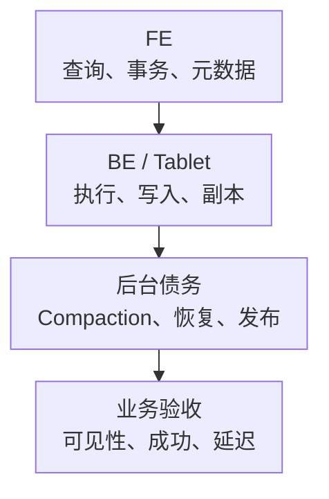

# Doris 核心监控指标采集与告警

Doris 的 FE 负责元数据、规划和调度，BE 保存 Tablet 并执行查询、导入和 Compaction。查询成功、导入事务完成、数据对查询可见和副本恢复，不能只用同一个“成功数”判断。

以下以 **Doris 3.x 监控文档与 branch-3.0 传统存算一体实现**说明指标，不作为生产版本建议。存算分离、Cloud 与其他小版本要补充其控制服务、缓存和对象存储指标。基础约定见[监控指标地图](../../../sre/observability/01-主流组件监控指标地图.md)，分 job `doris-fe`、`doris-be`，target 标签 doris_cluster 唯一标识部署。

## 1. 查询与后台债务



图表示影响关系，不是 SELECT 必须等待所有 Compaction 才能执行。导入频繁的小批次可能增加版本和合并压力，后台债务会与查询争用 CPU、内存和 IO。

## 2. 接入与身份

分别访问 FE HTTP 端口和 BE Web 端口的 `/metrics`，不选择 `type=json` 给 Prometheus。按所有 FE/BE 发现，保留实例、角色和数据目录；限制监控网络与凭据，不假设 SQL 认证自动覆盖所有 HTTP 端点。

| 来源 | 核心证据 | 聚合边界 |
| --- | --- | --- |
| FE | 请求、查询、连接、事务、发布与元数据角色 | 全局和按 user/db 的同义指标不能相加 |
| BE | Fragment、Tablet、内存、磁盘、导入和 Compaction | 每个物理副本/实例的工作量不等于唯一业务量 |
| 管理 SQL/Profile | Tablet、副本、队列、Load 任务、执行计划 | 按范围查询，不默认都是原生逐表指标 |
| 客户端 | 查询结果、耗时、导入最终状态、数据新鲜度 | HTTP 接收导入不必然代表最终可见 |

接口与名称见[3.x 指标文档](https://doris.apache.org/docs/3.x/admin-manual/maint-monitor/metrics/)。采集前检查实际 TYPE、标签和组件版本，不照抄“所有 total 都是 Counter”。

## 3. 核心指标卡片

| 问题 | 指标或证据 | 类型、单位与边界 |
| --- | --- | --- |
| FE 查询 | `doris_fe_query_total`、`doris_fe_query_err` | C，查询/错误次；全局序列与 user 明细只选一层 |
| FE 连接 | `doris_fe_connection_total` | **G**，当前连接数；不是累计连接创建量 |
| FE 延迟 | `doris_fe_query_latency_ms{quantile="0.99"}` | 服务端分位数，毫秒；不是标准桶，不能平均成集群 P99 |
| 事务 | `doris_fe_txn_counter{type=...}`、`doris_fe_txn_num`、`doris_fe_publish_txn_num` | 累计决议/当前事务与待发布量，分别解释 |
| 数据目录容量 | `doris_be_disks_avail_capacity`、`doris_be_disks_total_capacity` | G，字节，path 标签；多个目录可能共用同一块盘 |
| 目录状态 | `doris_be_disks_state` | G，1 正常、0 异常；与剩余容量分开 |
| Compaction | `doris_be_tablet_cumulative_max_compaction_score`、`doris_be_tablet_base_max_compaction_score` | G，合并压力分值；不是毫秒或任务完成速率 |
| Fragment | `doris_be_fragment_instance_count`、`doris_be_fragment_requests_total` | 当前执行量/累计 Fragment 次，不是 SQL 请求数 |
| 内存与副本 | MemTracker、进程 RSS、Tablet/Replica 状态 | 跟踪内存、进程、容器范围不同；副本个数不代表故障域完整 |

## 4. 源码分析与查询

[MetricRepo](https://github.com/apache/doris/blob/branch-3.0/fe/fe-core/src/main/java/org/apache/doris/metric/MetricRepo.java)把 connection_total 定义成 Gauge，同时为 query_total/query_err 注册全局和按 user 的计数。下面使用 `user=""` 选择没有 user 标签的全局层；PromQL 中空值匹配也包括该标签不存在的样本。

FE 全局查询/秒：

```promql
sum by (cluster, doris_cluster, instance) (
  rate(doris_fe_query_total{job="doris-fe",user=""}[5m])
)
```

FE 全局错误/秒，按错误原因再进入 Profile/日志，而不是直接归因 BE 容量：

```promql
sum by (cluster, doris_cluster, instance) (
  rate(doris_fe_query_err{job="doris-fe",user=""}[5m])
)
```

数据目录剩余比例：

```promql
(
  doris_be_disks_avail_capacity{job="doris-be"}
  / doris_be_disks_total_capacity{job="doris-be"}
)
and (doris_be_disks_total_capacity{job="doris-be"} > 0)
```

不要把同一文件系统的多个 path 空闲容量重复相加。全局平均充足，也可能有单盘、单 BE 或特定 Tablet 先达到写入/恢复限制。

当前累计 Compaction 最坏分值：

```promql
max by (cluster, doris_cluster, instance) (
  doris_be_tablet_cumulative_max_compaction_score{job="doris-be"}
)
```

[BE 指标定义](https://github.com/apache/doris/blob/branch-3.0/be/src/util/doris_metrics.cpp)将该分值作为 Gauge，不能 rate 当合并速度。[PrometheusMetricVisitor](https://github.com/apache/doris/blob/branch-3.0/fe/fe-core/src/main/java/org/apache/doris/metric/PrometheusMetricVisitor.java)将 FE Histogram 的 snapshot 输出成 quantile；其 `_sum` 还使用 count × 当前 snapshot mean 构造，不应未经验证就当作精确、单调的累计请求耗时。

## 5. 示例告警与故障判断

数据目录空闲不足 10% 持续 10 分钟提示容量风险；教学阈值需结合实际字节余量、增长、发布和副本恢复预算，而不是所有磁盘统一承诺安全。

```yaml
groups:
  - name: doris-storage-core
    rules:
      - alert: DorisDataDirectoryLowSpace
        expr: |
          (doris_be_disks_avail_capacity{job="doris-be"} / doris_be_disks_total_capacity{job="doris-be"}) < 0.1
          and (doris_be_disks_total_capacity{job="doris-be"} > 0)
        for: 10m
        labels:
          severity: warning
        annotations:
          summary: "Doris BE 数据目录持续缺少空间余量"
```

| 现象 | 优先证据 |
| --- | --- |
| FE 查询错误高、BE 空闲 | SQL/权限、规划、外部 Catalog、FE 角色与网络 |
| 导入成功回执后数据未见 | 具体 Load/事务状态、Commit/Publish、读路径，不能仅看接收量 |
| Compaction score 高且上升 | 批次大小、版本数、磁盘 IO、合并任务失败与资源争用 |
| 副本异常、总容量尚足 | 单盘、Tablet 分布、故障域与修复调度，平均值可能掩盖局部约束 |

不要自动删除 Tablet、强行清理副本或无限提高 Compaction 并发。先保留 Profile、Load 和副本证据，再做可回滚变更。

## 6. 掌握检查

1. 为什么把全部 query_total 相加会翻倍？可能同时计入全局和用户明细。
2. 为什么 connection_total 不取 rate？它是当前连接 Gauge。
3. 为什么 FE P99 不能直接平均？分位数与 snapshot 不保留可任意合并的请求分布。
4. 恢复标准是什么？查询、导入可见性、后台债务、副本保护及容量余量共同达标。
