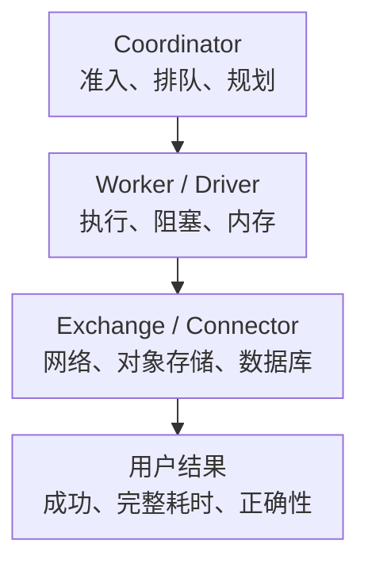

# Trino 核心监控指标采集与告警

Trino 是查询引擎，通常不保存业务主数据。Coordinator 规划与调度，Worker 执行 Stage/Task/Driver，Connector 访问数据库、对象存储或湖仓。查询慢可能是资源组准入、计算、Exchange 或外部存储等待，不能用“集群 CPU 不高”排除瓶颈。

以下固定 **Trino 476 的 System 表与运行时实现**讨论语义；原生 OpenMetrics/JMX 的名字受版本、对象名和配置影响，应按部署核对。本文用明确标注的自有归一化指标演示查询，不把它们称为 Trino 开箱即用指标。基础约定见[监控指标地图](../../../sre/observability/01-主流组件监控指标地图.md)，target 标签 trino_cluster 标识部署。

## 1. 查询、Task 和 Driver 不能混算



一个 Query 可以启动很多 Driver，Driver 阻塞可能是在等输入、输出或内存，并不总是线程死锁。查询完成数、Driver 完成数和扫描行数属于不同单位。

## 2. 三类采集来源

| 来源 | 用途 | 必须核对 |
| --- | --- | --- |
| 原生 OpenMetrics/JMX | JVM、HTTP、调度、内存、查询累计统计和 Connector 指标 | 版本、MBean/属性名、暴露允许列表、秒/毫秒与 TimeStat 分布 |
| system.runtime 表 | 当前/近期查询、节点身份、状态与排队时间 | 可见权限、历史保留、SQL 查询本身的资源开销 |
| 客户端/Event Listener | 完整请求结果、错误类别、查询完成与审计 | 采样、重试、客户端取消、查询文本脱敏 |

原生 OpenMetrics 的路径、认证与可选对象随版本核对，[官方接口说明](https://trino.io/docs/current/admin/openmetrics.html)不能替代实际端点检查。JMX/RMI 或 Java Agent 管理端点应限制网络与权限，不能为监控开放远程控制。

System 表采集需要最小权限、专用身份、资源组/并发预算与超时。必须验收监控账户能看见全部目标查询，而不只是自己的查询；SQL 成功但被权限过滤成空集，不能解释为集群空闲。满载时监控 SQL 自身也可能排队，因此不能只靠它判断整个引擎是否活着；另保留直接进程指标和客户端探测。

## 3. 指标卡片与归一化契约

下列 site_trino_* 是**需要自行实现的采集适配层**名称，不是安装 Trino 后就会存在的指标。可以用有界 SQL collector 实现，或把已核对的原生指标映射到等价语义；不能用名字相似的 Driver 数代替 Query 数。

| 归一化指标/来源 | 类型、单位 | 计算契约 |
| --- | --- | --- |
| `site_trino_queries{state=...}` | G，Query 数 | system.runtime.queries 中各状态数量，排除专用监控用户 |
| `site_trino_longest_queued_query_seconds` | G，秒 | 当前 QUEUED 查询的 max(queued_time_ms)/1000；成功查询且没有排队时输出 0 |
| `site_trino_active_workers` | G，节点数 | system.runtime.nodes 中 active 且 coordinator=false 的数量 |
| `site_trino_collector_success` | G，0/1 | 本轮适配采集是否成功，失败不可把业务状态重写成零 |
| `site_trino_collector_last_success_timestamp_seconds` | G，Unix 秒 | 上次完整采集成功时间；与 HTTP up 分开 |
| 原生 Driver 统计 | 当前运行/排队/阻塞量 | 是内部执行单元，不能称为 Query 数 |
| 原生内存/Spill | 预留、可撤销、进程内存、溢写字节 | 各范围不同，溢写降低内存风险但增加 IO 和延迟 |
| 业务失败与耗时 | 完成事件 Counter/Histogram | 需要区分用户错误、资源不足、外部源失败、内部错误与取消 |

## 4. 从 System 表生成有界事实

固定版本的[QuerySystemTable](https://github.com/trinodb/trino/blob/476/core/trino-main/src/main/java/io/trino/connector/system/QuerySystemTable.java)公开 state、user、source 和 queued_time_ms；[NodeSystemTable](https://github.com/trinodb/trino/blob/476/core/trino-main/src/main/java/io/trino/connector/system/NodeSystemTable.java)公开 coordinator 与小写 state。示意 SQL：

```sql
SELECT state, count(*) AS query_count
FROM system.runtime.queries
WHERE "user" <> 'monitoring' AND state IN ('QUEUED', 'RUNNING')
GROUP BY state;

SELECT coalesce(max(queued_time_ms), 0) / 1000.0 AS longest_queued_seconds
FROM system.runtime.queries
WHERE "user" <> 'monitoring' AND state = 'QUEUED';

SELECT count(*) AS active_workers
FROM system.runtime.nodes
WHERE state = 'active' AND NOT coordinator;
```

monitoring 是专用账户示例。只在查询成功后，为约定枚举中没有记录的状态输出零；失败、无权限或超时时记录 collector_success=0，不伪造空集群。不要把 query_id、完整 SQL、用户输入或任意资源组路径直接变成标签。

System 表只保留有限的近期查询，不能把“当前看见的 FAILED 行数”当累计 Counter。累计失败量应来自完成事件或已核对的原生 Counter。[QueryManagerStats](https://github.com/trinodb/trino/blob/476/core/trino-main/src/main/java/io/trino/execution/QueryManagerStats.java)也区分 FailedQueries 与 RunningDrivers 等统计；不同属性不能因都含 running/failed 就相互替换。

## 5. 常用查询与告警

约定 `job="trino-state"` 每个逻辑集群仅有一个状态采集贡献者；多副本适配器要选主/去重，不能相加全局视图。

```promql
site_trino_queries{job="trino-state",state="QUEUED"}
```

```promql
site_trino_longest_queued_query_seconds{job="trino-state"}
```

```promql
site_trino_active_workers{job="trino-state"}
```

采集新鲜度秒数：

```promql
time() - site_trino_collector_last_success_timestamp_seconds{job="trino-state"}
```

最老排队超过 60 秒持续 5 分钟，且状态采集成功、新鲜时提示资源组/容量风险。阈值来自查询等待预算，不是所有批查询的统一 SLA：

```yaml
groups:
  - name: trino-admission-core
    rules:
      - alert: TrinoQueuedQueryTooOld
        expr: |
          (site_trino_longest_queued_query_seconds{job="trino-state"} > 60)
          and on (cluster, trino_cluster, instance)
          (site_trino_collector_success{job="trino-state"} == 1)
          and on (cluster, trino_cluster, instance)
          ((time() - site_trino_collector_last_success_timestamp_seconds{job="trino-state"}) < 120)
        for: 5m
        labels:
          severity: warning
        annotations:
          summary: "Trino 当前查询持续超出排队预算"
```

陈旧采集不触发这条业务规则，但必须由独立 collector 失败/新鲜度告警接管，不能显示为健康。未部署适配器时这些查询不会有结果，应先完成接入而不是补零。

## 6. 深化判断与掌握检查

| 现象 | 优先检查 |
| --- | --- |
| 查询排队、Worker 空闲 | 资源组准入/并发、Coordinator 规划与配额，不先加 Worker |
| Running 多、CPU 低 | 阻塞 Driver、Exchange、连接池、外部源与可撤销内存 |
| Spill 高、耗时增加 | 内存预算、Join/聚合、分布、磁盘和对象存储，Spill 不必然是错误 |
| Worker 掉线、重试继续 | 容错执行策略、Exchange 存储和最终结果；重试不等于业务完成 |

能区分 Query 与 Driver，解释 SQL 状态采集为何会受准入影响，并用客户端结果、资源组、内存和外部源证据完成归因，才算掌握。不要自动无限提高并发、取消全部查询或关闭内存限制。
