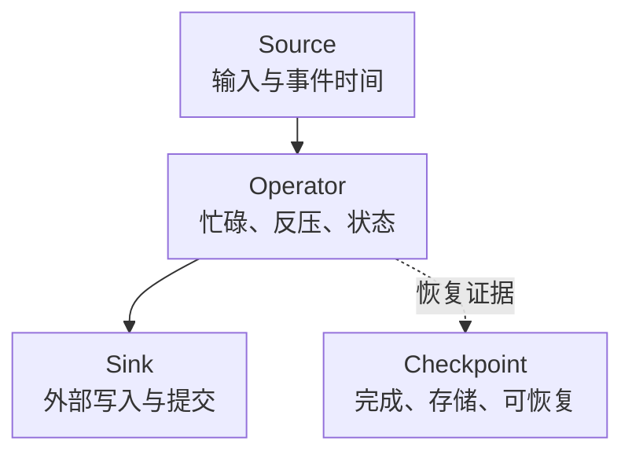

# Flink 核心监控指标采集与告警

Flink Job RUNNING 只说明运行状态，不保证数据在推进、Checkpoint 可恢复或 Sink 已完成外部事务。监控应同时覆盖处理吞吐、事件时间、反压、状态/恢复和业务结果。

本文固定 **Flink 2.0.0 原生 Prometheus Reporter 与默认逻辑 scope**解释指标。自定义 scope、Operator/Task 层级、Connector 和后续版本要核对实际暴露，不是生产版本推荐。基础约定见[监控指标地图](../../../sre/observability/01-主流组件监控指标地图.md)，分 job `flink-jobmanager`、`flink-taskmanager`，target 标签 flink_cluster 标识部署。

## 1. 数据进展与恢复进展



Watermark 是事件时间进展，不是采集机器时钟；Checkpoint 完成也不自动证明所有外部副作用都是 Exactly-Once。Connector 的事务协议、提交与恢复行为必须独立验收。

## 2. 接入与身份

安装匹配版本的 reporter 依赖，并配置 factory。示例端口仅供说明，同机多个 JM/TM 要避免冲突并建立实际端口发现：

```yaml
metrics.reporter.prom.factory.class: org.apache.flink.metrics.prometheus.PrometheusReporterFactory
metrics.reporter.prom.port: 9249
```

按 JM/TM 实例采集，限制端口访问，不假设 Web UI 认证同时保护 reporter。job_id、job_name、task/operator、subtask_index、attempt 和实例承担不同身份；重启/扩缩容后不能把历史 attempt 与当前 attempt 当成不同业务分片相加。

## 3. 类型映射是查询的前提

[Reporter 文档](https://nightlies.apache.org/flink/flink-docs-release-2.0/docs/deployment/metric_reporters/)与[实现](https://github.com/apache/flink/blob/release-2.0.0/flink-metrics/flink-metrics-prometheus/src/main/java/org/apache/flink/metrics/prometheus/AbstractPrometheusReporter.java)的映射为：

| Flink 类型 | Prometheus 暴露 | 如何解释 |
| --- | --- | --- |
| Counter | Gauge | 有些 Flink Counter 可减；仅对已确认单调的累计量使用 rate |
| Meter | Gauge | 已经是速率，不再次 rate |
| Histogram | Summary | quantile 不可跨 subtask 平均，不假设存在标准 bucket |
| Gauge | Gauge | 当前状态、时间戳、最近一次耗时等需分别解释 |

下表采用常见默认 scope。相同短名出现在 Operator 和 Task 时可能覆盖不同集合，不能两层求和称作业务吞吐。

| 问题 | 指标 | 单位与边界 |
| --- | --- | --- |
| 任务输入/输出 | `flink_taskmanager_job_task_numRecordsIn`、`..._numRecordsOut` | 累计记录数的语义；重试可重复处理，记录不等于唯一业务事件 |
| 输入速率 | `flink_taskmanager_job_task_numRecordsInPerSecond` | 已计算的记录/秒 Gauge |
| 任务忙碌 | `flink_taskmanager_job_task_busyTimeMsPerSecond` | 毫秒/秒；不是 CPU 利用率 |
| 反压 | `flink_taskmanager_job_task_backPressuredTimeMsPerSecond` | 毫秒/秒；说明此任务受到下游压力，不必然是根因位置 |
| 事件时间 | `flink_taskmanager_job_task_currentInputWatermark` | 毫秒时间戳，可能有未初始化哨兵值；空闲输入会改变解释 |
| 最近 Checkpoint | `flink_jobmanager_job_lastCheckpointCompletedTimestamp` | 毫秒时间戳；没有成功记录时不能直接算普通年龄 |
| Checkpoint 耗时 | `flink_jobmanager_job_lastCheckpointDuration` | 最近一次耗时，毫秒 Gauge；不是 P99 |
| 完成/失败次数 | `flink_jobmanager_job_numberOfCompletedCheckpoints`、`..._numberOfFailedCheckpoints` | 当前 Job 生命周期累计含义，以 Gauge 暴露，重提作业会变化 |
| 状态资源 | Checkpoint size/full size、State Backend、JVM/Native、磁盘与 IO | 增量上传量不等于完整可恢复状态大小 |

完整名称与更新条件见[2.0 Metrics](https://nightlies.apache.org/flink/flink-docs-release-2.0/docs/ops/metrics/)。表中的省略前缀不是另一条真实指标名，接入以原始端点为准。

## 4. 常用查询

任务输入记录/秒，仅针对该单调累计记录量：

```promql
rate(flink_taskmanager_job_task_numRecordsIn{job="flink-taskmanager"}[5m])
```

当前反压时间占比：

```promql
flink_taskmanager_job_task_backPressuredTimeMsPerSecond{job="flink-taskmanager"} / 1000
```

不要乘并行度称为全局 CPU，也不要把不同任务的比例相加成“集群反压率”。找最先饱和的下游，并结合 Source lag、Sink 延迟、倾斜和状态 IO。

最近成功 Checkpoint 距现在的秒数，排除无有效记录：

```promql
(time() - flink_jobmanager_job_lastCheckpointCompletedTimestamp{job="flink-jobmanager"} / 1000)
and (flink_jobmanager_job_lastCheckpointCompletedTimestamp{job="flink-jobmanager"} > 0)
```

最近 Checkpoint 耗时秒数：

```promql
flink_jobmanager_job_lastCheckpointDuration{job="flink-jobmanager"} / 1000
```

对现代 Unix 毫秒事件时间，可比较有效 Watermark 与时钟，但空闲、乱序、历史回放和哨兵值要先排除；不能将所有 Watermark 停滞都判成故障。真正的数据新鲜度还应由源事件与下游可见时间测量。

## 5. 示例告警与恢复判断

orders 是约定持续运行、启用周期 Checkpoint 的作业。最近成功 Checkpoint 超过 5 分钟且已有有效时间戳，持续 2 分钟触发：

```yaml
groups:
  - name: flink-checkpoint-core
    rules:
      - alert: FlinkCheckpointTooOld
        expr: |
          (time() - flink_jobmanager_job_lastCheckpointCompletedTimestamp{job="flink-jobmanager",job_name="orders"} / 1000) > 300
          and (flink_jobmanager_job_lastCheckpointCompletedTimestamp{job="flink-jobmanager",job_name="orders"} > 0)
        for: 2m
        labels:
          severity: warning
        annotations:
          summary: "Flink 有状态作业持续缺少近期成功 Checkpoint"
```

首次 Checkpoint 一直未成功、作业指标消失或 Job 未运行，不会被这条规则覆盖，应由启动期限、Job 资产/状态和采集覆盖告警接管。窗口由恢复预算和 Checkpoint 周期推导，不能直接用于批作业或暂停作业。

| 现象 | 优先证据 |
| --- | --- |
| 吞吐低、反压高 | Sink、倾斜、网络缓冲、状态读写；上游反压不是自动根因 |
| Checkpoint 对齐慢 | Barrier 到达、反压与倾斜，区分 alignment 和上传时间 |
| Checkpoint 完成但业务重复 | Source/Sink 协议、事务提交、重试、外部副作用和幂等 |
| 恢复时间变长 | 全量状态、文件数量、远端存储吞吐、分片与重分布 |

恢复需证明作业、业务进展、近期可用 Checkpoint 和外部提交均正常。不要自动删状态、跳 Offset 或无限增 Checkpoint 超时掩盖恢复风险。

## 6. 掌握检查

能解释 Counter 为何以 Gauge 暴露、反压与 CPU 为何不同、Watermark 为何不是实时数据年龄，以及 Checkpoint 完成为什么仍需恢复演练。相关原理见[Checkpoint 与 Exactly-Once](./05-Checkpoint-Barrier-Savepoint与Exactly-Once.md)。
