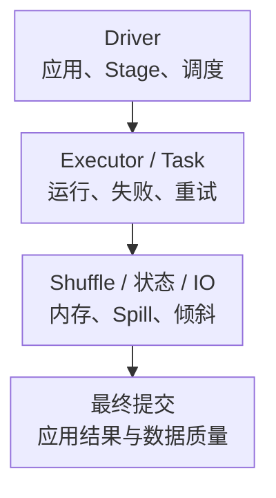

# Spark 核心监控指标采集与告警

Spark 是有生命周期的应用：Driver 规划、调度并维护状态，Executor 执行 Task；Task/Stage 重试可以让应用继续运行，也可能增加大量重复工作。Pod Running、Task completed 或吞吐高，都不等于最终数据已经正确提交。

本文以 **Spark 4.0.0 的 ExecutorSummary PrometheusResource**为查询契约，不是生产版本推荐。它不同于 MetricsSystem 的 PrometheusServlet、JMX 和第三方 Exporter，名称不能混用。基础约定见[监控指标地图](../../../sre/observability/01-主流组件监控指标地图.md)，示例 job 为 `spark-executors`，target 标签 spark_cluster 标识部署。

## 1. 应用完成与内部任务完成



一个应用可以包含多个 Job，一个 Stage 又有很多 Task/Attempt。投机执行、重试与动态资源分配都会改变物理任务数和 Executor 身份，不能按“完成次数”直接计算唯一数据产出。

## 2. 四类观测来源

| 来源 | 适用场景 | 边界 |
| --- | --- | --- |
| MetricsSystem / PrometheusServlet / JMX | Driver、Executor 与其他组件的运行统计 | 名称、namespace、sink 配置随来源变化 |
| Driver `/metrics/executors/prometheus/` | ExecutorSummary 聚合视图 | 实验性接口；数据由 Driver 保存，不是独立直连每个 Executor |
| Event Log / History Server / REST | Stage、Task、Attempt、失败、倾斜与应用结束后分析 | 必须配置事件日志与保留；短任务可能在抓取间隔之间结束 |
| Structured Streaming Progress/Listener | Batch、源进度、状态与流式延迟 | 需实际 instrumentation/导出，不能假设同名字段已是原生 Prometheus 指标 |

UI/端点按部署启用和授权，通常随 Driver UI 服务访问；端口可变化，应通过 Application 身份发现，不固定假设永远 4040。需要时核对 `spark.ui.prometheus.enabled`，同时保护 UI 与指标网络访问。完整配置见[4.0 监控说明](https://spark.apache.org/docs/4.0.0/monitoring.html)。

## 3. 核心指标卡片

以下名称来自指定 ExecutorSummary 路径，标签包括 application_id、application_name、executor_id。接口没有为每个数值都声明 TYPE，需按实现解释累计量和当前量。

| 问题 | 指标/证据 | 单位与边界 |
| --- | --- | --- |
| 当前任务 | `metrics_executor_activeTasks`、`metrics_executor_maxTasks` | 当前 Task 数/槽位上限，不是 CPU 利用率 |
| 完成与失败 | `metrics_executor_completedTasks_total`、`metrics_executor_failedTasks_total` | 累计 Task 次；失败可被重试，完成也不是最终应用提交 |
| Task 累计时间 | `metrics_executor_totalDuration_seconds_total` | 秒；多个并行 Task 时间不能直接当作应用墙钟时间 |
| GC 时间 | `metrics_executor_totalGCTime_seconds_total` | 秒；不是所有请求 STW/P99，也不任意和 Task 时间作精确占比 |
| Shuffle | `metrics_executor_totalShuffleRead_bytes_total`、`metrics_executor_totalShuffleWrite_bytes_total` | 累计字节；不同 Stage/重试可能重复搬运 |
| Storage Memory | `metrics_executor_memoryUsed_bytes`、`metrics_executor_maxMemory_bytes` | 缓存块存储口径，不是整个 JVM Heap/RSS |
| 峰值内存 | `metrics_executor_JVMHeapMemory_bytes` 等 peakMemoryMetrics | 来源是峰值统计，不能一律解释为每次抓取的当前值 |
| Spill、倾斜与调度 | Stage/Task REST、Event Log、UI | 需要 Task 分布与 Attempt，不用全局平均替代长尾 |

## 4. 源码分析与常用查询

[PrometheusResource.scala](https://github.com/apache/spark/blob/v4.0.0/core/src/main/scala/org/apache/spark/status/api/v1/PrometheusResource.scala)明确基于 ExecutorSummary，而不是 ExecutorSource；它将部分毫秒累计值乘 0.001 后输出秒。还只枚举 active Executor，已退出的失败 Executor 不保证继续出现在此端点，必须用事件和应用状态补齐历史。

以下排除 Driver 行，保留 application_id 与 executor_id；不同应用同名或 Executor ID 重用时不能互相 join。

```promql
rate(metrics_executor_completedTasks_total{job="spark-executors",executor_id!="driver"}[5m])
```

```promql
rate(metrics_executor_failedTasks_total{job="spark-executors",executor_id!="driver"}[5m])
```

当前活动 Task 占槽位比例：

```promql
(
  metrics_executor_activeTasks{job="spark-executors",executor_id!="driver"}
  / metrics_executor_maxTasks{job="spark-executors",executor_id!="driver"}
)
and (metrics_executor_maxTasks{job="spark-executors",executor_id!="driver"} > 0)
```

窗口 Shuffle 读取字节/秒：

```promql
sum by (cluster, spark_cluster, application_id, application_name) (
  rate(metrics_executor_totalShuffleRead_bytes_total{job="spark-executors",executor_id!="driver"}[5m])
)
```

这些查询主要描述当前可见 Executor。动态移除会造成指标消失，不能把序列消失当作零失败；应用结束后也不能将正常 Driver 退出当作永久服务故障。需要调度器/Operator 的预期应用与最终结果清单。

## 5. Structured Streaming 的独立进度

StreamingQueryProgress 的 inputRowsPerSecond、processedRowsPerSecond、durationMs、eventTime、stateOperators、sources/sink 需要一起看。它们不是本篇 ExecutorSummary 中天然存在的同名指标，导出时应使用自有 namespace、明确单位与更新周期。

processedRowsPerSecond 大于输入速率并不证明所有积压已消除：它可能只描述当前 Batch 的处理能力。还需源 Offset/积压、批次完成时间、Watermark、状态大小与 Sink 提交；没有数据时空闲批次也要与真正卡住区分。

Event Log 能帮助事后分析，但不是数据备份。流式恢复依赖 Checkpoint、Source 重放与 Sink 协议，删除 Checkpoint 可能改变处理范围和 Exactly-Once 边界。

## 6. 示例告警与响应

当前活跃 Executor 持续出现新 Task 失败，提示检查重试与故障。它不覆盖已经退出的 Executor，也不代表所有失败都不可恢复：

```yaml
groups:
  - name: spark-task-core
    rules:
      - alert: SparkExecutorTaskFailures
        expr: rate(metrics_executor_failedTasks_total{job="spark-executors",executor_id!="driver"}[5m]) > 0
        for: 5m
        labels:
          severity: warning
        annotations:
          summary: "Spark 当前 Executor 持续发生 Task 失败"
```

| 现象 | 优先证据 |
| --- | --- |
| 少数 Task 极慢 | 分区大小、Key 倾斜、Join、Shuffle 与远端读，不用平均时间掩盖 |
| GC/Spill 高 | Heap/Native/Python 预算、缓存、执行内存与数据分布 |
| Task 重试、应用仍 RUNNING | 失败原因、丢失 Executor、Shuffle 文件、网络与重试成本 |
| Task 完成但数据未见 | 输出 Committer、事务、元数据/表快照和调度最终结果 |

不要自动删除 Shuffle/Checkpoint、无界增加 Executor 内存或把重试次数调到无限。恢复应验证最终产出、质量、成本和下一次恢复能力。

## 7. 掌握检查

能解释三套 Prometheus/JMX 来源为何不能混名、Storage Memory 为什么不是完整内存、Executor 消失为什么需要事件补齐，以及 Task 完成为什么不代表业务产出。深入原理见[Shuffle、内存与 Spill](./04-Shuffle内存缓存Spill与序列化.md)、[Structured Streaming](./06-Structured-Streaming状态Watermark与Checkpoint.md)。
