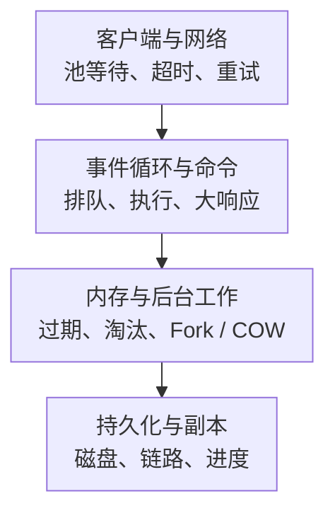

# Redis 核心监控指标采集与告警

Redis 监控要同时回答：业务是否变慢、缓存有没有保护住后端、进程是否还有内存余量，以及持久化与副本能否满足数据安全目标。高命中率和高 QPS 都不能单独证明这些目标已经满足。

本文以 **Redis Open Source 8.x 的通用语义、oliver006/redis_exporter v1.77.0 的指标映射**为学习基线；不是生产版本推荐。模块、云服务、ACL 和各小版本的暴露集应单独核对。标签和缺失处理沿用[监控指标地图](../../../../sre/observability/01-主流组件监控指标地图.md)，示例 job 为 `redis`，`instance` 表示 Redis 实例而非共享 Exporter 地址。

## 1. 先分清四层耗时



图用于定位证据，不表示每条 GET 都同步经过磁盘。Slowlog/commandstats 主要记录服务端执行，不能覆盖客户端池等待、网络和所有排队。应用 P99 应由真实客户端路径测量。

## 2. 接入清单与采集开销

基础接入包括 INFO 的 clients、memory、stats、persistence、replication、commandstats；Exporter 还可能请求 CONFIG、LATENCY、SLOWLOG、Cluster/Sentinel 命令，取决于选项与目标能力。按[固定版本 README](https://github.com/oliver006/redis_exporter/blob/v1.77.0/README.md)为监控账户配置最小 ACL，不直接复制跨产品、跨版本的大范围授权。

Cluster 按节点发现并抓取，Sentinel 另采仲裁/主库状态；只抓某一个节点不能证明所有 slot 与副本健康。共享 Exporter 的多目标接口要限制目标来源，避免成为任意内网探测代理。私网隔离、TLS 与凭据轮换和 `up` 监控分别验收。

默认不为“指标齐全”开启全 Key 扫描、任意 Lua 或逐 Key Value 导出。SCAN 仍消耗资源，Key 名/Value 也可能泄密；大 Key、热 Key、Stream 明细应有范围、速率和基数预算。

## 3. 日常核心指标

表中 C/G 表示累计计数/当前值；名称以该 Exporter 的默认 `redis` namespace 为准。

| 问题 | 指标 | 类型、单位与边界 |
| --- | --- | --- |
| 采集是否有效 | `redis_up`、`redis_exporter_last_scrape_error` | G；与 Prometheus `up` 分开，后者可能带 `err` 标签 |
| 命令吞吐 | `redis_commands_processed_total` | C，命令次；不是业务事务数，也不是客户端去重请求数 |
| 命令分类 | `redis_commands_total`、`redis_commands_duration_seconds_total` | C，次/秒；`cmd` 标签，对应 commandstats |
| 连接 | `redis_connected_clients`、`redis_blocked_clients` | G，连接数；阻塞式队列命令可能合法占用 blocked clients |
| 连接拒绝 | `redis_rejected_connections_total` | C，次；与客户端错误和连接上限关联 |
| Key 查找 | `redis_keyspace_hits_total`、`redis_keyspace_misses_total` | C，查找次；不是整条业务请求的缓存命中率 |
| 内存 | `redis_memory_used_bytes`、`redis_memory_used_rss_bytes`、`redis_memory_max_bytes` | G，字节；分配内存、RSS、maxmemory 是不同边界 |
| 数据生命期 | `redis_evicted_keys_total`、`redis_expired_keys_total` | C，Key 数；淘汰和 TTL 过期分别看 |
| Fork | `redis_latest_fork_seconds` | G，秒；最近一次 Fork，不是持续累计时间 |
| RDB | `redis_rdb_last_bgsave_status`、`redis_rdb_last_save_timestamp_seconds` | G，状态/Unix 秒；保存成功不代表离线备份已完成 |
| AOF | `redis_aof_enabled`、`redis_aof_last_write_status`、`redis_aof_last_bgrewrite_status` | G；仅在相关能力启用时按预期检查 |
| 副本链路 | `redis_master_link_up`、`redis_master_last_io_seconds_ago` | G，状态/秒；在副本上观察，附 master 地址标签 |
| 副本进度 | `redis_connected_slave_lag_seconds`、`redis_connected_slave_offset_bytes` | G，秒/字节位置；在主库观察，不能对 offset 求 `rate` 当业务吞吐 |
| Cluster | `redis_cluster_slots_ok`、`redis_cluster_slots_fail`、`redis_cluster_state` | G，slot 数/状态；按实际拓扑与预期覆盖检查 |

完整 INFO 含义见[Redis INFO](https://redis.io/docs/latest/commands/info/)，映射见[exporter.go](https://github.com/oliver006/redis_exporter/blob/v1.77.0/exporter/exporter.go)。某项缺失可能是未启用、权限或版本不支持，不应全局补零。

## 4. 源码分析：单位和状态如何转换

[metrics.go](https://github.com/oliver006/redis_exporter/blob/v1.77.0/exporter/metrics.go)将 `ok/true` 转成 1，将 `err/fail/false` 转成 0；并把原始 `latest_fork_usec` 除以一百万，以 `redis_latest_fork_seconds` 暴露。因此不能把原始 INFO 名直接拼到 Dashboard，也不能再把该 Fork 指标当微秒。

累计命令执行时间与调用次数的比值可得到窗口内的平均执行时间：

```promql
(
  rate(redis_commands_duration_seconds_total{job="redis"}[5m])
  / rate(redis_commands_total{job="redis"}[5m])
)
and on (cluster, instance, cmd)
(rate(redis_commands_total{job="redis"}[5m]) > 0)
```

输出秒/调用，不是 P99；它也不是 SDK 总耗时。对 Counter 先求 rate，再按需要聚合。若启用延迟直方图/百分位指标，还需核对单位、LATENCY 命令支持和额外权限，不能平均节点百分位数。

## 5. 命中率必须带上分母与业务含义

```promql
(
  rate(redis_keyspace_hits_total{job="redis"}[5m])
  /
  (
    rate(redis_keyspace_hits_total{job="redis"}[5m])
    + rate(redis_keyspace_misses_total{job="redis"}[5m])
  )
)
and on (cluster, instance)
(
  rate(redis_keyspace_hits_total{job="redis"}[5m])
  + rate(redis_keyspace_misses_total{job="redis"}[5m]) > 0
)
```

结果为 0～1；没有 Key 查找时显示无流量，不伪造 100%。多 Key 命令、应用本地缓存、负缓存和不同请求的回源成本，使这个比例不等于“多少业务请求不访问数据库”。

告警应结合每秒 miss 数、回源错误/延迟、热点与配置变更。99% 命中率在百万次查找/秒下仍有一万次 miss；而一个低频高成本热点失效也可能迅速打满数据库。

## 6. 内存、淘汰与 OOM 是三条不同边界

```promql
(
  redis_memory_used_bytes{job="redis"}
  / redis_memory_max_bytes{job="redis"}
)
and on (cluster, instance)
(redis_memory_max_bytes{job="redis"} > 0)
```

`maxmemory=0` 不是零容量，而是未设置该上限；此时比例不适用，仍需监控 RSS、主机/容器上限和增长趋势。分配内存比 maxmemory 只能粗略反映压力，淘汰记账还涉及不计入淘汰的缓冲；不能将它当作精确可写余量。

缓存允许淘汰，状态/队列/锁可能不允许。`rate(redis_evicted_keys_total[5m]) > 0` 应按 Key 语义解释：缓存场景关注命中率和回源，关键状态存储则可能已经破坏业务假设。

```yaml
groups:
  - name: redis-capacity-example
    rules:
      - alert: RedisMemoryBudgetPressure
        expr: |
          (redis_memory_used_bytes{job="redis"} / redis_memory_max_bytes{job="redis"} > 0.90)
          and on (cluster, instance) (redis_memory_max_bytes{job="redis"} > 0)
        for: 10m
        labels:
          severity: warning
        annotations:
          summary: "Redis 分配内存持续接近 maxmemory"
          action: "检查淘汰策略、增长、RSS、客户端/复制缓冲与 Fork/COW 余量"
```

90%/10 分钟为教学预警，不能代替真实内存预算或业务错误告警。Redis RSS、allocator 碎片、输出缓冲、AOF/复制与 COW 会使进程在达到这个阈值前先撞上容器 OOM。切勿仅把 maxmemory 调大。

## 7. 持久化、复制与拓扑

RDB 最近结果为 1 但保存时间很旧，可能是没有触发新快照，也可能不符合预期计划。根据实际快照策略、dirty changes、正在保存状态和业务 RPO 判断；不要对纯缓存实例机械设置“每小时必须快照”。AOF 写入/rewrite 失败需关联磁盘/inode、权限、fsync 和现有文件，不能自动删除或截断 AOF。

副本链路查询示例：

```promql
redis_master_link_up{job="redis"} == 0
```

只覆盖已暴露的副本序列。角色变化、节点被删除或预期副本漏采需要拓扑清单；主库没有 master_link 指标不是故障。主库报告的副本 lag 更接近 ACK 交互线索，不直接等于业务可见性时间；复制字节差也不能在所有写入速率下固定换算成秒。

Cluster 每节点都报告全局视图，不能把各节点 `slots_ok` 相加得到 slot 总数。结合预期 16384 slot、fail/pfail、节点链路、各分片可提升副本和业务读写探测；Sentinel 的仲裁能力另验收。恢复能力仍依赖[独立备份与恢复验证](./15-Redis持久化备份与Cluster恢复专项.md)。

## 8. Dashboard 与诊断

首页先展示客户端成功/超时/P99与池等待，再看命令、Key 查找、内存/淘汰、持久化和复制；按实例、分片和 cmd 下钻，避免集群均值掩盖一条大脚本或热点分片。

| 组合现象 | 优先检查 |
| --- | --- |
| 客户端慢但命令平均耗时正常 | 池、网络、事件循环等待、输出缓冲和 Fork/fsync |
| miss/s 升且数据库延迟升 | TTL/发布、热点、批量失效与回源保护 |
| RSS 升而 used_memory 稳定 | 分配器、碎片、缓冲、COW、OS/cgroup |
| 副本断开、Full Sync 频繁 | 网络、backlog 覆盖、磁盘和并行同步压力 |
| blocked_clients 高但延迟正常 | 是否大量合法 BLPOP/XREAD BLOCK，而非直接扩容 |

## 9. 学习验收

**问：命中率很高为何数据库仍过载？** 比例没有表达绝对 miss 数与每次回源成本，需要查流量、热点和数据库负载。

**问：used_memory 只占 maxmemory 的 70%，能排除 OOM 吗？** 不能，RSS、缓冲和 COW 与 cgroup/主机限制是不同边界。

**问：Slowlog 没有慢命令，能否排除 Redis 链路慢？** 不能；Slowlog 不覆盖全部客户端、网络和排队时间，应继续沿图定位。
