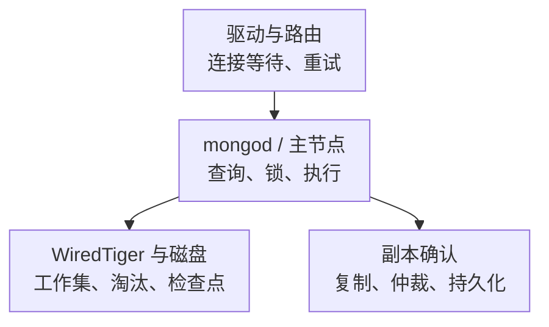

# MongoDB 核心监控指标采集与告警

MongoDB 是文档数据库。客户端请求可能经过驱动连接池、mongos 路由、分片的主节点、WiredTiger 和副本确认。监控需要回答请求是否及时成功、工作集与存储是否承压，以及复制能否满足一致性与恢复目标，不能只看文档数和连接数。

以下使用 **MongoDB 8.0 的字段语义与 Percona mongodb_exporter v0.43.0 新命名模式**建立指标契约，不是生产版本推荐。Atlas、不同节点角色和其他 Exporter 的接口需另行核对。基础约定见[监控指标地图](../../sre/observability/01-主流组件监控指标地图.md)，`job="mongodb"`，target 标签 `mongodb_cluster` 标识部署，副本集另保留唯一标识。

## 1. 请求与数据安全是两条线

文档是 BSON 记录，Collection 组织一组文档；副本集用主节点和多个成员保存同一份数据，分片则把数据分布到不同 shard。mongos 是分片路由入口，mongod 承担实际数据库服务，WiredTiger 是其常见存储引擎。复制与分片解决的问题不同，监控对象不能混成一组机器平均值。



客户端重试可能增加服务端操作次数，单个 find 的 getMore 又可能形成后续操作。服务端操作速率不是去重业务请求数。写入确认还受 write concern、journaling 与拓扑影响，复制正常也不能替代可恢复备份。

## 2. 接入与采集预算

按 mongod、mongos、配置服务器、副本集成员分别发现，不能只抓路由入口。共享多目标 Exporter 的 `instance` 应归一化为被监控节点，而不是所有样本都指向同一个 Exporter。

| 项目 | 验收内容 |
| --- | --- |
| 基础采集 | diagnosticdata、serverStatus 相关字段和节点角色是否可见 |
| 复制 | replSetGetStatus、主从身份、成员健康与时间戳；仲裁节点没有完整存储指标 |
| 分片 | mongos、配置服务器、每个 shard 副本集、迁移与热点分布 |
| 可选 collector | dbStats、collStats、indexStats、currentOp、profile 按权限和开销选择，不默认 collect-all |
| 安全 | 最小监控权限、TLS、凭据轮换和监控网络；不把 URI 密码写入仓库 |

[固定版本 README](https://github.com/percona/mongodb_exporter/blob/v0.43.0/README.md)给出 clusterMonitor 与 local 读取等权限起点；实际 collector 还需要对应命令权限。集合/索引级采集应限制对象，慢查询与 profile 可能带来额外开销并泄露查询内容。

`up=1` 仅证明 Exporter HTTP 端点可抓取。还应检查 collector 错误、采集耗时和预期专项字段，防止数据库连接失败或权限不足被误判成健康。

## 3. 核心指标卡片

新模式很多指标暴露为 Untyped，下面按**业务语义**区分累计量与当前量。名称及标签转换可查[兼容映射源码](https://github.com/percona/mongodb_exporter/blob/v0.43.0/exporter/v1_compatibility.go)。

| 问题 | 指标或原始证据 | 单位与解释 |
| --- | --- | --- |
| 连接余量 | `mongodb_ss_connections{conn_type="current"}`、`{conn_type="available"}` | 当前连接数/可用连接名额；不是正在执行 SQL 的线程数 |
| 新连接风暴 | `mongodb_ss_connections_totalCreated` | 累计连接次；需结合驱动池复用、短连接与网络故障 |
| 操作量 | `mongodb_ss_opcounters` | 累计操作次，标签 legacy_op_type；不与复制操作计数直接相加 |
| 操作耗时 | `mongodb_ss_opLatencies_latency`、`mongodb_ss_opLatencies_ops` | 累计微秒/操作次，标签 op_type；平均耗时而非 P99 |
| WT Cache 占用 | `mongodb_ss_wt_cache_bytes_currently_in_the_cache`、`mongodb_ss_wt_cache_maximum_bytes_configured` | 当前字节/配置字节；高占用可正常，不直接说明内存泄漏 |
| WT Dirty | `mongodb_ss_wt_cache_tracked_dirty_bytes_in_the_cache` | 当前脏数据字节；关联检查点、淘汰、磁盘和写入延迟 |
| 进程内存 | `mongodb_ss_mem_resident` | MB 口径，不是 bytes；与 WT Cache、文件缓存、容器记账分开 |
| 扫描效率 | serverStatus.metrics.queryExecutor 与 explain | documents/keys examined、返回量；需要按查询形态诊断 |
| 复制安全 | replSetGetStatus、oplog 时间窗口、write concern 错误 | 主节点身份、应用进度、成员健康和恢复余量一起看 |

MongoDB 字段含义和版本差异见[8.0 serverStatus](https://www.mongodb.com/docs/v8.0/reference/command/serverstatus/)。节点角色可能没有相应字段，不能将缺失全部填成零。

## 4. 源码分析与常用查询

[diagnosticDataCollector](https://github.com/percona/mongodb_exporter/blob/v0.43.0/exporter/diagnostic_data_collector.go)获取 getDiagnosticData，再递归映射字段；其中还处理 MongoDB 8.0 将诊断数据拆成多个 block 的结构变化。数据库版本升级既可能改变字段，也可能改变采集器能否正确解包。

`--compatible-mode` 会同时输出新旧两套同义指标，不能两套都求和。新模式名称保留部分 camelCase，例如 `opLatencies`、`totalCreated`，照着旧 Dashboard 改大小写可能得到空图。

按操作类型查看每秒速率：

```promql
sum by (cluster, mongodb_cluster, instance, legacy_op_type) (
  rate(mongodb_ss_opcounters{job="mongodb"}[5m])
)
```

平均服务端操作秒数，原始累计微秒只转换一次：

```promql
(
  rate(mongodb_ss_opLatencies_latency{job="mongodb"}[5m])
  / rate(mongodb_ss_opLatencies_ops{job="mongodb"}[5m]) / 1000000
)
and (rate(mongodb_ss_opLatencies_ops{job="mongodb"}[5m]) > 0)
```

WT Cache 占配置上限的比例：

```promql
(
  mongodb_ss_wt_cache_bytes_currently_in_the_cache{job="mongodb"}
  / mongodb_ss_wt_cache_maximum_bytes_configured{job="mongodb"}
)
and (mongodb_ss_wt_cache_maximum_bytes_configured{job="mongodb"} > 0)
```

新建连接/秒：

```promql
rate(mongodb_ss_connections_totalCreated{job="mongodb"}[5m])
```

Cache 很满但淘汰、检查点和用户延迟稳定，可能只是工作集被充分缓存。若脏数据、淘汰等待、磁盘延迟与操作时间同时升高，才有存储压力的组合证据。不要把“Cache 命中率高”当作所有查询都有高效索引。

## 5. 复制延迟不是一个可随意相减的时间戳

复制应区分收到日志、写入/持久化、应用和多数派提交。比较时间戳时必须明确副本集、成员身份与阶段，不能拿不同 shard 或陈旧主节点观测互相相减。时钟、选主、空闲期和采样偏差也会改变时间差的解释。

oplog 保留窗口是能否追赶的时间预算，不是当前复制延迟。需要同时比较副本落后量、恢复速度、oplog 增长与窗口；窗口耗尽可能要求重新同步。分片集群还要排查单 shard 热点、迁移与路由，不用全局平均掩盖最慢分片。

## 6. 示例告警与判断路径

示例以当前连接占“当前 + 可用”超过 90% 持续 10 分钟提示连接余量风险。每个节点只允许一个采集贡献者；90% 是教学阈值，实际还需预留管理、故障切换和发布扩容连接。

```yaml
groups:
  - name: mongodb-connection-core
    rules:
      - alert: MongoDBConnectionHeadroomLow
        expr: |
          (
            sum by (cluster, mongodb_cluster, instance) (mongodb_ss_connections{job="mongodb",conn_type="current"})
            / sum by (cluster, mongodb_cluster, instance) (mongodb_ss_connections{job="mongodb",conn_type=~"current|available"})
          ) > 0.9
          and on (cluster, mongodb_cluster, instance)
          (sum by (cluster, mongodb_cluster, instance) (mongodb_ss_connections{job="mongodb",conn_type="available"}) >= 0)
        for: 10m
        labels:
          severity: warning
        annotations:
          summary: "MongoDB 节点持续缺少连接余量"
```

零总名额产生不可判定值，不视为健康；缺少 available 序列也不会被这条规则补成零。另用覆盖规则发现 collector 缺失。先查驱动池数量、副本数、连接创建速率、持有时间和节点分布，不自动增大连接上限。

| 现象 | 深化判断 |
| --- | --- |
| 连接多但 CPU 低 | 连接可能空闲或在等待，结合 active、驱动池和操作耗时 |
| 读慢且扫描多 | explain、索引选择、过滤/排序与文档大小，不先扩 WT Cache |
| 主节点正常、副本落后 | 复制应用、磁盘、网络、oplog 窗口和读一致性要求 |
| Cache 高、RSS 更高 | 口径不同，关联容器预算与文件缓存，不能直接相减认定泄漏 |

## 7. 掌握检查

1. 为什么旧新指标都有图却不能相加？兼容模式输出的是同一事实的两种表示。
2. 为什么平均操作耗时不等于业务 P99？它没有尾部分布，也不覆盖驱动池、网络和完整重试。
3. 为什么只监控 mongos 不够？分片、副本和配置服务器承担不同职责，路由正常不代表各 shard 健康。
4. 恢复标准是什么？请求成功与延迟恢复，复制重新满足目标，连接/存储余量和备份恢复能力均符合预算。
