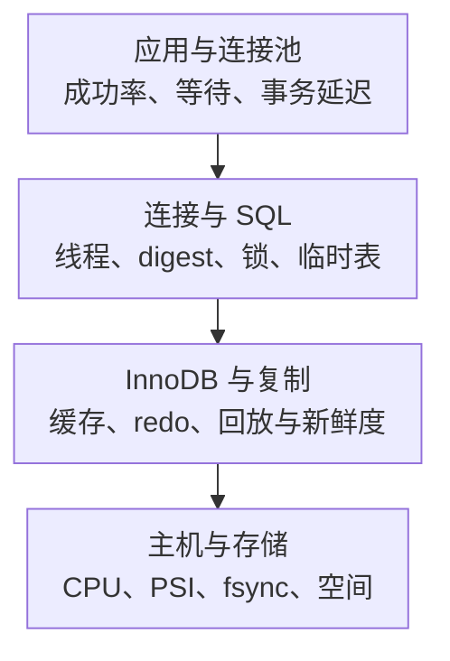

# MySQL 核心监控指标采集与告警

MySQL 接入监控，需要同时看业务请求、数据库等待和主机资源。QPS 正常不代表查询快，连接可建立不代表事务能提交，副本延迟显示零也不能单独证明数据新鲜。

本文以 **MySQL 8.4 LTS、mysqld_exporter v0.20.0** 为指标映射基线。MariaDB、Percona、MySQL 旧版和云数据库可能有不同字段与权限。通用标签契约见[监控指标地图](../../../../sre/observability/01-主流组件监控指标地图.md)；Performance Schema 的原理见[事件与关键状态指标](./02-PerformanceSchema-sysSchema与关键状态指标.md)。

## 1. 从哪里采，分别能说明什么



| 来源 | 基础/条件 collector | 能回答的问题 |
| --- | --- | --- |
| `SHOW GLOBAL STATUS` | `collect.global_status`，默认启用 | 当前连接、活跃线程与累计操作 |
| `SHOW GLOBAL VARIABLES` | `collect.global_variables`，默认启用 | max_connections、Buffer Pool 等配置分母 |
| `SHOW REPLICA STATUS` 等 | `collect.slave_status`，默认启用 | 复制通道运行与位置/延迟字段，名称仍有历史前缀 |
| Performance Schema | `collect.perf_schema.*`，按需启用 | SQL digest、等待、文件 I/O、内存与复制 worker |
| InnoDB 详细状态 | `collect.engine_innodb_status` / `collect.info_schema.innodb_metrics`，按需 | 事务/历史链、引擎内部细节，注意版本和开关 |
| 应用/代理 | 应用 SDK、连接池和网关 | 请求错误、池等待、端到端 P99；默认 Exporter 不能补出这些 |

collector 与支持范围见[固定版本 README](https://github.com/prometheus/mysqld_exporter/blob/v0.20.0/README.md)。不要一次打开所有 collector：表、索引、文件路径和 SQL digest 都可能造成高基数、查询开销与敏感信息暴露。

## 2. 安全接入与采集验收

使用专用只读监控账户，按启用 collector 配置权限、连接来源、TLS 和连接上限。复制状态可能需要 `REPLICATION CLIENT`，进程/引擎与 P_S 查询还涉及对应权限；根据实际 SQL 与托管服务限制校验，不为省事授予 `ALL PRIVILEGES` 或业务写权限。

账号密码放权限受控的配置或 Secret，不放 URL、文章示例、Shell 历史或 Dashboard 标签。v0.20.0 可配置 per-scraper 查询超时与每次 scrape 的连接数；多实例并发抓取会放大监控账户连接量，应与账户 `MAX_USER_CONNECTIONS`、数据库余量匹配。

单目标 `/metrics` 与多目标 `/probe` 是两种接入方式。多目标时把实际数据库地址映射到 `instance`，Exporter 地址仅用作抓取地址；否则所有数据库可能被误合并成同一实例。

验收至少检查三层：

1. `up{job="mysql"}`：Prometheus 能否抓取端点；
2. `mysql_up{job="mysql"}` 与采集错误/日志：Exporter 能否连接数据库并完成所需采集；
3. 应用路径读写/事务探测：代表性业务是否可用。

`up == 1` 而 `mysql_up == 0` 是典型采集可达、数据库连接失败；两者都为 1 仍不能保证业务权限、连接池、代理或提交路径正常。可用性设计见[数据库 SLI/SLO](./06-数据库SLI-SLO-Dashboard告警与变更关联.md)。

## 3. 源码阅读：为什么不能靠名字猜类型

`collector/global_status.go` 读取 `SHOW GLOBAL STATUS`，规范化状态名后转换：

| MySQL 原始状态 | v0.20.0 暴露方式 | 语义 |
| --- | --- | --- |
| `Threads_connected` | `mysql_global_status_threads_connected` | 当前连接数，Gauge 语义 |
| `Threads_running` | `mysql_global_status_threads_running` | 非 Sleep 线程数，不等于真正同时执行 CPU 的线程数 |
| `Questions` | `mysql_global_status_questions` | 累计客户端语句数，Counter 语义 |
| `Com_select` | `mysql_global_status_commands_total{command="select"}` | 显式分组 Counter |
| `Connection_errors_max_connections` | `mysql_global_status_connection_errors_total{error="max_connections"}` | 显式分组 Counter |
| `Innodb_buffer_pool_pages_dirty` | `mysql_global_status_buffer_pool_dirty_pages` | 当前脏页，Gauge |

源码对未特殊分组的可解析数值使用 **Untyped**，不会因为它是累计状态就自动加 `_total`。因此 `Questions` 虽以 Untyped 暴露，仍应按累计计数计算 `rate`；`Threads_connected` 则不应求每秒增长当连接占用。映射实现见[global_status.go](https://github.com/prometheus/mysqld_exporter/blob/v0.20.0/collector/global_status.go)，状态含义见[MySQL 8.4 状态变量](https://dev.mysql.com/doc/refman/8.4/en/server-status-variables.html)。

## 4. 连接、查询与并发

### 4.1 指标卡：连接占用

```promql
mysql_global_status_threads_connected{job="mysql"}
/ on (cluster, instance)
mysql_global_variables_max_connections{job="mysql"}
```

该查询要求每个数据库 `cluster,instance` 唯一，且全局变量 collector 已启用。连接占用持续接近上限时，结合 `Threads_running`、连接创建速率、max_connections 错误与连接池等待判断。

- connected 高、running 低：可能有大量空闲池连接，先检查池规模与泄漏；
- running 高、CPU 低：可能在锁或 I/O 上等，不等于 CPU 不够；
- connections 速率高：可能短连接/重连风暴，需查代理、认证和网络；
- 池等待高、数据库连接不多：可能是应用侧池上限或事务占用过长。

### 4.2 指标卡：客户端语句速率

```promql
rate(mysql_global_status_questions{job="mysql"}[5m])
```

Questions 与 Queries 的统计范围不同，Queries 还包含存储程序内部执行等语句，不能换了指标后仍不加区分地标为同一个 QPS。按命令分类可看：

```promql
sum by (cluster, instance, command) (
  rate(mysql_global_status_commands_total{job="mysql",command=~"select|insert|update|delete|commit|rollback"}[5m])
)
```

`Com_commit + Com_rollback` 只反映相应命令，不包含所有 autocommit 事务，**不能直接命名为数据库总 TPS**。业务事务吞吐应由业务边界埋点定义；查询语句、行操作与事务是三种不同计数对象。

## 5. Buffer Pool 与临时表

### 5.1 指标卡：逻辑读中的物理读取比例

```promql
(
  rate(mysql_global_status_innodb_buffer_pool_reads{job="mysql"}[5m])
  / rate(mysql_global_status_innodb_buffer_pool_read_requests{job="mysql"}[5m])
)
and on (cluster, instance)
(rate(mysql_global_status_innodb_buffer_pool_read_requests{job="mysql"}[5m]) > 0)
```

可把 `1 - 上述比例` 作为指定口径的命中率，但它不是所有 I/O 的节省比例，也不是事务成功率。即使命中率 99.9%，巨大的逻辑读取总量仍可能造成高物理 IOPS；因此同时看 reads/s、数据文件读延迟、扫描行数和工作集变化。

脏页看 `mysql_global_status_buffer_pool_dirty_pages`，字节预算看 `mysql_global_variables_innodb_buffer_pool_size`。页数转字节需使用实际 page size，不能固定所有实例为 16 KiB。高脏页不是必然故障，应关联刷脏速度、checkpoint/redo 压力和提交延迟。

### 5.2 临时表与排序是诊断信号

`mysql_global_status_created_tmp_disk_tables` 是累计落盘临时表数量；同时看 `created_tmp_tables`、digest、rows examined 和执行计划。MySQL 8.4 的 TempTable 内存映射文件路径等行为使“disk_tables / tmp_tables”不能覆盖所有临时数据落盘，也不能换算落盘字节或查询占比。

不要看到临时表就直接增加全局缓冲区。先确认排序、GROUP BY、JOIN、字段类型和执行计划，再按并发估算内存放大。原理见[Join、排序与临时表](../04-index-optimizer/04-Join子查询CTE排序与临时表执行原理.md)。

## 6. 锁、redo 与慢 SQL

| 核心/诊断指标 | 类型与单位 | 正确用途 |
| --- | --- | --- |
| `mysql_global_status_innodb_row_lock_current_waits` | 当前等待数 | 仅 InnoDB 行锁等待，不覆盖 MDL 等所有锁 |
| `mysql_global_status_innodb_row_lock_waits` | 累计等待次 | `rate` 看等待增长 |
| `mysql_global_status_innodb_row_lock_time` | 累计毫秒 | `rate` 后仍是毫秒/秒；与等待次数相除才是该口径平均等待毫秒 |
| `mysql_global_status_innodb_log_waits` | 累计次 | redo 日志缓冲相关等待，不是所有 fsync 延迟 |
| `mysql_global_status_slow_queries` | 累计次 | 受 long_query_time 等配置影响，不提供完整 P99 |
| P_S digest / data_locks / data_lock_waits | 条件诊断 | 确认哪类 SQL 消耗、谁阻塞谁 |

等待数高时先定位阻塞链、最老事务、事务边界与 SQL；大量连接排队只是后果，不宜先把 max_connections 调大。MDL、长事务阻碍 purge、redo/checkpoint 压力和磁盘慢需要不同证据，不能用一个“锁等待”总图混在一起。

P_S digest 汇总适合找 Top SQL，默认 Exporter 并没有通用的“所有请求端到端延迟直方图”。即使收集到 digest 的某些分位字段，也不能平均它们得到实例 P99。真正的用户请求 P99 应在应用/代理记录 Histogram，并区分池等待、执行、结果传输和事务提交。

继续阅读：[行锁与 MDL](../03-innodb-transactions/06-行锁间隙锁NextKeyLock-MDL与死锁.md)、[Redo 与提交路径](../03-innodb-transactions/04-Redo-Undo-Binlog与一次提交的完整路径.md)。

## 7. 复制：进程状态、延迟和业务新鲜度

仅在预期为副本的实例与通道上启用复制告警。主库没有复制状态行可能完全正常，不能用全局 `absent` 判成故障。

v0.20.0 的 [slave_status.go](https://github.com/prometheus/mysqld_exporter/blob/v0.20.0/collector/slave_status.go)兼容尝试不同 SHOW 语句，指标前缀仍是 `mysql_slave_status_`，但后缀按实际返回列名小写生成：

| MySQL 8.4 返回列 | 对应指标 | 单位/含义 |
| --- | --- | --- |
| `Replica_IO_Running` | `mysql_slave_status_replica_io_running` | 状态值；检查源连接接收线程 |
| `Replica_SQL_Running` | `mysql_slave_status_replica_sql_running` | 状态值；检查回放线程 |
| `Seconds_Behind_Source` | `mysql_slave_status_seconds_behind_source` | 秒；不是端到端业务新鲜度保证 |

旧版本可能返回 Slave/Master 字段并形成不同后缀，不能照搬旧 Dashboard。保留 `channel_name`，并校对 `master_host/master_uuid` 等历史标签。NULL/不可解析状态可能不形成数值序列；缺失不能当零延迟。

```promql
mysql_slave_status_replica_sql_running{job="mysql"} == 0
```

该条件只检查已有序列；预期通道缺失需由复制拓扑清单核对。业务关注数据新鲜度时，可建立受控 heartbeat 或版本标记，经过真实写入和副本读取路径测量；要考虑时钟、空闲源、并行回放和读路由。字段限制见[SHOW REPLICA STATUS](https://dev.mysql.com/doc/refman/8.4/en/show-replica-status.html)。

## 8. 告警示例、Dashboard 与动作

```yaml
groups:
  - name: mysql-capacity-example
    rules:
      - alert: MySQLConnectionsNearLimit
        expr: |
          mysql_global_status_threads_connected{job="mysql"}
          / on (cluster, instance)
          mysql_global_variables_max_connections{job="mysql"} > 0.85
        for: 10m
        labels:
          severity: warning
        annotations:
          summary: "MySQL 连接占用持续接近上限"
          action: "检查池等待、活跃线程、长事务、连接错误和最近发布；不要直接放大连接上限"
```

85%/10 分钟是教学预警，需要按连接保留、池预算和响应时间调整。连接被拒绝、业务超时或读写探测失败属于用户症状，应另设更及时的告警。仅提高上限可能使每连接内存与并发争用雪崩。

Dashboard 从业务成功/延迟进入实例，再分连接、SQL、锁/引擎、复制、主机/存储。数据目录、binlog、relay log、临时文件和备份的空间都要覆盖，并维护数据库实例到主机/挂载点的映射；DB 端口与 Node Exporter 端口不同，不能直接按 `instance` 强行 join。

| 组合现象 | 优先判断 |
| --- | --- |
| 池等待升、connected 接近上限、running 低 | 检查池规模、空闲连接、长事务和连接泄漏 |
| running 升、row lock waits 升、CPU 不高 | 查阻塞事务与热点写，先不扩 CPU |
| 物理读取升、设备延迟升、P99 升 | 查工作集/执行计划变化与存储路径 |
| 提交慢、redo 等待或存储同步写耗时升 | 查日志缓冲、checkpoint、fsync 与持久化设置 |
| 副本延迟升且应用读取旧数据 | 查通道/worker、长事务、源写入和读路由 |

## 9. 学习验收

**问：为什么命中率很高，数据库仍被磁盘拖慢？** 命中率是比例；逻辑请求总量很大时，少量未命中也可能超过磁盘能力，另外还有 redo、刷脏和 binlog I/O。

**问：为何 Com_commit 的速率比业务事务数少很多？** 业务可能使用 autocommit；该命令计数不是所有事务的完整分母。

**问：副本 Seconds_Behind_Source 没值，能填零吗？** 不能。可能未配置复制、线程状态异常、NULL 或采集问题，应先与预期拓扑和原始 SHOW 状态校对。
