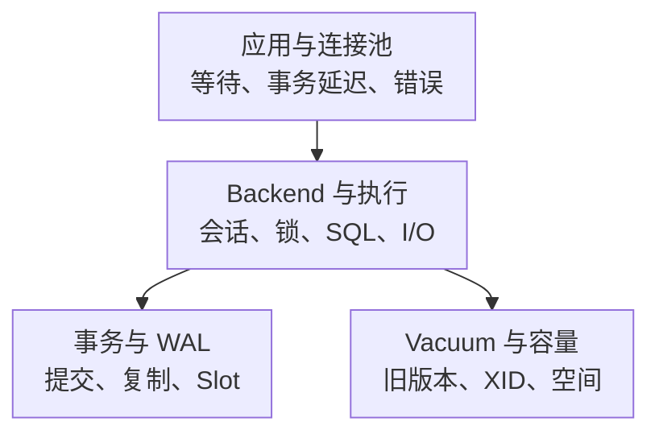

# PostgreSQL 核心监控指标采集与告警

PostgreSQL 的“慢”可能发生在应用连接池、锁、执行、存储或同步提交；数据库可以正常接收连接，却因为长事务、复制槽或 Vacuum 落后持续逼近故障。监控应把用户耗时与这些内部等待和容量边界连接起来。

本文以 **PostgreSQL 18、prometheus-community/postgres_exporter v0.18.1 的映射实现**为说明基线，不宣称它是最新版本或完整支持所有 18.x 新视图。新旧 collector、内置默认查询、设置采集和扩展分别验收。通用标签见[指标地图](../../../../sre/observability/01-主流组件监控指标地图.md)，示例 job 为 `postgres`。

## 1. 请求等待与维护债务



图表示证据关联，不意味着每条 SELECT 都产生 WAL。长事务、复制与维护如何互相影响，见[MVCC 与锁](../02-storage-concurrency/07-PostgreSQL-MVCC-Snapshot隔离级别锁与SSI.md)、[Vacuum 与 Freeze](../02-storage-concurrency/09-PostgreSQL-Vacuum-Autovacuum-Freeze与Bloat.md)。

## 2. 接入与版本验收

使用专用登录角色，按需要授予连接、统计读取等权限；`pg_monitor`/`pg_read_all_stats` 等预定义角色应按范围评审，不用超级用户跑长期监控。P_S 式“全局统计”和每个数据库局部表/扩展视图不同：只连 postgres 数据库，不保证看见其他数据库的表级统计或扩展对象。

在 v0.18.1 中，`stat_database`、`stat_user_tables`、`replication`、`replication_slot` 等有独立 collector；`pg_stat_activity` 等还来自内置默认查询映射。关闭默认查询或 settings 后，相应指标可能消失，不能只看一个 collector 开关推断所有暴露集。细节见[README](https://github.com/prometheus-community/postgres_exporter/blob/v0.18.1/README.md)。

`stat_statements` 需要扩展和对应加载/权限；原始 SQL、application_name、用户名、表名都可能造成基数或信息泄露，应有 allowlist。生产不为了补监控直接开启任意扩展或无界全库扫描。

验收依次检查 Prometheus `up`、`pg_up`、`pg_exporter_last_scrape_error`、collector/数据库日志，以及代表性应用读写。能连接数据库不等于每条统计 SQL 都成功，也不等于实际用户权限和事务路径正常。

## 3. 核心指标清单

| 对象 | 指标 | 类型、单位与条件 |
| --- | --- | --- |
| 数据库连接 | `pg_stat_database_numbackends` | G，连接数；`datname`，不是正在执行的 SQL 数 |
| 状态与等待 | `pg_stat_activity_count` | G，会话数；含 `datname,state,backend_type,wait_event_type,wait_event` 等标签 |
| 事务年龄 | `pg_stat_activity_max_tx_duration` | G，秒；分组内最老事务年龄，不是查询执行时间 |
| 事务结果 | `pg_stat_database_xact_commit`、`pg_stat_database_xact_rollback` | C，事务次；统计范围不是业务服务的请求边界 |
| Buffer 读取 | `pg_stat_database_blks_hit`、`pg_stat_database_blks_read` | C，块；共享缓冲命中与读取，不区分读取是否命中 OS Page Cache |
| 临时数据 | `pg_stat_database_temp_bytes`、`pg_stat_database_temp_files` | C，字节/文件；临时落盘规模，不是慢查询个数 |
| 死锁 | `pg_stat_database_deadlocks` | C，事件次；不覆盖所有普通锁等待 |
| 表版本 | `pg_stat_user_tables_n_dead_tup`、`pg_stat_user_tables_n_live_tup` | G，估计行版本数；表级条件核心，不是精确 bloat 字节 |
| 复制 | `pg_replication_lag_seconds`、`pg_replication_is_replica` | G，秒/0或1；由 replication collector 的 SQL 推导 |
| 发送与回放差 | `pg_stat_replication_pg_wal_lsn_diff` | G，字节差；内置查询映射，主库上按连接副本观察 |
| Slot | `pg_replication_slot_slot_is_active`、`pg_replication_slot_safe_wal_size_bytes`、`pg_replication_slot_wal_status` | G，状态/字节；Slot collector，NULL 与无上限要单独处理 |
| XID 年龄 | `pg_database_wraparound_age_datfrozenxid_seconds` | G，**事务 ID 距离，不是秒**；该固定版本名称误导，collector 默认关闭 |

数据库、表和会话定义分别见 [stat_database collector](https://github.com/prometheus-community/postgres_exporter/blob/v0.18.1/collector/pg_stat_database.go)、[stat_user_tables collector](https://github.com/prometheus-community/postgres_exporter/blob/v0.18.1/collector/pg_stat_user_tables.go)及[内置映射](https://github.com/prometheus-community/postgres_exporter/blob/v0.18.1/cmd/postgres_exporter/postgres_exporter.go)。

## 4. 会话状态与真正的等待

```promql
sum by (cluster, instance, datname, state, wait_event_type) (
  pg_stat_activity_count{job="postgres",backend_type="client backend"}
)
```

`active` 表示查询正在执行，不代表一直占 CPU；`active` 且 `wait_event_type="Lock"` 是锁等待线索。`ClientRead` 常是数据库在等客户端下一条消息，不能一律判断为数据库慢。`idle in transaction` 则可能持续持有事务、锁或旧快照。

```promql
max by (cluster, instance, datname) (
  pg_stat_activity_max_tx_duration{job="postgres",state="idle in transaction"}
)
```

最老事务年龄升高时，继续用 `pg_stat_activity`、`pg_blocking_pids()` 定位 Owner 与阻塞链；监控查询不把 PID 或完整 query 放进长期时序标签。连接预算应考虑 max_connections、保留连接、池和后台进程，不能把 numbackends 与某个全局分母不加说明地称为“可用业务连接比例”。

```yaml
groups:
  - name: postgresql-transaction-example
    rules:
      - alert: PostgreSQLIdleTransactionTooOld
        expr: |
          max by (cluster, instance, datname) (
            pg_stat_activity_max_tx_duration{job="postgres",state="idle in transaction"}
          ) > 300
        for: 5m
        labels:
          severity: warning
        annotations:
          summary: "PostgreSQL 存在持续不结束的空闲事务"
          action: "检查事务 Owner、阻塞链和 Vacuum 影响；勿自动批量终止会话"
```

300 秒/5 分钟为教学阈值；报表、批任务与 OLTP 应分别设定。告警不是自动 Kill 授权；取消/终止可能触发回滚和重试放大。

## 5. 事务、缓存与临时落盘

数据库事务吞吐可按实例/数据库观察两个累计结果的速率：

```promql
rate(pg_stat_database_xact_commit{job="postgres"}[5m])
+ rate(pg_stat_database_xact_rollback{job="postgres"}[5m])
```

不要把 commit/rollback 简单等同于用户成功/失败：一个业务请求可包含多个事务，回滚也可能是应用的正常控制流程。统计重置或数据库重建后，rate 能处理下降，但不能恢复采样间隔内所有丢失事件。

共享 Buffer 命中率：

```promql
(
  rate(pg_stat_database_blks_hit{job="postgres"}[5m])
  /
  (rate(pg_stat_database_blks_hit{job="postgres"}[5m]) + rate(pg_stat_database_blks_read{job="postgres"}[5m]))
)
and on (cluster, instance, datname)
(
  rate(pg_stat_database_blks_hit{job="postgres"}[5m]) + rate(pg_stat_database_blks_read{job="postgres"}[5m]) > 0
)
```

它不等于物理磁盘命中率。`blks_read` 可能仍由 OS 缓存供给；比例高也不能排除 WAL、临时文件和随机读取造成的 I/O 压力。对应字段与统计快照行为见[PostgreSQL 18 累计统计](https://www.postgresql.org/docs/18/monitoring-stats.html)。

`rate(pg_stat_database_temp_bytes[5m])` 输出字节/秒；临时落盘突增应关联 Top SQL、Sort/Hash、并行节点与 work_mem。不能为了消灭临时文件全局放大 work_mem，因为它可被一个查询的多个节点和多个 Worker 分别使用。

## 6. Vacuum、XID 与维护进度

`n_dead_tup` 是估计值；需要连同表大小、更新速率、Autovacuum 的执行/完成时间、长事务和 Slot 一起看。死元组多不直接等于可回收磁盘字节，普通 Vacuum 通常复用空间而不是立即缩小文件；不要自动执行 VACUUM FULL。

[pg_database_wraparound.go](https://github.com/prometheus-community/postgres_exporter/blob/v0.18.1/collector/pg_database_wraparound.go)查询的是 `age(datfrozenxid)` 和 `mxid_age(datminmxid)`，却在该版本名称中使用 `_seconds`。源码中的值是 ID 年龄，不能换算成“多少天没 Vacuum”。实际接入可在指标字典中显式改名/标注，再按事务消耗率、Freeze 预算和修复时间设预警。

```sql
SELECT datname, age(datfrozenxid) AS xid_age,
       mxid_age(datminmxid) AS multixact_age
FROM pg_database
WHERE datallowconn;
```

PostgreSQL 18 的 `pg_stat_io`、`pg_stat_wal`、`pg_stat_checkpointer` 应按目标版本建立额外采集映射；不能将旧 bgwriter collector 当作已覆盖所有新视图。计时还取决于 track_io_timing/track_wal_io_timing，先评估开销。维护语义见[Routine Vacuuming](https://www.postgresql.org/docs/18/routine-vacuuming.html)。

## 7. 复制：同为“lag”，来源却不同

[pg_replication.go](https://github.com/prometheus-community/postgres_exporter/blob/v0.18.1/collector/pg_replication.go)在非副本上返回 lag=0；在已接收与已回放 LSN 相等时也返回 0，否则使用最近事务回放时间推导。因此 `pg_replication_lag_seconds == 0` 既不能证明源链路连接，也不能证明所有业务读都新鲜。

```promql
pg_stat_replication_pg_wal_lsn_diff{job="postgres"}
```

该字节差与时间差并列展示，不直接用固定除数换算秒。`pg_stat_replication` 只显示当前连接的 WAL Sender，断开的预期副本会消失；需要独立拓扑和 receiver/连接状态监控。空闲源的 replay timestamp 也可能很旧，单独用“现在减最近回放时间”会产生假延迟。

[Slot collector](https://github.com/prometheus-community/postgres_exporter/blob/v0.18.1/collector/pg_replication_slot.go)暴露 active、safe WAL size 与 wal_status。active 不代表消费追得上；safe_wal_size 为 NULL 时不能当作零预算。其 confirmed_flush_lsn 主要用于逻辑槽，**不是用 current LSN 减它就能得到所有物理槽的 WAL 保留量**。

```sql
SELECT slot_name, slot_type, active, wal_status, safe_wal_size,
       pg_wal_lsn_diff(pg_current_wal_lsn(), restart_lsn) AS retained_bytes
FROM pg_replication_slots;
```

这条主库只读诊断 SQL 使用 restart_lsn 分析保留范围，NULL 单独展示；没有为它暗示一个默认已存在的 Exporter 指标。长期采集应通过受控 SQL collector 显式定义 Gauge、Slot 标签和主库条件。WAL 空间、归档失败与磁盘耗尽仍需独立监控，不能靠删除 `pg_wal` 或未知归属 Slot 处置。

## 8. Dashboard 与验收

按“应用/连接池 → 会话与等待 → Top SQL → Buffer/Temp/WAL/I/O → Vacuum/XID → 复制/Slot → 主机”组织，优先保留实例/数据库，再按需下钻表与 SQL digest。

**问：active 会话很多但 CPU 很低，是不是应该减少监控？** 不是，先看 Lock、IO、IPC 和同步提交等待，CPU 只是其中一层。

**问：缓存命中率低是否一定导致物理磁盘瓶颈？** 不一定，还可能命中 OS Page Cache；同时看读取量、主机设备延迟和用户耗时。

**问：slot active 且 lag 为零，可以证明数据安全和新鲜吗？** 不能，需确认来源语义、拓扑、WAL 保留、读路由与业务验证。
