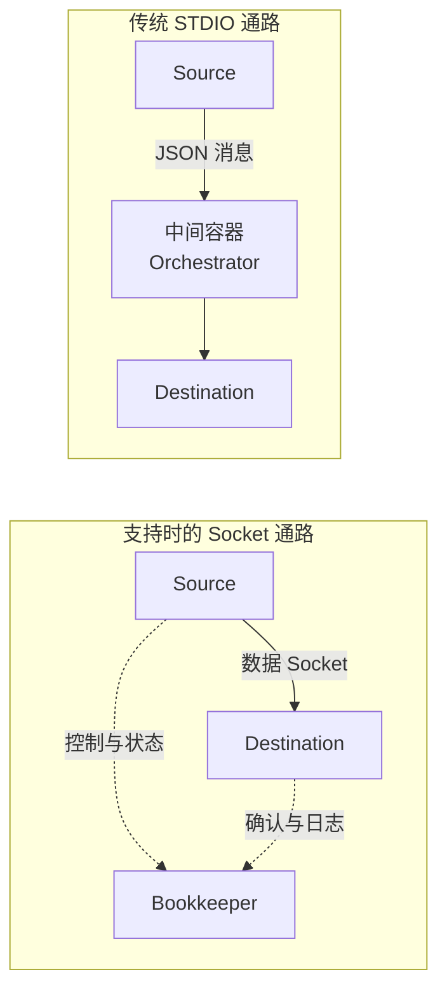

# Airbyte Connector 协议与 Workload 执行链路

点击 Sync 后，不是 Web 服务直接从数据库读行再写目标。平台需要调度连接器工作负载、传递配置并保存确认后的状态。本篇根据 **2026-11-14 官方文档**拆解职责；实际运行模式仍由平台、连接器能力和连接配置决定。

## 1. 五类接口分别做什么

| 接口 | 主要问题 | 不能证明什么 |
| --- | --- | --- |
| `spec` | 连接器需要哪些配置与能力 | 账号真的能访问源数据 |
| `check` | 配置是否满足该连接器的连通性检查 | 全量读取和长期权限一定正常 |
| `discover` | 源端有哪些 Stream 与字段 | 所有表都已选择或同步 |
| `read` | 按 Catalog、配置与 State 读取 | 目标已经提交 |
| `write` | 接收记录、加载并确认进度 | 端到端业务绝无重复 |

这让不同数据库和 API 可以接入相近的执行协议，但插件内部仍可能使用分页、分区查询、增量游标或日志 CDC。共同接口不代表相同快照和删除能力。

## 2. Catalog 与消息不是同一类东西

Catalog 描述源发现的 Stream、字段和能力；Configured Catalog 进一步选择哪些 Stream、读取模式、目标模式、游标和主键。数据库认证配置则是另一份输入，不应该把密码放进数据 schema。

传统通路中的消息包括 RECORD、STATE、LOG 和其他控制/追踪类型。RECORD 是数据，STATE 是连接器定义的恢复进度，LOG 是诊断输出。看到一条 State 被源端输出，不代表平台已经可以把它当成安全恢复点。

## 3. Job、Attempt 与 Workload

Job 表示一次同步工作的整体执行，Attempt 表示其中一次尝试，Workload 是交给基础设施执行的离散连接器调用。SYNC 工作负载调用源 read 与目标 write；CHECK、DISCOVER、SPEC 则对应检查与发现等调用。

平台把工作交给 Workload 调度和启动组件，再创建相应 Kubernetes Pod。一次失败重试通常有新的 Attempt/Workload 身份，不能只在 UI 查一个 Job ID 就停止；需保留它们与 Pod、连接器镜像的关联。

## 4. 两种数据通路都要认识

传统方式由中间容器处理数据和控制消息；Socket 方式允许源和目标通过 Unix domain socket 传输数据，Bookkeeper 负责状态、统计和生命周期等控制工作。协议支持相应序列化协商，不能仅从容器数推断传输格式。

Socket 并非所有任务强制使用。连接器传输能力、协议兼容、文件操作及连接配置等会影响选择。它也不会自动提高源数据库或目标仓库的提交能力，不能把某一公开性能数字当成自己环境的保证。

## 5. 从哪里读源码与日志

先从 Protocol 定义找到输入输出边界，再阅读所用 Source 的游标、分页或日志处理，以及 Destination 的批量提交与 State 确认。平台侧沿 Job/Attempt 到 Workload API/Launcher 与 Pod 跟踪即可，不必一开始读完所有 UI 和 API 模块。

排障区分三条线：控制任务有没有被创建；连接器有没有启动并持续发消息；目标有没有确认对应进度。平台 UI 空闲而 Worker Pod 很忙是可能的，控制面 CPU 不代表同步数据面的负载。

## 6. 练习与答案

**问题一：check 成功为何仍可能 read 失败？**

答案：检查可能只覆盖部分权限与连接步骤，真实分页、表访问、CDC 权限、限流和大数据读取仍可能失败。

**问题二：所有记录都经过 Bookkeeper 吗？**

答案：不是。Socket 模式的数据可直接由源传给目标，Bookkeeper 主要处理控制与状态；传统模式则有不同路径。

**问题三：Job 失败重试后，目标数据会自动回滚吗？**

答案：不会普遍自动回滚。之前已提交的数据可能保留，重试必须依赖恢复状态和目标去重/幂等语义。

**问题四：平台 Web Pod CPU 低，能否证明同步没有计算瓶颈？**

答案：不能。负载可能在独立 Workload 的源、目标或中间容器，必须逐容器观察。

参考：[Airbyte Protocol](https://docs.airbyte.com/platform/understanding-airbyte/airbyte-protocol)、[Workloads & jobs](https://docs.airbyte.com/platform/understanding-airbyte/jobs)、[平台源码](https://github.com/airbytehq/airbyte-platform)。
