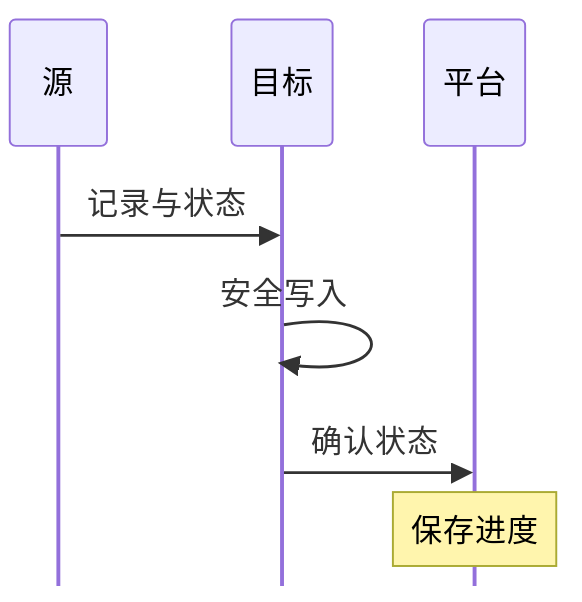

# Airbyte State 确认、CDC 与失败恢复

同步中最重要的数字不只是“读了多少行”，还有“哪些行已经被目标安全确认”。如果进度跑在真实提交之前，恢复就可能跳过数据；如果提交跑在进度之前，恢复通常需要容忍重放。本篇基于 **2026-11-14 官方协议**解释这条边界。

## 1. 一个 State 的生命周期



图中省略了具体中间容器和传输模式。源端发出 State 只是声称读取到了某个边界；Destination 必须满足对应数据安全持久化的协议条件后确认，平台才能用确认的状态推进恢复点。Socket 模式还有并行分区与 State 顺序关联，不能拿“最后看到一条消息”替代安全进度。

## 2. 一段合成 STDIO 消息

下面只用于阅读协议结构，不是某个真实连接器导出的生产 State；`cursor` 的具体结构由连接器决定。

```jsonl
{"type":"RECORD","record":{"stream":"orders","namespace":"demo","emitted_at":1794614400000,"data":{"order_id":101,"updated_at":"2026-11-14T00:00:00Z"}}}
{"type":"STATE","state":{"type":"STREAM","stream":{"stream_descriptor":{"name":"orders","namespace":"demo"},"stream_state":{"cursor":"2026-11-14T00:00:00Z"}}}}
```

`emitted_at` 是消息发出时间的毫秒时间戳，不是业务事务提交位置；Stream State 关联到指定流，不能把一个流的游标复制给所有流。还存在其他状态类型，特别是需要跨流协调的状态，不能统一压扁为单个日期。

## 3. 用一次失败推导重放

设已持久化确认状态为 S1。源端又发出两批数据并到达 S2，目标提交了第二批，但确认丢失或平台尚未保存时任务退出。下次仍从 S1 继续，部分数据会再次出现。

这不必然是故障实现错误，而是至少一次处理需要覆盖的边界。Append 可能保留重复，按业务键与版本去重的目标可以抑制部分重复，但不能由此承诺所有副作用或所有连接器具有跨系统 exactly-once。

反过来，若人为把 State 改成目标最大时间，而某批数据其实未提交，就可能跳过尚未成功的记录。因此不要用手工“调大日期”解决落后。

## 4. CDC 的恢复还依赖源日志

数据库 CDC 的状态可能包含日志位置、快照阶段和连接器内部信息。源端权限、复制槽或日志保留设置，必须覆盖最长停机与追赶窗口。源日志已清理时，不能仅凭保存着 State 就继续无损读取。

Airbyte 的 CDC 通常仍由同步计划启动有边界的作业：一次读取追到相应边界后结束，再由下次同步接续；不能把“使用日志”理解成一定有一个永不退出的实时消费者。同步间隔、任务耗时与源日志保留要一起设计。

PostgreSQL 的复制槽可能保留 WAL 导致源盘增长，MySQL 的 Binlog 清理可能使旧位置失效。两者风险方向不同，监控时既要看消费延迟，又要看源端保留字节和磁盘。具体配置应按所用 Source Connector 的数据库版本文档执行。

## 5. Retry、Refresh 与重建不能混用

Retry 是按任务和状态机制再尝试；Refresh/Reset 等操作可能重新读取、改变目标数据或状态，名称和行为随版本及模式变化。执行前明确受影响的 Connection、Stream、目标表与覆盖语义。

遇到不可恢复日志缺口，先保留配置、错误和现有数据，设计隔离全量与增量衔接，再校验和切换。不应让新全量随意覆盖仍在提供查询的目标，也不应同时保留两个竞争任务写同一表。

## 6. 练习与答案

**问题一：Source 输出 S2，平台是否应立即把恢复点改为 S2？**

答案：不能只凭源输出。要等目标满足协议的安全写入与确认条件，再保存对应可恢复状态。

**问题二：目标提交成功但确认丢失，恢复更可能产生什么？**

答案：从较旧安全状态重放，可能出现重复；因此需要正确的模式、业务键、版本或其他幂等处理。

**问题三：把 State 游标改成今天，为什么危险？**

答案：可能跳过未提交或迟到数据，而且 State 可能包含更多连接器特定信息，不是单个日期水位。

**问题四：保存着旧 State，Binlog 已清理，还能保证无损恢复吗？**

答案：不能。恢复需要的位置已不存在，应判断补齐来源或设计一致性重建，不可把缺口忽略成成功。

参考：[协议中的 State 确认规则](https://docs.airbyte.com/platform/understanding-airbyte/airbyte-protocol)、[Workload 的状态通路](https://docs.airbyte.com/platform/understanding-airbyte/jobs)、[CDC 概念](https://docs.airbyte.com/platform/understanding-airbyte/cdc)。
