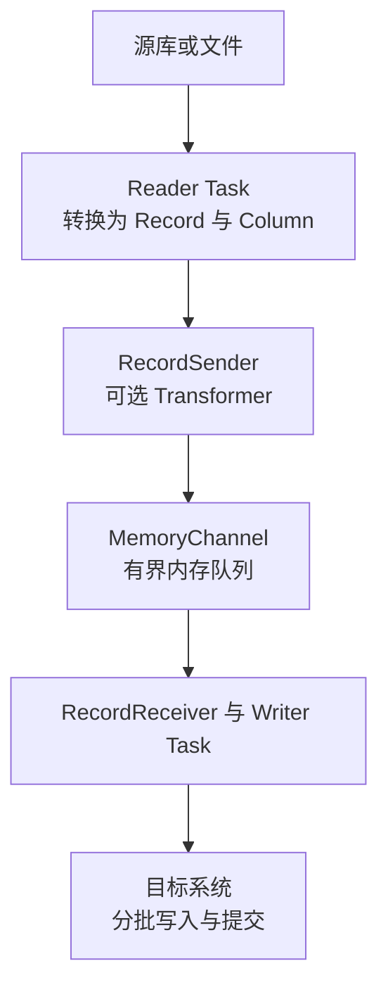

# DataX Job、Task、Channel 与源码执行链路

启动一次 DataX，并不是 Python 把数据库逐行搬过去。Python 启动器组装并启动 Java 命令；主要的数据同步运行在 JVM 中。把启动器、控制路径和数据路径分清，看到不同阶段的日志后才知道应该检查哪里。

## 1. 从命令到运行容器

| 入口或组件 | 职责 | 不是它的职责 |
|---|---|---|
| `datax.py` | 解析启动参数，启动 Java 子进程并返回退出状态 | 执行 JDBC 查询与批量写入 |
| `Engine` | 加载配置、绑定插件装载信息，选择运行容器 | 逐条处理业务数据 |
| `JobContainer` | 初始化、准备、切分、安排 TaskGroup、收尾和统计 | 直接承担每条记录的搬运 |
| `TaskGroupContainer` | 在分配到的通道预算内组织 Task 执行和状态检查 | 自动变成一台远程工作节点 |
| Reader/Writer Runner | 调用对应插件 Task 的读写生命周期 | 提供跨数据库全局事务 |

在本系列的 standalone 模式中，JobContainer 和 TaskGroupContainer 处于同一个 Java 进程。`TaskGroup` 是框架内的执行组织单位，不等于 Kubernetes Pod、独立 JVM 或另一台机器。源码中的模式名称也不能证明当前发行包包含可用的分布式服务。

## 2. Job 切成 Task，再决定同时跑多少

一个 Job 表达这次同步任务。Reader 的 `Job.split()` 根据文件、表或切分键产生读取配置；Writer 根据读取任务数产生对应写入配置，框架将两侧配成 Task。

例如要搬十个冻结文件，Reader 可能产生十个 Task；只分配两个并发通道时，并不需要十个 Task 同时运行。任务总数决定有多少工作单元，并发预算决定同一时刻能推进多少。

`channel=8` 也不会让一个完全不支持内部切分的大文件突然变成八份。必须先确认 Reader 的切分能力与最终任务日志。

## 3. 一条记录实际经过哪些对象

Record 是一行，Column 是行中的一个字段。Reader 把 JDBC 或文本中的值装入 Column，Writer 再按目标类型取出。Channel 传递的是这些内存对象，不是数据库网络包，也不是 Kafka Topic。

`ReaderRunner`、`WriterRunner` 与交换器把插件接入上述路径。理解时优先跟踪 `startRead()`、`sendToWriter()`、`getFromReader()`、`startWrite()` 等边界，不必一开始阅读所有辅助类。

## 4. 队列为什么会让上游等下游

MemoryChannel 使用有界队列；批量推入路径还会检查记录数量和内存字节预算。目标写入慢时，队列逐渐积累，Reader 侧等待可用空间；源端慢时，Writer 侧等不到下一批记录。

这就是背压。增大缓冲区只能吸收一段时间内的速度差，不能把长期只能写 20 MB/s 的目标变成 100 MB/s。还要区分等待名称的视角：Reader 等 Writer，通常意味着下游跟不上；Writer 等 Reader，通常意味着上游供应不足。结合调用栈和两端负载验证，不仅看一个等待字段。

默认 MemoryChannel 不是持久化检查点。进程退出后，队列内容不会自动变成重启可用的事务日志；已在数据库提交的批次却可能继续存在。

## 5. 生命周期与失败位置

典型主线是 `init → prepare → split → schedule → post → destroy/统计`。框架和插件在 Job 与 Task 两个层次都有生命周期方法，不能把 `prepare()` 一概理解成“每条记录之前”。

连接失败可能发生在初始化、预处理 SQL、实际读取或实际写入阶段。某些 Task 已提交、另一个 Task 失败时，Job 最终可以失败；这不意味着前面的提交被撤回。

## 6. 带着问题读源码

| 问题 | 首先查看 |
|---|---|
| 命令怎样启动 Java | `core/src/main/bin/datax.py` 的 `buildStartCommand()` |
| 为什么进入这个容器 | `Engine.start()` |
| 如何计算通道数和调用切分 | `JobContainer.adjustChannelNumber()`、`split()` |
| 谁创建读写执行器 | `TaskGroupContainer` 的 Task 执行逻辑 |
| 为什么发送记录被阻塞 | `MemoryChannel.doPushAll()` |
| SQL 何时提交 | 对应 Writer 与共享 RDBMS Writer 的批量写入逻辑 |

下一篇准备[可复核的运行环境](./03-部署构建驱动与运行环境.md)，先验证启动器与插件，而不是直接连接生产库。

## 7. 练习与答案

**问题一：有 100 个 Task、4 个通道，是否代表要启动 100 个 JVM？**

答案：不是。standalone 的工作仍在一个 JVM 中，Task 在有限的并发预算内逐步执行。

**问题二：Reader 很快、队列接近上限，应该先扩大队列吗？**

答案：先检查目标写入、数据库锁、提交和限速。扩大队列可能暂时减缓等待，但会增加内存且不能消除持续吞吐瓶颈。

**问题三：进程崩溃后，MemoryChannel 中未写出的记录会自动重放吗？**

答案：普通内存通道不会。恢复需要重新确定输入范围，识别目标已提交部分，并以安全策略重跑。

**问题四：看到 `TaskGroup` 日志，能判断作业已经分布式运行吗？**

答案：不能。它也用于单进程内的任务组织，必须核对运行模式、实际进程和调度部署。

参考：[Engine](https://github.com/alibaba/DataX/blob/80ec23d5c5328eb90ca364d2749e92dfaf44541e/core/src/main/java/com/alibaba/datax/core/Engine.java)、[TaskGroupContainer](https://github.com/alibaba/DataX/blob/80ec23d5c5328eb90ca364d2749e92dfaf44541e/core/src/main/java/com/alibaba/datax/core/taskgroup/TaskGroupContainer.java)、[MemoryChannel](https://github.com/alibaba/DataX/blob/80ec23d5c5328eb90ca364d2749e92dfaf44541e/core/src/main/java/com/alibaba/datax/core/transport/channel/memory/MemoryChannel.java)。
