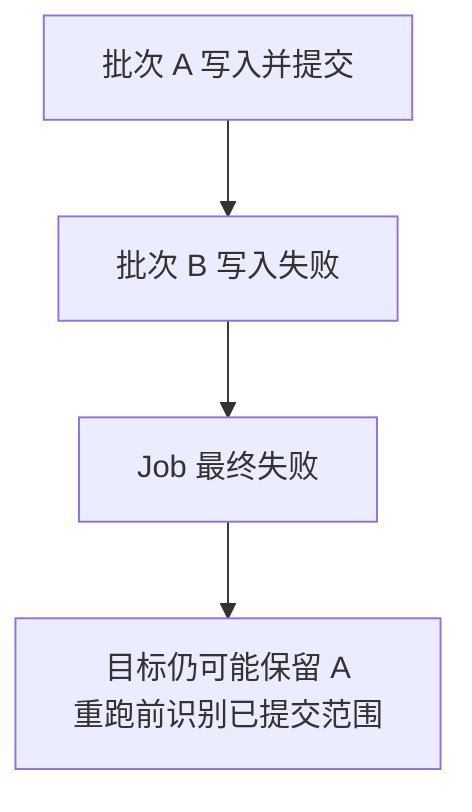

# DataX Writer、批量提交、重试与幂等

一次任务最后显示失败，并不意味着目标表没有变化。理解 Writer 最重要的线索是“什么时候提交了一批”，而不是“整个 Job 什么时候退出”。

## 1. 数据按位置进入目标列

Reader 输出五个 Column，Writer 的 `column` 就需要以对应顺序列出五个目标字段。一般不能期待框架自动按源列名匹配目标同名列。

例如源顺序是 `order_id, customer_id, amount`，目标误写成 `order_id, amount, customer_id`，可能触发类型错误，也可能在两列都能接收字符串时静默写错。列数相等只是最低条件，不是正确性证明。

MysqlWriter 片段如下；完整任务见配套示例。目标使用专用 staging 表，不直接覆盖业务正式表。

```json
{
  "writer": {
    "name": "mysqlwriter",
    "parameter": {
      "username": "${target_username}",
      "password": "${target_password}",
      "column": ["order_id", "customer_id", "amount", "status", "updated_at"],
      "writeMode": "insert",
      "batchSize": 500,
      "connection": [
        {"jdbcUrl": "${target_jdbc_url}", "table": ["orders_stage"]}
      ]
    }
  }
}
```

## 2. 三种写法的语义不同

| MysqlWriter 模式 | 主要行为 | 必须检查的风险 |
|---|---|---|
| `insert` | 插入新行，受主键和唯一约束约束 | 重复键、部分提交后重跑 |
| `replace` | 使用 MySQL REPLACE 语义处理冲突 | 删除再插入式效果、触发器、默认列和关联约束 |
| `update` | 固定实现生成 INSERT ... ON DUPLICATE KEY UPDATE | 唯一键设计、旧数据覆盖新数据、更新触发器 |

`update` 不是通用的 `UPDATE ... WHERE` 模板，也不天然带 `incoming.version > current.version` 条件。固定基线会用目标列构造更新部分；不同数据库 Writer 不保证同样支持这三种模式。

MySQL 的旧式 `VALUES(column)` 引用、目标版本告警和未来兼容性也要放进回归，不因为当前 SQL 能执行就忽略它。

## 3. `batchSize` 不是整个作业的事务大小

RDBMS Writer 会缓冲记录后分批写入。`batchSize` 影响缓冲与批量请求边界，但具体提交、失败降级和重试还取决于插件实现与驱动。

例如第一个 Task 已提交两批，第二个 Task 在唯一约束处失败，此时目标可能已经存在部分记录。一个连接回滚自己的未提交批次，不会回滚另一个连接之前提交的数据。



还要考虑提交结果未知：数据库已经提交，但返回确认时连接断开。客户端收到异常不等于服务端没有提交；这正是重试需要幂等设计的原因。

## 4. 重试安全需要不变量

最简单的“按主键覆盖”只适用于重复执行不会改变业务含义的情况。以下情况仍可能出错：旧窗口晚完成后覆盖新窗口；更新触发器额外发消息；重复写入累加统计；目标存在其他唯一键冲突。

更稳妥的设计通常包括：固定输入范围、稳定业务键、批次隔离、源版本或更新时间判断，以及一个可验证的发布动作。若采用自定义合并 SQL，需要单独验证并发和版本条件，不能仅把 `writeMode` 改成 `update` 就宣布实现了全链路 Exactly-once。

## 5. staging 如何隔离失败

可以为每个批次准备独立 staging 表，或在共享 staging 中使用 `batch_id` 参与隔离。批次完成后校验，再由目标数据库事务或受控发布机制合入正式表。

配套示例的 `orders_stage` 用于**单任务串行实验**，`insert` 模式故意不隐藏重复键。第一次运行必须确认表为空；重跑时创建新的实验表或明确处理旧批次，不把清空操作自动藏在 `preSql` 中。

正式场景还需要决定：谁创建 staging，谁持有合并权限，谁确认失败残留，何时保留或回收。批次隔离不是单纯给日志换个名字。

## 6. `preSql` 与 `postSql` 不是事务保护伞

预处理和后处理 SQL 属于插件生命周期操作。它们可能清空目标、更新状态或触发发布，但不会自动与所有 Task 的数据写入组成一个大事务。

不要直接放入 `TRUNCATE 正式表` 再期望失败回滚恢复全部数据。需要发布原子性时，让暂存、校验、合并、状态记录拥有明确的数据库事务和恢复协议。

## 7. 练习与答案

**问题一：Job 失败，目标为什么还有几千行？**

答案：之前的批次或其他 Task 可能已经独立提交，最终 Job 状态不会自动撤销它们。

**问题二：使用 `update`，能防止昨天的任务覆盖今天的新状态吗？**

答案：不能自动防止。还需要版本条件、隔离和调度互斥等机制。

**问题三：为什么 REPLACE 不应当简单理解为“更新已有字段”？**

答案：它使用冲突替换语义，可能产生删除和插入式副作用，影响未提供列、触发器和约束。

**问题四：提交后网络断开，重跑可以直接使用普通 insert 吗？**

答案：必须先处理提交结果未知与重复键风险。可以隔离新批次后校验发布，或采用经过验证的幂等合并策略。

参考：[MysqlWriter](https://github.com/alibaba/DataX/blob/80ec23d5c5328eb90ca364d2749e92dfaf44541e/mysqlwriter/doc/mysqlwriter.md)、[写入 SQL 构造](https://github.com/alibaba/DataX/blob/80ec23d5c5328eb90ca364d2749e92dfaf44541e/plugin-rdbms-util/src/main/java/com/alibaba/datax/plugin/rdbms/writer/util/WriterUtil.java)、[批量写入实现](https://github.com/alibaba/DataX/blob/80ec23d5c5328eb90ca364d2749e92dfaf44541e/plugin-rdbms-util/src/main/java/com/alibaba/datax/plugin/rdbms/writer/CommonRdbmsWriter.java)。
