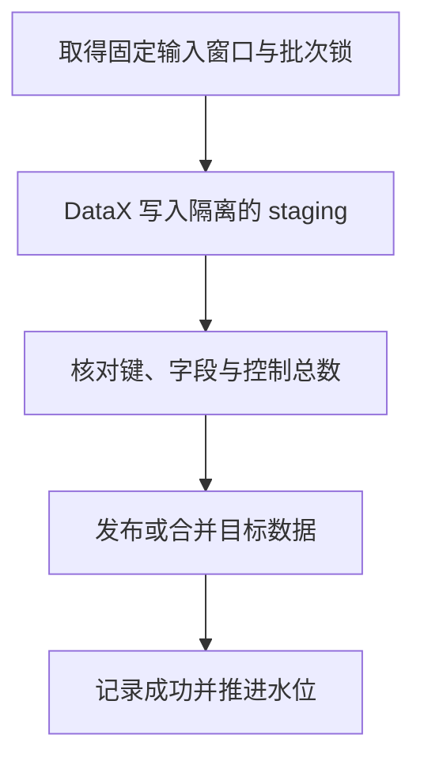

# DataX 增量水位、补数与 CDC 衔接

DataX 可以执行“读取某段更新时间范围”的查询，但不会因此自动维护一个完整的增量协议。窗口如何确定、失败后是否重跑、什么时候推进水位，都需要显式设计。

## 1. 固定半开窗口

对于相邻小时，使用 `[00:00, 01:00)` 和 `[01:00, 02:00)`。前闭后开使恰好等于 01:00 的记录只归属后一个窗口，避免相邻区间在边界上重复或遗漏。

```sql
SELECT order_id, customer_id, amount, status, updated_at
FROM datax_lab.orders
WHERE updated_at >= '2026-11-01 00:00:00'
  AND updated_at <  '2026-11-01 01:00:00';
```

不要让每个 Task 自己计算一个不断变化的“当前时间”。上界应在批次开始前确定，重试继续使用同一个区间和配置版本。

## 2. 更新时间不等于提交时间

设事务 T 在 00:50 写入 `updated_at=00:50`，直到 01:10 才提交；任务在 01:00 抽取 `[00:00,01:00)` 时看不到它，随后推进水位到 01:00。下一个窗口从 01:00 开始，又会排除这条记录。

这说明半开区间只解决边界归属，不解决迟到可见性。应用时间回填、时钟偏差、长事务和只读副本延迟都可能产生类似问题。

重叠回读可以把下一次起点回退一段，并在目标幂等合并，但它只能覆盖约定范围内的迟到。没有最大迟到约束时，有限回读不能证明绝对不漏；需要对账、补偿或日志 CDC。

## 3. 按自增 ID 也可能遇到迟到提交

事务 A 分配 ID 101 后未提交，事务 B 分配并提交 ID 102。抽取端看到了 102 就推进到 102，A 后续提交的 101 仍可能被漏掉。

因此“ID 递增”与“事务按 ID 顺序提交”不同。按最大 ID 推进只在明确的写入契约下成立，不能仅根据字段名 `AUTO_INCREMENT` 推导。

## 4. 水位必须等到业务发布成功



任何阶段失败，都需要保留原水位和明确的批次状态。DataX 退出码为零只是必要条件之一；校验失败或发布失败时，不能继续推进。

还要防止两个执行器并发推进。状态更新应检查预期旧值并配合任务互斥、租约或 fencing；只有 CAS 状态更新而没有发布隔离，也可能让落后的任务覆盖较新的目标数据。

## 5. 更新与删除怎样覆盖

目标必须按稳定业务键处理多次更新，必要时比较源版本，不能让旧窗口最后完成时覆盖新状态。硬删除则不会留在普通 SELECT 的结果里。

可以使用可信的软删除标记、删除事件表、CDC 或周期性完整对账。每种办法要明确保留期限和恢复能力。例如删除日志已经清理，停机任务便可能失去补齐依据。

## 6. 全量与 CDC 不能靠两个“当前时间”拼接

先做 DataX 全量、再从 CDC 的“现在”开始，会漏掉全量期间发生的变化；先记一个日志位置，但全量快照并不与它协调，也可能存在覆盖与重复问题。

正确衔接需要一个能够证明的快照与日志关系：保留覆盖初始化时间的日志，协调快照可见范围与 CDC 起点，处理重复与版本顺序，并在切换前核对目标追平情况。DataX 的时间筛选本身不提供这份证明。

要求严格迁移时，优先采用有明确初始化协议的 CDC/迁移机制；DataX 可以承担受控回灌，不单独承诺跨表事务级零丢失。相关快照机制见 [Debezium Snapshot](../debezium/03-Initial-Schema-only-Never-When-needed与Incremental-Snapshot.md)。

## 7. 补数需要独立身份

补数记录原窗口、源版本或输入清单、转换版本、目标批次和发布状态。历史补数不能直接修改最新日常水位，也不能默认覆盖当前状态；先区分是在补“历史事件”还是重建“最新视图”。

## 8. 练习与答案

**问题一：半开区间是否足以证明更新时间增量不漏数据？**

答案：不是。它只确定边界归属，迟到提交、回填时间与副本延迟仍可能让记录在窗口关闭后才可见。

**问题二：自增 ID 已读到 102，为什么 101 还可能随后出现？**

答案：ID 分配先于事务提交，两个事务可能按不同顺序提交。

**问题三：DataX 返回零，数据校验失败，是否推进水位？**

答案：不推进。发布成功与校验通过是外部状态推进的前置条件。

**问题四：重叠回读一天，能保证任何长期停机和迟到都不漏吗？**

答案：不能。一天只覆盖有限的回读范围，需要迟到上限、保留策略、补数与对账，或使用可恢复的日志位置。

参考：[MySQLReader 的条件查询](https://github.com/alibaba/DataX/blob/80ec23d5c5328eb90ca364d2749e92dfaf44541e/mysqlreader/doc/mysqlreader.md)、[Debezium MySQL 快照与变更流](https://debezium.io/documentation/reference/stable/connectors/mysql.html#mysql-snapshots)。
