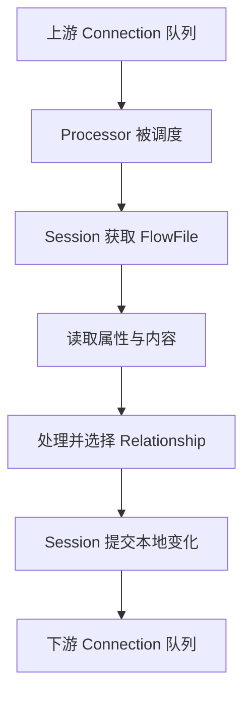

# NiFi FlowFile、Processor 与 Session 执行链路

把一个订单文件交给 NiFi，不是让每个组件都把整个文件复制到 Java 堆再交给下一组件。NiFi 用元数据描述文件，并把内容保存在独立存储中。本篇以 **2.12.0 的 Traditional Engine** 说明这套机制。

## 1. FlowFile 的两部分

FlowFile 包含属性，例如文件名、UUID、业务标签，以及指向内容的引用。内容可以是字节流、JSON 数组、CSV 或其他格式。属性适合小型元数据；把整个大文件塞进属性会增加堆和元数据开销，也容易泄露敏感信息。

修改属性与修改内容不是同一类操作。多个 FlowFile 在某些操作后可共享底层内容引用，内容更新通常采用新的内容引用与相应管理机制；因此一次路由或复制不必等于物理复制全部字节。但不能由此假定磁盘永不增长，仍需考虑新内容、归档和引用释放。

## 2. 一个处理周期经过什么

Processor 从 Session 获取对象，读取或生成内容，更新属性，再通过某个 Relationship 转移或移除。每个拿到的 FlowFile 必须有合法去向；未处理的关系会让组件无效，或在运行中造成事务问题。

Relationship 是组件声明的结果通道，例如成功、失败、重试或某个动态查询名称；Connection 决定把哪些关系连到下游。不是所有 Processor 都提供同名关系，必须看组件文档。

## 3. ProcessSession 提交解决哪一层问题

Session 管理本次处理涉及的 FlowFile、内容引用和队列变化。成功提交后，这些本地变化成为可继续处理的状态；异常回滚则撤销相应局部变化，使输入有机会重新处理。

但 SQL 数据库、HTTP 服务和对象存储属于外部系统。假设一次处理先向支付接口发出请求，接口成功，随后本地 Session 尚未提交时进程崩溃。恢复后输入重现，再调用一次支付接口，可能重复扣款。本地 rollback 不会跨网络撤回已经完成的支付。

解决办法不是简单“增加重试”，而是让外部请求带幂等键、使用目标唯一约束或条件版本；必要时用事务发件箱与独立消费协议。具体 Processor 的事务和确认能力仍要逐个核对。

## 4. 调度、并发、Penalty 和 Yield

Timer Driven/CRON 决定触发时机，Concurrent Tasks 控制某组件可同时执行的任务数。一个任务可能处理多个 FlowFile，而一个 FlowFile 又可能包含多条 Record，所以并发数不能直接当成每秒业务记录数。

Penalty 常用于让特定 FlowFile 暂时不可再次被取走，避免失败数据紧密循环；Yield 暂停组件调度一段时间，常用于当前整体无法取得有效工作。两者不是同一个超时，也不能替代带上限的重试策略。

如果每次失败都立刻绕回自己，可能产生高 CPU、日志洪水与目标重复请求。应区分暂时性故障和永久数据错误，记录尝试次数与首次失败时间，把不可自动恢复的数据送到受控失败队列。

## 5. 观测时避免三个混淆

组件被调度不等于取到了数据，取到数据不等于写入目标成功，本地提交成功也不一定代表业务已经发布。应对齐输入/输出计数、队列年龄、处理耗时、Provenance 与目标提交记录。

源码阅读可从 `nifi-api` 的 `Processor`、`ProcessContext`、`ProcessSession` 接口开始，再进入所用 Processor 的 `onTrigger`，最后跟踪仓库与调度实现。先画清职责，再看实现细节，比从 UI 请求一路跳转更容易保持方向。

## 6. 练习与答案

**问题一：只增加一个路由属性，会复制整个文件内容吗？**

答案：不必然。属性与内容引用分开管理；实际内容写入、引用与归档行为由操作和存储实现决定。

**问题二：Session 回滚为什么不能保证 HTTP 没执行过？**

答案：外部 HTTP 副作用不属于本地队列事务，可能已成功但响应或本地提交失败，需要外部幂等协议。

**问题三：Concurrent Tasks 为 8，是否每次只处理八条订单？**

答案：不是。它是并发执行任务数；每次处理的 FlowFile 和其内部 Record 数由组件与数据格式决定。

**问题四：永久格式错误是否适合无限立即重试？**

答案：不适合。应隔离错误、保留原因和数据引用，修复契约后受控重放，避免持续占用队列与目标资源。

参考：[开发者指南](https://nifi.apache.org/nifi-docs/developer-guide.html)、[用户指南中的调度与连接](https://nifi.apache.org/nifi-docs/user-guide.html)、[2.12.0 API 源码](https://github.com/apache/nifi/tree/rel/nifi-2.12.0/nifi-api)。
