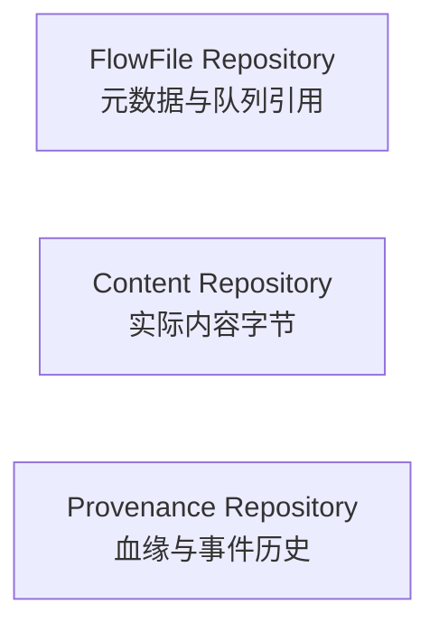

# NiFi Repository 持久化与重放边界

NiFi 能保存队列并提供数据血缘，但“有磁盘目录”与“任何故障都不丢数据”之间还差存储耐久性、配置和恢复验证。本篇以 **NiFi 2.12.0 Traditional Engine** 为基线，区分几份容易混淆的状态。

## 1. Repository 各自负责什么

FlowFile Repository 记录元数据和队列相关状态，Content Repository 保存实际字节，Provenance Repository 记录流转历史。Processor state 还可能保存列表进度、游标等小型状态，它又不是整个内容仓库。

图中三个框是职责对照，不是依次执行的流水线，也不表示三份业务内容副本。

所以，看到 Provenance 中“处理过文件 A”，不代表 A 的内容仍被保留，也不代表外部目标已永久保存。元数据、内容、事件与目标业务事实必须分别确认。

## 2. 重启恢复依赖什么

正常重启或进程异常后，持久 Repository 为恢复队列提供基础。但持久卷消失、文件系统损坏、写入未达到要求的耐久性，或者引用与内容来自不一致时间点，都可能破坏恢复。

例如元数据恢复后引用某段内容，但 Content 卷没有一起保留，会出现“知道有这个 FlowFile，却读不到其内容”。只备份 `flow.json.gz` 可以重建流程形状，不能重建仍在排队的业务字节。

不要直接对运行中的多个目录分别做普通复制，并把结果称为一致性备份。应按部署与存储能力采用经过验证的停写/停止或一致性快照策略，并验证密钥、组件、状态、Repository 与外部源/目标之间的关系。

## 3. Provenance 的 replay 有前提

血缘可帮助回答数据来自哪里、经过哪些组件以及何时转发。能否重放还取决于对应内容是否仍可访问、保留策略、权限与事件类型；不是永久数据备份。

即使可重放，也可能再次发送 HTTP、插入数据库或发布消息。重放前要确认目标幂等键、重复范围、原先是否已成功，以及是否需要写入隔离目标。不能因为它是 UI 上的按钮，就认为只改变展示状态。

## 4. Traditional 与 Stateless 不能混用结论

Traditional Engine 的组件通过队列解耦，持久化配置支持在进程恢复后继续处理。Stateless Process Group 把一段流程作为执行单元，内部队列不按同样方式持久保存；重启后不能指望恢复那些内部在途数据。

Stateless 可以适合可由输入重放的短流程，但它不是“更快且无条件更可靠”的开关。还要确认输入确认与整个处理单元完成的关系，尤其是流程内部已经产生外部副作用的情况。

## 5. 设计重复与丢失验证

为每条测试数据设置业务键和版本，记录源端发送集合、目标提交集合及失败队列。分别在处理前、外部提交后、本地提交前后中断隔离实验，比较结果。

数据库目标可用唯一约束与版本条件；文件目标可使用明确批次名与原子发布；HTTP 目标需要支持幂等键和可查询执行结果。NiFi 的本地可靠队列为这些协议提供基础，但不能代替外部系统共同参与的确认机制。

## 6. 练习与答案

**问题一：Provenance 里存在事件，内容是否一定能下载？**

答案：不一定。事件和内容有不同保留与权限条件，内容可能已经释放或归档过期。

**问题二：恢复流程定义后为什么队列仍为空？**

答案：流程定义描述组件和连接，不包含所有在途数据；还需要相应持久 Repository、组件状态与一致恢复方式。

**问题三：Stateless 内部排队是否具备 Traditional 队列同样的重启恢复能力？**

答案：不能如此假定。Stateless 内部队列不持久保存，恢复应依赖输入和整体处理协议。

**问题四：目标已插入成功但 Session 未提交，重启后怎么避免重复？**

答案：用业务幂等键、目标唯一约束/版本或事务协议识别重放，不能依赖本地 Session 回滚撤销外部提交。

参考：[用户指南的执行引擎与 Provenance](https://nifi.apache.org/nifi-docs/user-guide.html)、[管理员指南的 Repository](https://nifi.apache.org/nifi-docs/administration-guide.html)、[2.12.0 源码](https://github.com/apache/nifi/tree/rel/nifi-2.12.0)。
