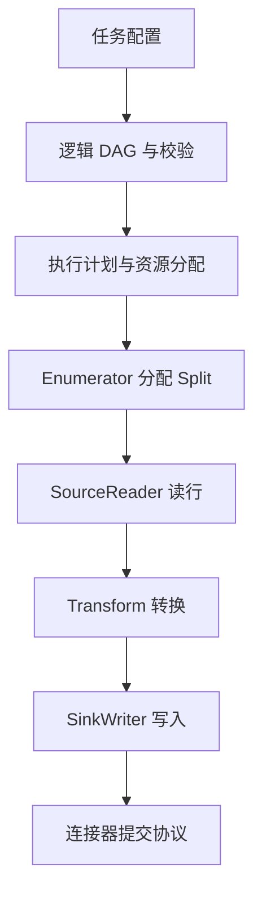

# Source、Transform、Sink 与 Zeta 执行链路

假设把订单表读出，统一字段，再写入分析库。业务上只是一条管道，运行时却至少需要决定“谁读哪部分”“哪一行是什么类型”“写到哪里算完成”“失败从哪里继续”。SeaTunnel 的组件就是围绕这些问题拆分的。本篇以 **3.0.0、Zeta** 为基线。

## 1. Source 不只是一个查询函数

Source 的协调部分发现可读取的工作，并把它划为 **Split（切分片段）**；SourceReader 负责实际读取分配给自己的片段。Split 可以代表数据库键范围、文件片段或消息分区，不保证所有连接器采用同一种切法。

| 部分 | 负责的事 | 不能直接推导的事 |
| --- | --- | --- |
| SplitEnumerator | 发现、分配、记录待处理片段 | 不代表所有 Reader 共享数据库快照 |
| SourceReader | 读取、解析、报告进度与状态 | 不负责替目标库提交事务 |
| Source 状态 | 恢复所需位置、待处理片段等 | 不是源数据库完整备份 |

例如四个 Reader 同时查询四个主键范围，可以提升吞吐，但四个连接的事务开始时刻可能不同。要获得一致视图，需要连接器与数据库共同支持一致性机制，而不是只设置 `parallelism = 4`。

## 2. 一条记录如何经过执行图

这是职责图，不表示每个方框都独占一个进程。计划会决定节点间的边、并行度和任务分组，实际网络传输还受引擎执行策略影响。数据路径中，行数据包含字段值；在 CDC 场景还需保留表身份与变更种类，不能把所有事件当成普通 INSERT。

Transform 修改行或 schema，例如重命名、过滤和计算。字段名字改了而 Sink 仍按旧列顺序绑定，就可能出现类型错误，甚至在类型相容时静默写错列。因此配置校验之后，还应检查实际输出 schema 和几条边界数据。

## 3. SinkWriter 与提交不是同一个动作

Writer 接收记录，可能先进入内存批次，再发送数据库，随后提交事务。网络写调用返回、批次发送完、事务提交、检查点确认，是不同的时间点。

部分 Sink 实现提交信息、Committer 或聚合提交机制，用来与检查点协同。不能因为框架有这些接口，就推断 Console、HTTP 和所有 JDBC 模式都具备相同保证。对 JDBC，要分别确认普通 INSERT、原生 UPSERT 与 XA 等模式的语义。

例如目标已经提交订单 101，但进程尚未保存对应进度就退出；恢复后再发 101，结果可能是重复一行、主键冲突，或覆盖同一键。最终行为来自目标约束与写入方式，而不是“框架会重试”这句话。

## 4. 数据流与控制流分开看

**数据流**搬运记录；**控制流**负责任务部署、片段分配、状态快照、失败通知和恢复。吞吐下降可能来自数据流慢，也可能来自控制面频繁切换，让任务反复恢复。

Zeta 维护集群成员、资源与作业状态。作业协调侧负责把逻辑关系转为可运行任务并监控；执行侧跑 Reader、Transform、Writer。混合部署时两种职责可在同一个 JVM，所以“机器 CPU 很高”还需要继续区分是转换计算、GC，还是协调线程忙。

## 5. 如何沿源码阅读而不陷入代码海

在固定标签中依次看 `seatunnel-api`、`seatunnel-engine` 和目标 `seatunnel-connectors-v2` 插件。先查 Source/Reader/Enumerator、Sink/Writer/Committer 等接口，再跟随所用连接器的实现，不必先逐行阅读整个引擎。

每经过一个接口，记录四件事：输入是什么、输出是什么、保存什么状态、失败由谁处理。例如 JDBC Source 的查询切分属于插件，任务调度属于引擎，目标数据库的提交规则属于数据库与 Sink 的组合。这样能避免把三层问题归因给一个参数。

## 6. 练习与答案

**问题一：Reader 数增加到八个，为什么可能没有提速？**

答案：可读 Split 不足、数据倾斜、数据库连接或 I/O 受限、目标写入慢，都可能让新增 Reader 等待或加重争用。

**问题二：Transform 成功是否意味着目标字段正确？**

答案：不意味着。仍需验证字段顺序、类型、精度、时区、NULL 和 Sink 映射，以及目标真实存储值。

**问题三：哪个组件决定“恢复后再写同一行会怎样”？**

答案：Source 的恢复位置决定是否重放，Sink 的提交机制与目标主键/事务决定重复结果，不能只看其中一方。

**问题四：为什么执行图中不能把每个节点都当成一台机器？**

答案：逻辑节点表示职责，物理任务、线程、进程与主机由执行计划和部署方式映射，二者不是一一对应。

参考：[核心 API 设计](https://github.com/apache/seatunnel/blob/v3.0.0/docs/en/architecture/core-api-design.md)、[DAG 执行](https://github.com/apache/seatunnel/blob/v3.0.0/docs/en/architecture/engine/dag-execution.md)、[JDBC Sink](https://github.com/apache/seatunnel/blob/v3.0.0/docs/en/connectors/sink/Jdbc.md)。
