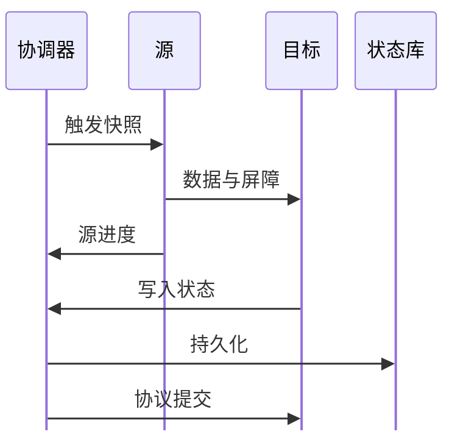

# SeaTunnel CDC、Checkpoint 与一致性边界

“引擎支持 exactly-once”不等于“任何 Source 接任何 Sink 都不会重复”。需要把可重放输入、状态快照、目标提交与恢复协议放在一起检查。本篇以 **SeaTunnel 3.0.0、Zeta** 解释这些条件，不把演示用 Console 视为事务数据库。

## 1. CDC 为什么需要快照与日志一起考虑

新建同步通常既要已有数据，也要启动以后的变化。只先全表 SELECT，再从“此刻”开始读日志，中间提交的事务可能被遗漏；先读日志再无条件导入快照，又可能重复或用旧值覆盖新值。

数据库 CDC 连接器需要协调快照边界、切分进度、日志位置和变更顺序。具体做法随插件变化，不能用一种数据库的实现解释全部 CDC。启用前还要核对源端权限、日志格式、保留窗口、server-id/连接标识隔离，以及 DDL 支持边界。

普通 JDBC 的 `WHERE updated_at > ...` 是轮询查询：通常无法发现硬删除，也不能天然保证多个范围查询共享一个快照。频率再高，也不会自动变为日志 CDC。

## 2. 检查点保存的是什么

检查点描述的是一个可恢复的执行进度，包括连接器和引擎需要的状态，而不是把源库、目标库完整备份一次。Source 可能保存日志位置与 Split 进度，Sink 可能保存待提交事务信息；具体字段由插件实现。



图中是协作关系，不是所有插件都实现同一种两阶段提交。要确认“报告完成”究竟表示已发出、已持久化，还是可恢复的预提交。

## 3. 为什么失败后仍可能重放

假设检查点记录源位置 100，目标随后提交了 101—120，但对应新进度尚未持久化时进程崩溃。从 100 恢复后，101—120 可能再次到达目标。普通 INSERT 可能重复或冲突；按业务主键 UPSERT 可以让相同版本重复写不增加行数，但乱序旧版本仍可能覆盖新值。

可选策略有：具备恢复协议的事务 Sink；主键与版本条件实现幂等；按批次写入隔离区后校验发布。幂等不等于所有副作用都恰好一次，例如数据库写入不重复，但触发器发送邮件可能已经执行过。

JDBC Sink 的 XA 模式还依赖数据库与驱动的 XA 支持、事务权限、超时、悬挂事务处理和连接器配置。不能只加一个开关，就忽略数据库的 prepared transaction 资源与恢复操作。

## 4. 一个检查点配置片段

下面是 `config/seatunnel.yaml` 的相关片段，**不是完整集群配置**。时间单位为毫秒，HDFS 地址为示意，运行前替换并验证权限：

```yaml
seatunnel:
  engine:
    checkpoint:
      interval: 60000
      timeout: 180000
      storage:
        type: hdfs
        max-retained: 3
        plugin-config:
          namespace: /seatunnel/checkpoint/
          storage.type: hdfs
          fs.defaultFS: hdfs://nameservice1
```

一分钟一次只是说明量级，不是通用最优值。长间隔减少协调与存储开销，却增大故障后的重放区间；短间隔增加存储请求、屏障和事务压力。超时应覆盖真实负载下的尾部耗时，同时避免卡住的任务长期不暴露。

## 5. 恢复前先核对保留窗口

若恢复需要的 Binlog/WAL 已被清理，再完整的检查点也不能让日志重新出现。日志保留时间应覆盖最长停机、恢复耗时与安全余量；停机期间日志生成速度也要计入容量。

恢复时使用匹配的任务、连接器、schema 和状态，并观察重放区间及目标重复结果。删除检查点、重建任务、改主键、改变表集合都可能把一次恢复变成重新全量。先确认影响范围，再操作隔离目标，不能在生产中用“重跑试试”代替决策。

## 6. 练习与答案

**问题一：检查点成功能否证明目标数据库已完整备份？**

答案：不能。检查点保存执行状态，不能替代目标数据备份与源日志保留；恢复还依赖输入可重放和提交协议。

**问题二：为什么 UPSERT 后仍需版本条件？**

答案：主键只避免同键新增多行。旧事件晚到时，若没有版本/顺序校验，仍可能覆盖新状态。

**问题三：一分钟检查点是否保证最多丢一分钟数据？**

答案：不能。它影响恢复进度与重放量；是否丢数还取决于源日志是否保留、状态持久化、目标提交和恢复过程。

**问题四：源端日志已被清理，应该直接继续旧检查点吗？**

答案：不应。先判断能否从其他保留副本补齐；否则需要一致性重建与校验，而不是把日志缺口当作正常成功。

参考：[检查点机制](https://github.com/apache/seatunnel/blob/v3.0.0/docs/en/architecture/fault-tolerance/checkpoint-mechanism.md)、[CDC 管道架构](https://github.com/apache/seatunnel/blob/v3.0.0/docs/en/architecture/cdc-pipeline-architecture.md)、[检查点存储](https://github.com/apache/seatunnel/blob/v3.0.0/docs/en/engines/zeta/checkpoint-storage.md)、[JDBC 事务写入](https://github.com/apache/seatunnel/blob/v3.0.0/docs/en/connectors/sink/Jdbc.md)。
