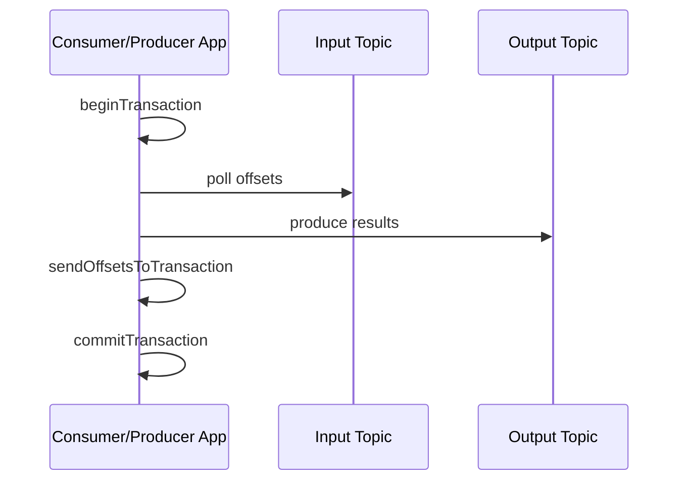

# Kafka 事务与端到端 Exactly-Once 边界

Kafka 事务可以原子提交多个 partition 的写入，并把 consumer group offset 与输出写入放入同一 Kafka 事务，适合 consume-transform-produce。但事务不会自动跨到任意数据库、对象存储和 HTTP API。

## 1. 事务角色

- Transactional producer 使用稳定事务标识初始化 producer identity/epoch；
- Transaction coordinator 跟踪事务状态与涉及 partition；
- 事务记录在提交前对 `read_committed` consumer 不可见；
- Abort marker 使 consumer 跳过已中止数据；
- Producer fencing 阻止旧实例继续以同一事务身份写入。

### 1.1 持久化决定与分区 marker 是两层状态

下面是传统事务协议的逻辑状态机，名称用于解释持久化决策，不代替目标版本的完整实现：

```text
Empty → Ongoing → PrepareCommit → CompleteCommit
                ↘ PrepareAbort  → CompleteAbort
```

进行中的事务收集参与分区；提交或中止决定先进入协调器的持久状态，再向参与分区写相应 marker，最后完成该状态。协调器故障后要从日志恢复决定并继续传播，而不是因为某个分区还没收到 marker 就反向中止已决定提交的事务。[KIP-98 事务协议](https://cwiki.apache.org/confluence/spaces/KAFKA/pages/66854913/KIP-98+-+Exactly+Once+Delivery+and+Transactional+Messaging)

原子提交表示事务不能最终在部分分区提交、部分分区中止，不表示不同消费者在同一墙钟时刻看到所有分区的一个统一快照。Marker 的传播、各分区的未完成事务边界和消费者 fetch 进度都影响可见时间；跨分区业务聚合不能仅凭一次 poll 推断“整个事务已读全”。

## 2. Consume-Transform-Produce



输出记录与“输入已经消费到哪里”一起提交。进程在提交前失败，事务中止，输入 offset 不推进；重启后重算，但旧输出不可见。提交成功后 ACK 丢失时，客户端/协调器通过事务状态处理不确定结果。

### 2.1 用 offset 100 到 109 手算故障恢复

假设输入已提交的下一位置为 100，应用消费 100…109，产生十条输出。本事务提交的是下一位置 **110**，不是最后处理位置 109。输出和 offset=110 属于同一事务，其恢复分三种情况：

| 故障点 | 持久状态 | 正确恢复依据 |
| --- | --- | --- |
| 提交决定尚未持久化 | 事务可能被中止，已提交 offset 仍为 100 | 根据协议解决旧事务，再从已提交位置重新处理 |
| 提交决定已持久化、marker 未到齐 | 决定是 commit，传播未完成 | 协调器恢复并完成 marker，不另造相反决定 |
| 已提交但客户端 ACK 丢失 | 输出与 offset 最终提交，客户端暂时不确定 | 按客户端异常契约处理不确定结果，不能盲目新建事务重发整批 |

一次 abort 不会自动把正在运行的 consumer 的本地 poll position 从 110 改回 100。应用需要在仍拥有分区的前提下恢复已提交位置，或通过重建客户端重新取得位置；若仅 abort producer 然后继续 poll，就可能跳过这十条输入。[Kafka 4.1 的事务与异常边界](https://kafka.apache.org/41/design/design/)

## 3. 读取隔离

`read_committed` 只返回已提交事务和非事务记录，并受未完成事务边界影响；`read_uncommitted` 可看到随后被 abort 的数据。下游若要求 EOS，必须检查消费隔离配置，不能只配置 producer。

### 3.1 LSO 为什么可能挡住更晚的已提交数据

High Watermark 表示达到复制可读条件的日志边界；Last Stable Offset 还受最早未完成事务影响。假设日志位置 0…9 已达到复制条件，但一个仍 open 的事务从位置 5 开始，那么 `read_committed` 暂时不能越过这个不稳定边界，即使位置 8 属于另一个已提交事务。

事务 5 解决后，稳定边界可以前进；若它 abort，consumer 会跳过其数据与控制记录，而不会把它们作为正常业务消息返回。返回记录 offset 有间隔不必然是丢消息，可能是事务过滤或控制记录。长事务造成的可见性停顿也不等于复制落后。[KIP-98 的 read_committed 与 LSO](https://cwiki.apache.org/confluence/spaces/KAFKA/pages/66854913/KIP-98+-+Exactly+Once+Delivery+and+Transactional+Messaging)

## 4. 事务代价

事务增加协调、状态日志、marker、延迟和运维复杂度。长事务会延迟可见性并占用 broker 状态；事务超时、授权、实例并发和重启身份都需要规划。不要为本可通过主键 Upsert 解决的场景无条件开启事务。

## 5. 边界外系统

写数据库时可选：

- 业务主键/事件 ID 幂等 Upsert；
- 在同一 DB 事务保存结果与已处理 offset；
- Outbox/CDC 将 DB 事务变化发布回 Kafka；
- Flink checkpoint + 事务 sink；
- 写不可见文件后由表 snapshot 原子发布。

发短信、邮件等不可回滚副作用使用 idempotency key、业务状态机和人工补偿。绝不能因为 Kafka 开事务就宣称它们 Exactly-Once。

## 6. 重试与 Fencing

同一 transactional ID 同时运行两个实例时，新 epoch 会 fence 旧实例。这能防止僵尸 writer，但实例 ID 映射错误会造成互相 fencing、事务失败风暴。滚动发布必须确保实例身份稳定且旧进程退出时序正确。

### 6.1 三种去重或所有权不能混为一谈

Producer identity/epoch 与序列号用于识别某个 producer 会话中已接收的批次，事务状态决定整批是否提交，consumer group metadata 则约束谁能代表当前分区所有权提交消费进度。Producer fencing 不等于 consumer 分区仍归自己；应用失去分区后不能沿用旧 group 状态推进 offset。

已经提交的事务之后，再以一个合法新事务发送同一个业务 event ID，Kafka 不会因为 payload 一样自动去重。稳定 transactional ID 也不是永久业务去重表。因此要区分协议重试、故障后的输入重放和主动重复发布；业务事件级幂等仍需独立契约。

## 7. 验证实验

输入 10 万条唯一事件，在输出过程中终止进程，分别用两种 isolation 读取输出。恢复后验证：输入提交 offset、输出 event ID 唯一数、金额总和和 abort 事务不可见。再把 sink 换成非幂等外部调用，观察 Kafka 事务无法覆盖外部副作用。

## 8. 指标与故障

- transaction begin/commit/abort rate 与 latency；
- transaction timeout、fenced producer、authorization error；
- coordinator/request error；
- read_committed consumer lag；
- 长时间 open transaction；
- event ID 重复与业务守恒校验。

## 9. 掌握验收

- 画出输入 offset 与输出 record 同事务提交；
- 解释 `read_committed` 的作用；
- 说明 producer fencing 的目的与发布风险；
- 为 Kafka 外部 sink 选择幂等、事务或 Outbox；
- 用故障注入证明定义范围内的 EOS，而非只看配置。
- 说明为什么提交 ACK 丢失不能直接重发一个新事务；
- 区分本地 poll position、已提交 offset、HW 和 LSO；
- 解释为何事务原子提交不是跨分区统一读取快照。

上一篇：[副本、ISR 与 KRaft](./04-副本ISR-Leader选举与KRaft.md)　下一篇：[Topic、Partition、磁盘与网络容量规划](./06-Topic-Partition磁盘网络与容量规划.md)

## 10. 参考资料 {/* #参考资料 */}

- [Kafka Design: Transactions](https://kafka.apache.org/documentation/#design_transactions)
