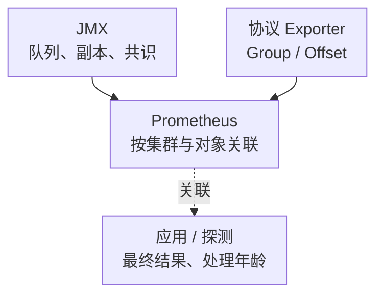

# Kafka 核心监控指标采集与告警

Kafka 监控的第一条边界是：Broker 能接收请求、消息具备足够副本、Consumer 已提交 Offset、业务已处理成功，是四个不同结果。只监控 Broker 存活或 Consumer lag，都不能覆盖完整消息链路。

本文以 **Kafka 4.0 的 KRaft/JMX 指标语义、JMX Exporter 1.2.0 的映射格式、danielqsj/kafka_exporter v1.9.0 的 Offset 指标**为基线。Exporter 版本不是 Kafka 协议兼容性的自动证明；目标版本、SASL/TLS、Group 协议与 ACL 均需接入验收。通用标签见[指标地图](../../../sre/observability/01-主流组件监控指标地图.md)，额外使用 `kafka_cluster` 区分消息集群。

## 1. 三条采集路径



图最后一条是查询关联，不是 Prometheus 产生业务指标。Producer/Consumer 的 JMX 或 SDK 埋点同样需要独立抓取；不能从 Broker JMX 中找到所有客户端的池等待、重试和业务耗时。

| 来源 | 核心对象 | 接入边界 |
| --- | --- | --- |
| JVM/JMX | Broker、Controller、客户端 | 每个进程的 MBean、GC、线程、CPU；限制管理端口，Java Agent 的 HTTP 端点也需隔离 |
| 协议 Exporter | Topic、Partition、Consumer Group | 使用元数据、Offset/Group API；不是 Broker 进程资源探针 |
| 应用与探测 | Produce 最终结果、处理完成、端到端延迟 | 区分重试尝试与业务去重，携带消息时间/序号但不放进指标标签 |

## 2. 显式定义 JMX 到 Prometheus 的映射

Kafka 定义 MBean 和属性，Prometheus 指标名由 JMX Exporter 配置决定。下面是**本文定义的最小映射**，不是所有 Chart 默认使用的名字。输入字符串的属性顺序、空格及实际暴露对象应按目标进程检查；它不包含 JVM/客户端/安全配置的完整部署清单。

```yaml
lowercaseOutputName: true
rules:
  - pattern: 'kafka.server<type=ReplicaManager, name=UnderReplicatedPartitions><>Value'
    name: kafka_broker_under_replicated_partitions
    type: GAUGE
  - pattern: 'kafka.server<type=ReplicaManager, name=UnderMinIsrPartitionCount><>Value'
    name: kafka_broker_under_min_isr_partitions
    type: GAUGE
  - pattern: 'kafka.server<type=BrokerTopicMetrics, name=MessagesInPerSec><>Count'
    name: kafka_broker_messages_in_total
    type: COUNTER
  - pattern: 'kafka.server<type=BrokerTopicMetrics, name=Bytes(In|Out)PerSec><>Count'
    name: kafka_broker_bytes_total
    labels:
      direction: '$1'
    type: COUNTER
  - pattern: 'kafka.network<type=RequestChannel, name=RequestQueueSize><>Value'
    name: kafka_broker_request_queue_size
    type: GAUGE
  - pattern: 'kafka.controller<type=KafkaController, name=ActiveControllerCount><>Value'
    name: kafka_controller_active
    type: GAUGE
  - pattern: 'kafka.controller<type=KafkaController, name=OfflinePartitionsCount><>Value'
    name: kafka_controller_offline_partitions
    type: GAUGE
  - pattern: 'kafka.controller<type=KafkaController, name=LastAppliedRecordLagMs><>Value'
    name: kafka_controller_metadata_apply_lag_seconds
    valueFactor: 0.001
    type: GAUGE
  - pattern: 'kafka.network<type=RequestMetrics, name=TotalTimeMs, request=(Produce|FetchConsumer|FetchFollower)><>99thPercentile'
    name: kafka_request_duration_p99_seconds
    labels:
      request: '$1'
    valueFactor: 0.001
    type: GAUGE
```

仅匹配无 topic 的 BrokerTopicMetrics，避免把“全局总量”和“每 Topic 分量”同时相加。`BytesInPerSec` 的 **Count** 是累计字节，不是其每秒速率；因此用 Counter 与 rate。方向标签值是 `In`/`Out`，输出名小写不表示标签值也自动小写。

MBean 定义见[Kafka 4.0 Monitoring](https://kafka.apache.org/40/operations/monitoring/)，规则字段和输入格式见[JMX Exporter Rules](https://prometheus.github.io/jmx_exporter/1.2.0/configuration/rules/)。单进程 JMX 已计算的 99thPercentile 是 Gauge，不能对它套 `histogram_quantile` 或平均多个 Broker 的 P99。

## 3. Broker：请求、吞吐与等待

| 指标或原始 MBean | 单位/用途 | 解释边界 |
| --- | --- | --- |
| `kafka_broker_messages_in_total` | 累计记录数 | 不等于业务去重消息数；批请求与消息是不同计数 |
| `kafka_broker_bytes_total` | 累计字节，direction | 入/出分开；副本流量和客户端流量按实际统计范围解释 |
| `kafka_broker_request_queue_size` | 当前请求数 | 队列深度与请求耗时/处理线程一起看 |
| `kafka_request_duration_p99_seconds` | 本地窗口 P99，秒 | 此处来自毫秒属性转换，不是可合并 Histogram |
| RequestQueueTimeMs / LocalTimeMs / RemoteTimeMs | 原始 JMX 延迟分段 | 排队、Leader 本地处理、等待副本；按 request 分组 |
| NetworkProcessorAvgIdlePercent / RequestHandlerAvgIdlePercent | 原始 JMX 空闲比例 | 注意属性/窗口，0～1 不是已经乘过 100 的百分数 |

```promql
sum by (cluster, kafka_cluster, direction) (
  rate(kafka_broker_bytes_total{job="kafka-jmx"}[5m])
)
```

结果字节/秒。吞吐增大并不自动代表服务改善，还应看 Produce 错误/超时、throttle、重试和端到端处理。RequestQueueTime 上升偏向入口处理能力，RemoteTime 上升可能涉及副本确认；每种假设都需磁盘、网络、ISR 和应用证据验证。

## 4. ISR、min ISR 与离线分区

URP 表示 ISR 小于副本集合，未必已低于 min.insync.replicas；UnderMinIsr 则意味着已经越过该副本预算，可能影响满足 acks=all 的写入。AtMinIsr 说明进一步失去一个副本的余量不足，不等于当前必然写入失败。

```yaml
groups:
  - name: kafka-replication-example
    rules:
      - alert: KafkaPartitionBelowMinISR
        expr: kafka_broker_under_min_isr_partitions{job="kafka-jmx"} > 0
        for: 2m
        labels:
          severity: critical
        annotations:
          summary: "Kafka 分区 ISR 持续低于 min ISR"
          action: "关联 Produce 错误，检查副本、磁盘、网络和变更；勿自动降低 min ISR"
```

两分钟是教学容忍窗口，须按业务持久化语义、维护和 SLO 调整；若用户写入已失败，应由应用症状更早呼叫。不能为消警自动降低 min ISR 或启用不洁选举，这可能改变数据安全边界。

OfflinePartitionsCount 从 active Controller 观察；与 Broker 的 OfflineReplicaCount 不是同一对象。采集所有 Controller，再按 active 身份、预期成员与 quorum 判断；不能只在 Broker 列表中寻找独立 Controller，也不能以“观测到一个 active”排除漏采与分区。

## 5. 消费组：提交位置不是业务完成

v1.9.0 的[kafka_exporter 文档](https://github.com/danielqsj/kafka_exporter/blob/v1.9.0/README.md)给出：

| 指标 | 类型/关键标签 | 用途 |
| --- | --- | --- |
| `kafka_consumergroup_current_offset` | Gauge；`consumergroup,topic,partition` | Group 提交的位置，不是 Counter |
| `kafka_consumergroup_lag` | Gauge；同上 | 近似 Offset 距离，不是秒 |
| `kafka_consumergroup_members` | Gauge；`consumergroup` | 成员数；空组、正常停用与故障需区分 |
| `kafka_topic_partition_current_offset` | Gauge；`topic,partition` | 分区当前位置，不能把 offset 全部求和当历史消息总数 |
| `kafka_topic_partition_oldest_offset` | Gauge；同上 | 保留窗口下界，可帮助识别即将越界风险 |

示例查询按 Topic 汇总已提交组的有效积压：

```promql
sum by (cluster, kafka_cluster, consumergroup, topic) (
  (kafka_consumergroup_lag{job="kafka-offset"} >= 0)
  and on (cluster, kafka_cluster, consumergroup, topic, partition)
  (kafka_consumergroup_current_offset{job="kafka-offset"} >= 0)
)
```

另看最差 Partition，避免少量热点被总量掩盖。未提交的 `-1`、已删除组、权限不足和过滤未采集都不能当成“零积压”。多个 Exporter 采同一个集群时先选择一个逻辑贡献者，或按分区键去重，不重复相加。

Offset 是日志位置，不保证与可见业务记录一一对应：压缩、事务控制记录、隔离级别与删除会影响解释。自动提交太早还会使 lag 很小、业务仍未完成；至少同时观测处理成功数、失败重试、下游延迟和最老待处理业务年龄。

## 6. 积压的时间含义与恢复能力

“lag 除以生产速率”只能在稳定流量与若干假设下粗估距离，不能称为真实端到端延迟。恢复时间的简化模型是：

```text
假设：积压与速率使用同一业务记录口径，持续生产和处理速率近似稳定
净消化速度 = 处理完成速率 - 新到达速率
预估清空时间 = 当前积压 / 净消化速度（仅当净速度 > 0）
```

处理速率等于或小于生产速率时，没有有限清空时间。扩 Consumer 还受 Partition 数、分配倾斜、串行处理和下游约束；先看最热分区、rebalance、poll 和处理链，而不是无限加实例。

积压告警按业务截止时间与保留窗口设计，结合“积压持续增长且业务年龄超标”。不要对 Offset Gauge 使用 rate 并宣称它天然是可靠消息处理速率；重置、回退、重平衡和保留截断都要单独处理。

## 7. KRaft、客户端与系统的条件核心

Controller 需观察 active 身份、事件队列等待/处理、元数据 apply lag 和错误；quorum 的多数派、选举、复制进度需结合 KRaft 指标与状态工具，不能拿元数据 apply lag=0 证明整个 quorum 健康。

Producer 关注最终成功、record error/retry、buffer/队列等待、batch、compression、throttle；Consumer 关注 assignment/rebalance、poll 间隔、处理耗时、提交和下游。固定配置与基数预算，避免任意 client-id/topic 全量展开导致监控本身失控。

同时接入 JVM Heap/GC、CPU/cgroup、Page Cache、数据盘延迟与空间、网络和证书。保留期、compaction、reassignment 与副本恢复都可能放大 I/O；磁盘满不能通过手工删 Segment 文件处置。

## 8. 接入验收与学习检查

按 Broker/Controller 角色清单检查 JMX 覆盖；按业务 Topic/Group 清单检查协议采集；然后用受控消息序号验证 Produce、消费完成和重试。Exporter 默认 `kafka.version` 或 group/topic filter 不一定适合目标集群，应记录实际协议与可见对象。

**问：URP=1 是否等于业务已经丢消息？** 不等于。需要看 min ISR、确认语义、当前 leader 和数据对账，但副本安全余量已下降。

**问：lag=0 为什么业务仍慢？** 可能提前提交、下游未完成、目标 Group 漏采或统计对象不同，需观察业务完成与端到端年龄。

**问：多个 Broker 的 P99 如何合成集群 P99？** 不能直接平均；需可合并的原始分布或在客户端统一埋点。最差节点 P99 可做诊断视图，但也不是全局 P99。
