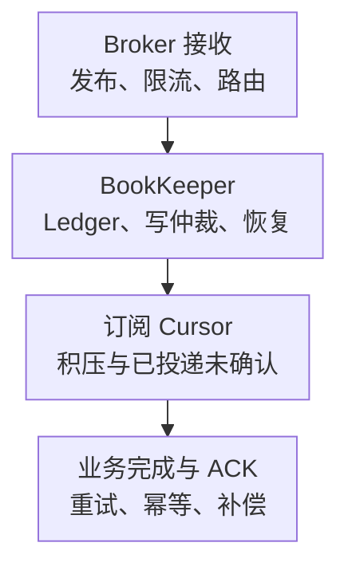

# Pulsar 核心监控指标采集与告警

Pulsar 将服务计算与持久化分开：Broker 管 Topic 和订阅，Bookie 保存 Ledger，Subscription Cursor 保存消费进度。Broker 能接请求、Bookie 能写入、消费者已 ACK、业务已提交，是不同的成功条件。

以下以 **Pulsar 4.0.0 传统 Prometheus 指标**为契约，不与另一套 OTel 命名混用，也不是生产版本推荐。基础约定见[监控指标地图](../../../sre/observability/01-主流组件监控指标地图.md)，示例 job 为 `pulsar-broker`。原生 cluster 表示 Pulsar 集群，应归一化为 `pulsar_cluster`，另用 target 标签 cluster 表示基础设施域，避免同名覆盖。

## 1. 三种积压必须分开



保留策略可以让已经 ACK 的数据仍占存储；批量发送又可能把多个 Message 放入一个 Entry。Entry 数、Message 数、字节数与等待年龄不能互相替代，跨这些单位算出的“消费完成时间”可能失真。

## 2. 接入清单

| 来源 | 必须覆盖 | 采集边界 |
| --- | --- | --- |
| Broker | 全部节点、Topic/Partition、关键订阅 | Topic owner 迁移后不能重复累计旧新节点 |
| BookKeeper | 全部 Bookie、可写状态、ADD/READ 错误与延迟、Journal/Ledger 磁盘 | Bookie 数量正常不保证故障域与写仲裁都满足 |
| 元数据服务 | 实际部署的元数据后端、连接与仲裁 | 不固定假设所有部署都只有 ZooKeeper |
| 客户端 | Publish/ACK 超时、处理成功、重试与业务年龄 | Broker 速率不是完整客户端体验 |
| 可选模块 | Geo-Replication、Offload、Functions、事务 | 只在启用时建立对应覆盖清单 |

Broker 通常从 Web 服务端口的 `/metrics` 抓取，BookKeeper 使用其 stats provider 端点，端口、TLS 和认证分别核对。不要把管理接口或任意多目标代理暴露到公网。

订阅指标要求 `exposeTopicLevelMetricsInPrometheus=true`；消费者明细还需核对对应配置。Topic、Partition、Subscription 和 Consumer 标签可能造成高基数，优先采关键 Namespace/订阅。以下查询要求 Topic 级采集，`topic!=""` 排除没有 Topic 维度的聚合样本。名称与配置见[4.0 指标说明](https://pulsar.apache.org/docs/4.0.x/reference-metrics/)。

## 3. 核心指标卡片

表中 C/G 表示业务语义上的累计量/当前量，不等同于所有原始 TYPE。此版本 Topic/Namespace 的[PrometheusMetricStreams](https://github.com/apache/pulsar/blob/v4.0.0/pulsar-broker/src/main/java/org/apache/pulsar/broker/stats/prometheus/PrometheusMetricStreams.java)在该输出路径统一写 Gauge header，累计 msgInCounter 也会如此。只有确认底层是单调累计计数后才用 rate；当前积压和预计算速率不能照做。

| 问题 | 指标 | 类型、单位与解释 |
| --- | --- | --- |
| 发布/分发速率 | `pulsar_rate_in`、`pulsar_rate_out` | G，已计算的 Message/秒，不能再次 rate |
| 累计接收量 | `pulsar_in_messages_total`、`pulsar_in_bytes_total` | C，Message/字节；先逐序列 rate 再聚合 |
| 订阅积压 | `pulsar_subscription_back_log` | G，未确认 Entry，批量时不是精确 Message 数 |
| 已投递未确认 | `pulsar_subscription_unacked_messages` | 当前未确认量，受分发、批量与 ACK 语义影响，不能等同完整业务在途数 |
| 消费者 | `pulsar_subscription_consumers_count` | G，连接到订阅的消费者数，存在不等于持续处理 |
| 确认/重投递 | `pulsar_subscription_msg_ack_rate`、`pulsar_subscription_msg_rate_redeliver` | G，预计算速率；重投递不等于唯一失败消息数 |
| 存储积压 | `pulsar_storage_backlog_size` | G，字节；与订阅 Entry 数不是同一单位 |
| 最老未确认年龄 | `pulsar_storage_backlog_age_seconds` | G，秒，Topic 级 best-effort 观测，不是某个订阅的精确业务年龄 |
| 配额驱逐 | `pulsar_storage_backlog_quota_exceeded_evictions_total` | C，次，含 quota_type；积压下降可能来自驱逐而非业务成功 |
| Bookie 可写 | `bookie_SERVER_STATUS` | G，1 可写、0 只读；要结合 Bookie 发现、仲裁与磁盘 |

TTL、延迟投递、保留、重试和 DLQ 会改变积压变化原因。主订阅积压下降但 DLQ/过期/驱逐增加，不应宣布业务恢复。

## 4. 源码分析与查询

[NamespaceStatsAggregator](https://github.com/apache/pulsar/blob/v4.0.0/pulsar-broker/src/main/java/org/apache/pulsar/broker/stats/prometheus/NamespaceStatsAggregator.java)从 Broker 内部统计读取 rate，并计算存储积压与最老未确认年龄；[TopicStats](https://github.com/apache/pulsar/blob/v4.0.0/pulsar-broker/src/main/java/org/apache/pulsar/broker/stats/prometheus/TopicStats.java)再按 Topic/订阅输出。指标名相似不代表粒度或单位相同。

当前发布速率直接读取 Gauge：

```promql
sum by (cluster, pulsar_cluster, namespace) (
  pulsar_rate_in{job="pulsar-broker",topic!=""}
)
```

累计接收量计算窗口速率：

```promql
sum by (cluster, pulsar_cluster, namespace) (
  rate(pulsar_in_messages_total{job="pulsar-broker",topic!=""}[5m])
)
```

两种速率的采样窗口不同，不要求每个时刻严格相等。Topic owner 必须唯一，不能因双路径采集把数据翻倍。保留分区身份的订阅积压保守视图：

```promql
max by (cluster, pulsar_cluster, namespace, topic, partition, subscription) (
  pulsar_subscription_back_log{job="pulsar-broker",namespace="app/orders"}
)
```

max 只适用于同一逻辑对象的重复状态观测，不代替修复陈旧 owner。启用拆分 Topic/Partition 标签时保留 partition；未拆分时 Topic 名本身已包含分区。Topic 最坏未确认年龄：

```promql
max by (cluster, pulsar_cluster, namespace, topic, partition) (
  pulsar_storage_backlog_age_seconds{job="pulsar-broker",topic!=""}
)
```

传统 `pulsar_storage_write_latency_le_*` 使用多个名字承载区间统计，不能自动套标准 `_bucket{le=...}` 的 histogram_quantile。先核对是否累计桶、窗口、单位和 +Inf；需要严格分布时选经过验收的原生直方图或客户端 instrumentation。

## 5. 示例告警与处置

对约定常驻消费的 payments 订阅，有积压且消费者为零持续 5 分钟才报警。批队列、计划暂停和维护窗口应另行制定策略：

```yaml
groups:
  - name: pulsar-subscription-core
    rules:
      - alert: PulsarSubscriptionWithoutConsumer
        expr: |
          (max by (cluster, pulsar_cluster, namespace, topic, partition, subscription) (
            pulsar_subscription_back_log{job="pulsar-broker",namespace="app/orders",subscription="payments"}
          ) > 0)
          and on (cluster, pulsar_cluster, namespace, topic, partition, subscription)
          (max by (cluster, pulsar_cluster, namespace, topic, partition, subscription) (
            pulsar_subscription_consumers_count{job="pulsar-broker",namespace="app/orders",subscription="payments"}
          ) == 0)
        for: 5m
        labels:
          severity: warning
        annotations:
          summary: "Pulsar 关键订阅有积压但没有消费者"
```

先检查消费者、权限、网络、订阅模式和 owner，再看 ACK、下游与 Bookie 读写。缺少消费者序列不会等价于零，需独立发现漏采。不能自动跳过 Cursor、清空积压或调高配额掩盖数据风险。

## 6. 掌握检查

1. 为什么 pulsar_rate_in 不再 rate？它已经是速率 Gauge。
2. 为什么多个订阅积压不能相加称作唯一消息数？同一个 Entry 可被多个订阅各自消费。
3. Broker 重启后消息还在，是否证明零 RPO？仍需核对 BookKeeper 仲裁、持久化、故障域和客户端确认边界。
4. 恢复标准是什么？业务年龄与成功率达标，游标推进、冗余与恢复余量正常，过期/驱逐/DLQ 均有解释。
