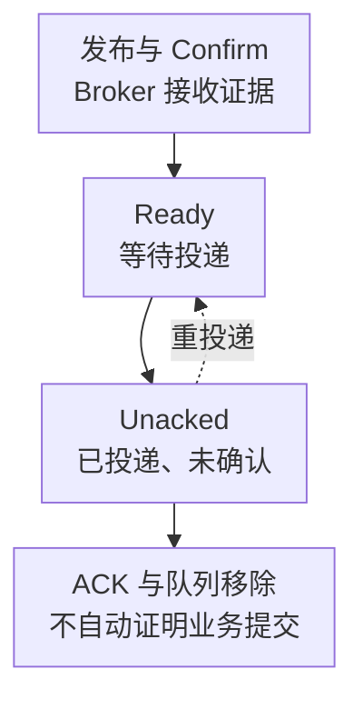

# RabbitMQ 核心监控指标采集与告警

RabbitMQ 的核心问题不是“队列长不长”，而是消息能否及时、安全地被业务完成。发布成功、Broker 接收、消息投递、消费者确认和业务提交是不同的里程碑，任何一层的吞吐都不能代替其他层的成功率。

本文以 **RabbitMQ 4.1.0 的内置 Prometheus 插件**为指标契约，不是生产版本推荐。Classic、Quorum、Stream 的存储与确认语义不同，Stream 的 offset/保留容量应另行检查。标签约定见[监控指标地图](../../../../sre/observability/01-主流组件监控指标地图.md)：`cluster` 是基础设施域，额外 target 标签 `rabbitmq_cluster` 唯一标识消息集群。

## 1. 从消息生命期理解指标



消费者提高 prefetch 后，Ready 可能下降而 Unacked 上升，消息只是搬到了消费者手中。只有结合业务完成量和消息年龄，才能判断积压是否真正消除。自动 ACK 下消息可以在业务执行前离开队列，队列清空尤其不能证明处理成功。

## 2. 接入时先决定粒度

内置插件通常在 HTTP 15692 暴露指标；TLS 端口与认证按部署配置验收。每个节点都要被发现，端点限制在监控网络，不将 Management API 凭据或抓取令牌写进仓库。

| 路径 | 粒度与成本 | 适合用途 |
| --- | --- | --- |
| `/metrics` | 默认将对象指标聚合到节点，成本较低 | 节点总量、内存、磁盘和告警水位 |
| `/metrics/per-object` | 输出大量逐对象指标 | 对象规模受控时的诊断，不能无预算全量开启 |
| `/metrics/detailed` | 显式选 family 和 vhost，默认不返回完整对象集 | 关键队列长期监控 |

例如只采 `orders` vhost 的待投递量和消费者数：

```yaml
scrape_configs:
  - job_name: rabbitmq-queues
    metrics_path: /metrics/detailed
    params:
      vhost: [orders]
      family: [queue_coarse_metrics, queue_consumer_count]
    static_configs:
      - targets: ['rabbit-a.example.internal:15692']
        labels:
          cluster: prod-a
          rabbitmq_cluster: orders-a
```

示例仅展示一个 target，实际需发现所有节点；另用 `job="rabbitmq"` 抓默认端点。增加投递/确认诊断时，显式增加 `queue_delivery_metrics`，不要假定上面的配置会产生投递指标。队列名、vhost 和临时队列会增加基数，要有允许列表和生命周期策略。端点行为见[4.1 官方指南](https://www.rabbitmq.com/docs/4.1/prometheus)。

## 3. 日常核心指标卡片

表中 C 表示累计计数，G 表示当前值；详细端点的前缀是 `rabbitmq_detailed_`，不能直接照搬默认端点的名称。

| 问题 | 指标 | 类型、标签与边界 |
| --- | --- | --- |
| 待投递 | `rabbitmq_detailed_queue_messages_ready` | G，消息数；`vhost,queue`，不是字节或消息年龄 |
| 已投递未确认 | `rabbitmq_detailed_queue_messages_unacked` | G，消息数；受 prefetch、处理速度和 ACK 策略影响 |
| 队列总量 | `rabbitmq_detailed_queue_messages` | G，Ready + Unacked；不要再把这三项相加 |
| 消费者 | `rabbitmq_detailed_queue_consumers` | G，连接到队列的消费者数；存在不等于持续处理 |
| 手动确认投递 | `rabbitmq_detailed_queue_messages_delivered_ack_total` | C，消息次；投递不等于 ACK |
| 自动确认投递 | `rabbitmq_detailed_queue_messages_delivered_total` | C，消息次；该名字不代表所有 ACK 模式的投递总和 |
| 确认 | `rabbitmq_detailed_queue_messages_acked_total` | C，消息次；业务是否先提交再 ACK 由应用协议决定 |
| 重投递 | `rabbitmq_detailed_queue_messages_redelivered_total` | C，消息次；可能是连接断开、NACK/requeue，不直接等于毒消息数 |
| 内存余量 | `rabbitmq_process_resident_memory_bytes`、`rabbitmq_resident_memory_limit_bytes` | G，字节；水位限制不是整个机器的物理内存 |
| 磁盘余量 | `rabbitmq_disk_space_available_bytes`、`rabbitmq_disk_space_available_limit_bytes` | G，字节；与数据目录所在文件系统关联 |
| 资源告警 | `rabbitmq_alarms_memory_used_watermark`、`rabbitmq_alarms_free_disk_space_watermark` | 暴露类型 Untyped，语义是当前状态：1 激活、0 未激活 |

资源告警可能导致发布被阻塞，应同时看发布延迟、连接 blocked 通知和 Confirm 超时。Quorum 还要关联成员可用性、leader、Raft/磁盘和多数派；只看磁盘空闲不能证明复制安全。

## 4. 源码分析：为什么同一张图不能随便换端点

[核心 collector](https://github.com/rabbitmq/rabbitmq-server/blob/v4.1.0/deps/rabbitmq_prometheus/src/collectors/prometheus_rabbitmq_core_metrics_collector.erl)分别定义 family、对象标签和聚合逻辑；详细端点给筛选后的对象指标加 `rabbitmq_detailed_` 前缀。默认聚合结果已经丢掉队列维度，查询里再写 `by(queue)` 无法恢复它。

[告警 collector](https://github.com/rabbitmq/rabbitmq-server/blob/v4.1.0/deps/rabbitmq_prometheus/src/collectors/prometheus_rabbitmq_alarm_metrics_collector.erl)将资源告警映射成 0/1，但取告警状态超时可能导致专项序列缺失。端点仍能被抓取不代表每个 collector 都正常，缺失不能补成 0。

同一逻辑队列可能因拓扑、采集路径或副本产生重复观测。下面用 `max by(cluster,rabbitmq_cluster,vhost,queue)` 展示关键队列的保守状态视图，前提是重复项确实代表同一个队列且没有历史残留。它不是计算精确集群消息总数的通用算法；精确总量必须先确认权威贡献者，不能把副本相加。

## 5. 查询：状态、流量和余量分开

关键队列 Ready 当前值：

```promql
max by (cluster, rabbitmq_cluster, vhost, queue) (
  rabbitmq_detailed_queue_messages_ready{job="rabbitmq-queues",vhost="orders",queue="payments"}
)
```

同一队列 Unacked 当前值：

```promql
max by (cluster, rabbitmq_cluster, vhost, queue) (
  rabbitmq_detailed_queue_messages_unacked{job="rabbitmq-queues",vhost="orders",queue="payments"}
)
```

手动 ACK 模式的每秒确认量，先逐序列处理重启，再聚合权威贡献者：

```promql
sum by (cluster, rabbitmq_cluster, vhost, queue) (
  rate(rabbitmq_detailed_queue_messages_acked_total{job="rabbitmq-queues"}[5m])
)
```

这里假设该 family 每个逻辑队列只有一个当前贡献者，未满足时先修正采集，不能用 `sum` 修复重复。内存占水位比例：

```promql
(
  rabbitmq_process_resident_memory_bytes{job="rabbitmq"}
  / rabbitmq_resident_memory_limit_bytes{job="rabbitmq"}
)
and (rabbitmq_resident_memory_limit_bytes{job="rabbitmq"} > 0)
```

磁盘高于阻塞水位的剩余字节：

```promql
rabbitmq_disk_space_available_bytes{job="rabbitmq"}
- rabbitmq_disk_space_available_limit_bytes{job="rabbitmq"}
```

剩余正数不等于还能安全运行很久；要关联增长速度、扩容时间、持久消息体和副本开销。消息年龄优先通过业务时间戳/处理完成时间测量，不把 `ready / ack_rate` 称为真实等待时间；该估算会被突发、停消费和不同消息成本打破。

## 6. 示例告警与判断路径

对约定必须常驻消费者的 `payments` 队列，Ready 大于 0 且消费者持续为 0 才触发。以下 5 分钟是教学策略，不适用于故意间歇消费的批队列：

```yaml
groups:
  - name: rabbitmq-queue-core
    rules:
      - alert: RabbitMQQueueWithoutConsumer
        expr: |
          (max by (cluster, rabbitmq_cluster, vhost, queue) (
            rabbitmq_detailed_queue_messages_ready{job="rabbitmq-queues",vhost="orders",queue="payments"}
          ) > 0)
          and on (cluster, rabbitmq_cluster, vhost, queue)
          (max by (cluster, rabbitmq_cluster, vhost, queue) (
            rabbitmq_detailed_queue_consumers{job="rabbitmq-queues",vhost="orders",queue="payments"}
          ) == 0)
        for: 5m
        labels:
          severity: warning
        annotations:
          summary: "关键队列有待投递消息但没有消费者"
```

第一步确认队列/vhost 是否正确、消费者部署和连接是否存在，然后查认证、网络、订阅错误和发布流量。消费者指标缺失不会触发这条规则，必须由独立覆盖检查发现；没有 Ready 时消费者为 0 则由服务常驻要求决定是否另报。

| 组合现象 | 优先判断 | 不能直接采取的动作 |
| --- | --- | --- |
| Ready 上升、ACK 低 | 消费不足、分流变化、路由或下游慢 | 不确认下游容量就无限增加消费者 |
| Ready 降、Unacked 高 | prefetch 迁移、长处理、ACK 丢失 | 不把 Ready 清零当作恢复 |
| 重投递高、业务成功低 | 重试循环、断连、毒消息与幂等 | 不盲目 requeue 或批量 ACK |
| 告警水位激活、发布超时 | 内存/磁盘阻塞传播到发布者 | 不先调高水位掩盖容量风险 |

## 7. 掌握检查

1. 为什么默认 `/metrics` 能看总量，却不能说明哪个队列积压？因为聚合时队列维度已丢失。
2. Ready 从一万降到零能否宣布完成？还要检查 Unacked、业务成功和最老未完成消息年龄。
3. 告警序列缺失是否表示资源安全？不是，要核对 collector、权限、超时和预期资产。
4. 为什么 Confirm 和业务 ACK 都不能实现端到端恰好一次？它们覆盖不同阶段，仍需幂等、事务边界与去重设计。

可从[学习路线](../00-RabbitMQ从零到精通学习路线.md)选择队列、确认与复制章节，运维流程见[监控、日志与 SLO](./11-Prometheus-Management-API-日志-告警与SLO.md)。
