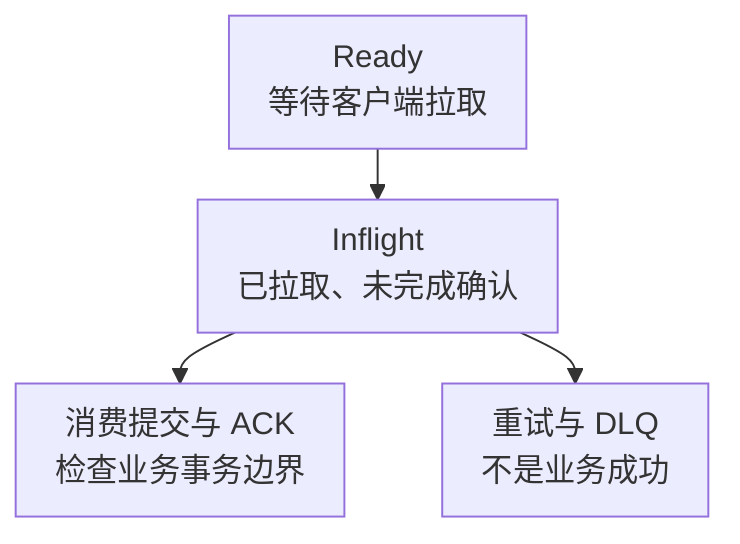

# RocketMQ 核心监控指标采集与告警

RocketMQ 的消费积压必须同时看“多少条”和“最老一条等多久”。同样十万条消息，在不同流量和消费成本下可能意味着几十秒或几个小时；Offset 追平也不自动证明下游事务完成。

本文固定 **RocketMQ 5.3.0 原生 OTel 指标实现**用于解释契约，不改变[学习路线](../00-RocketMQ从零到精通学习路线.md)的版本主线，也不是生产选型建议。其他 5.x、Proxy、云服务和旧独立 Exporter 的指标名可能不同，接入前以实际端点为准。基础约定见[监控指标地图](../../../../sre/observability/01-主流组件监控指标地图.md)。

## 1. 先区分消息在哪个阶段等待



这是监控上的概念分层，不是所有消费协议下都可严格相加的统一状态机。Push/Simple Consumer、顺序、定时和事务消息的可见性、重试与时间起点不同。业务完成年龄应由业务事件时间与完成回执定义。

## 2. 原生端点与标签契约

Broker 原生 Prometheus 导出示例：

```properties
metricsExporterType=PROM
metricsPromExporterPort=5557
```

按版本确认监听地址和网络策略。`PROM` 的抓取端点与 OTLP gRPC 接收器不是一种协议。Broker、Proxy、NameServer、Controller/复制角色各有观测职责，不能只采一个 Broker 就声称覆盖整个消息集群。

| 接入事项 | 要验证的边界 |
| --- | --- |
| 路径 | 原生 5.x 与旧独立 rocketmq-exporter 分开 job，不能将两套同义指标相加 |
| 身份 | `cluster` 保留基础设施域，`rocketmq_cluster` 标识 RocketMQ 集群；处理原生 `cluster` 的同名冲突 |
| 对象 | 保留 `node_id,node_type,topic,consumer_group,is_retry,is_system` 等实际标签 |
| 安全 | 端点限制监控网络，TLS/代理和凭据单独配置，不暴露消息内容 |
| 基数 | Topic/消费组允许列表；临时组、重试 Topic 和系统 Topic 不自动并入业务总量 |

Prometheus 默认 `honor_labels: false` 时，同名原生 `cluster` 可能变成 `exported_cluster`。应明确重命名为 `rocketmq_cluster`，或从服务发现写入一致的唯一标识；不要依赖隐式冲突结果来 join。以下示例统一使用归一化后的标签。

## 3. 核心指标卡片

表中列的是 **Prometheus 线上暴露名**，而不是仅列 Java instrument ID。C/G 分别表示累计计数/当前值。

| 问题 | 指标 | 类型、单位与含义 |
| --- | --- | --- |
| Broker 入/出消息 | `rocketmq_messages_in_total`、`rocketmq_messages_out_total` | C，消息次；重试和重复投递会改变与业务事件数的对应关系 |
| 数据吞吐 | `rocketmq_throughput_in_total`、`rocketmq_throughput_out_total` | C，字节；不是磁盘写放大后的物理 IO |
| 消费积压量 | `rocketmq_consumer_lag_messages` | G，消息数；按组/Topic/节点观察，确认重复副本贡献 |
| 最老未消费等待 | `rocketmq_consumer_lag_latency_milliseconds` | G，毫秒；不是请求耗时分位数 |
| 尚未拉取 | `rocketmq_consumer_ready_messages` | G，消息数；与客户端缓存和业务完成分开 |
| 已拉取未确认 | `rocketmq_consumer_inflight_messages` | G，消息数；受消费协议、可见性时间和 ACK 行为影响 |
| 最老未拉取等待 | `rocketmq_consumer_queueing_latency_milliseconds` | G，毫秒；与 lag latency 的时间边界不同 |
| 进入死信 | `rocketmq_send_to_dlq_messages_total` | C，消息次；需对应补偿与责任人 |
| 事务决议 | `rocketmq_commit_messages_total`、`rocketmq_rollback_messages_total` | C，消息次；不是所有业务事务数 |
| 半消息 | `rocketmq_half_messages` | G，消息数；结合事务回查、超时和业务决议 |

Broker 的存储刷盘、复制进度、磁盘容量和依赖 JVM/OS 是条件核心证据，具体名称随存储与 HA 实现核对；不要用流入字节代替刷盘完成或副本安全。

## 4. 源码分析：Lag 和单位到底从哪里来

[BrokerMetricsConstant](https://github.com/apache/rocketmq/blob/rocketmq-all-5.3.0/broker/src/main/java/org/apache/rocketmq/broker/metrics/BrokerMetricsConstant.java)定义 instrument ID，例如 `rocketmq_consumer_lag_latency`；[BrokerMetricsManager](https://github.com/apache/rocketmq/blob/rocketmq-all-5.3.0/broker/src/main/java/org/apache/rocketmq/broker/metrics/BrokerMetricsManager.java)把它注册成单位 `milliseconds` 的 Gauge。OTel Prometheus 导出增加单位后缀，因此抓取名是 `rocketmq_consumer_lag_latency_milliseconds`。照抄 instrument ID 会得到空图；把毫秒误当秒则会差一千倍。

[ConsumerLagCalculator](https://github.com/apache/rocketmq/blob/rocketmq-all-5.3.0/broker/src/main/java/org/apache/rocketmq/broker/metrics/ConsumerLagCalculator.java)分别获取最早未消费、最早未拉取消息时间戳，BrokerMetricsManager 的回调再以当前毫秒时间相减；没有取得相应时间戳时记录 0。因此 0 可能是没有适用消息，也可能没有可用时间证据，不能脱离 lag 数量和采集状态解释为业务完成。

定时消息的出生时间、可投递时间和实际处理时间不同；事务消息在决议前也不是普通 Ready 消息。这是指标需要结合消息类型的原因。[官方指标说明](https://rocketmq.apache.org/docs/observability/01metrics/)介绍 instrument 分类，实际导出还必须检查名称、单位、类型与标签。

## 5. 常用查询

业务 Topic 的每秒输入消息，排除系统对象：

```promql
sum by (cluster, rocketmq_cluster, topic) (
  rate(rocketmq_messages_in_total{job="rocketmq-broker",is_system="false"}[5m])
)
```

前提是每个节点贡献唯一数据且已处理 HA 副本重复。[SendMessageProcessor](https://github.com/apache/rocketmq/blob/rocketmq-all-5.3.0/broker/src/main/java/org/apache/rocketmq/broker/processor/SendMessageProcessor.java)的入站记录路径已排除重试/DLQ Topic，只附加 topic、message_type、is_system 等属性，不含 Lag 指标使用的 is_retry。把 `is_retry="false"` 机械复制到入站查询，会筛掉这些没有该标签的序列。

按消费组观察最坏等待秒数，不对时间 Gauge 使用 `rate`：

```promql
max by (cluster, rocketmq_cluster, topic, consumer_group) (
  rocketmq_consumer_lag_latency_milliseconds{job="rocketmq-broker",is_retry="false",is_system="false"}
) / 1000
```

消费量按逻辑分片贡献者求和，不能把备份副本、历史节点与当前节点不加区分地相加：

```promql
sum by (cluster, rocketmq_cluster, topic, consumer_group) (
  rocketmq_consumer_lag_messages{job="rocketmq-broker",is_retry="false",is_system="false"}
)
```

观察节点发生新死信事件：

```promql
sum by (cluster, rocketmq_cluster, topic, consumer_group) (
  increase(rocketmq_send_to_dlq_messages_total{job="rocketmq-broker"}[15m])
)
```

新死信数与 DLQ 当前存量不同；重置 Counter 由 `increase` 处理，但采集间隔中已经发生又重置的事件无法凭空恢复。不要 `rate(lag_messages)` 来声称消费吞吐，积压变化同时包含输入和处理两个方向。

## 6. 示例告警：数量与年龄同时存在

下面对普通业务消息设置教学阈值：最坏等待超过 60 秒，且组/Topic 确有积压，持续 5 分钟。实际阈值应来自业务数据新鲜度目标，重试/定时消息分别制定策略。

```yaml
groups:
  - name: rocketmq-consumer-core
    rules:
      - alert: RocketMQConsumerTooOld
        expr: |
          (max by (cluster, rocketmq_cluster, topic, consumer_group) (
            rocketmq_consumer_lag_latency_milliseconds{job="rocketmq-broker",is_retry="false",is_system="false"}
          ) > 60000)
          and on (cluster, rocketmq_cluster, topic, consumer_group)
          (sum by (cluster, rocketmq_cluster, topic, consumer_group) (
            rocketmq_consumer_lag_messages{job="rocketmq-broker",is_retry="false",is_system="false"}
          ) > 0)
        for: 5m
        labels:
          severity: warning
        annotations:
          summary: "RocketMQ 业务消费存在持续超龄积压"
```

先确认该组本来就应持续消费，再比较 Ready、Inflight、成功/失败日志和下游延迟。缺少年龄指标时，这条规则不判断健康；接入验收必须独立检查预期组、Topic 和 Broker 的覆盖。

| 现象 | 证据与下一步 |
| --- | --- |
| Ready 高、拉取低 | 查订阅、权限、负载均衡、客户端存活和网络，不先跳 Offset |
| Inflight 高、业务慢 | 查线程池、批量、超时与下游；扩消费者前确认下游容量 |
| Lag 低、DLQ 增长 | 消息可能失败后离开主队列，不能称作消费恢复 |
| 所有组突然变慢 | 查 Broker 磁盘、刷盘、复制、CPU/GC 和网络，再关联变更 |

Offset 重置会改变业务处理范围，死信重放可能重复产生副作用；二者均需审批、幂等与审计，不是告警自动恢复动作。

## 7. 掌握检查

1. 为什么官方表中的 latency 名在 Prometheus 找不到？先区分 instrument ID 与导出单位后缀，再查 job 和版本。
2. Lag 为零但死信增长说明什么？主队列进度不代表业务成功，需要补偿闭环。
3. Gauge 的 0 和缺失有什么区别？前者仍需解释时间戳边界，后者首先是覆盖问题。
4. 为什么不能用所有 Broker 的最大 lag 条数当总积压？最大值是最坏节点，不是分片总和；复制副本也不能被重复计入。

完整安全、升级和运维流程见[ACL、TLS、监控与迁移](./13-ACL-TLS监控Dashboard升级与跨集群迁移.md)。
