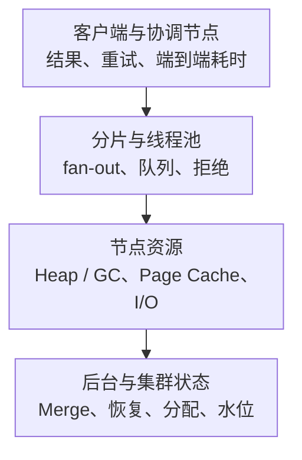

# Elasticsearch 核心监控指标采集与告警

Elasticsearch 的 green 主要描述分片分配状态，不代表查询够快、Bulk 每项写入成功或搜索结果足够新。监控必须同时覆盖用户结果、集群控制面、分片、节点资源与后台维护。

本文沿用 **Elasticsearch 9.x 的架构语义**，精确 Prometheus 名称按 **prometheus-community/elasticsearch_exporter v1.9.0** 的公共 stats 映射说明；不是宣称该旧 Exporter 已完整覆盖所有 9.x 功能。云/Serverless、OpenSearch、权限、版本和采集选项均需分别核对。通用查询规则见[指标地图](../../../../sre/observability/01-主流组件监控指标地图.md)。

## 1. 从请求到分片的监控层次



一条搜索请求可访问多个 Shard；节点 query count/time 的总和不天然等于 HTTP 请求总数/总耗时。Bulk 的外层 HTTP 成功也不代表每个 item 都成功，业务成功率必须检查 item 结果。

## 2. 采集范围与标签冲突

固定版本的 [README](https://github.com/prometheus-community/elasticsearch_exporter/blob/v1.9.0/README.md)列出 `--es.all`、indices、shards、snapshots 等选项。默认节点范围与全节点范围不同，应校对实际 `_nodes/stats` 返回和预期角色清单。全索引/分片采集可能显著增加请求量和基数，不应直接套“全部开启”。

使用只读监控角色和受控 API Key/TLS；不要为了抓取把安全关闭或授予写/删除索引权限。Prometheus `up` 只能证明抓取端点成功；每个 collector 的错误与 API 日志、缺失对象和业务探测都要看。

**本篇标签契约**：`cluster` 表示基础设施域，额外 target 标签 `es_cluster` 唯一标识 Elasticsearch 集群；节点原生标签为 `name`、`host` 等，线程池使用 `type`，GC 使用 `gc`，内存区域使用 `area`。

该 Exporter 自己也输出原生 `cluster` 标签。若 target 已设置同名标签且 `honor_labels: false`，Prometheus 会将冲突的样本标签改名为 `exported_cluster`。应明确保留/归一化策略，不要让同一条查询有时按基础设施集群、有时按 ES cluster_name 聚合。本文查询依赖已写入的 `cluster,es_cluster`，不能只设置 external_labels 就认为本地样本具备它们。

集群健康指标从多个 Exporter 返回时先去重；`--es.all` 的节点统计通常只需一个逻辑采集任务，不能每节点再抓一份全节点结果后求和。

## 3. 核心指标清单

| 对象 | v1.9.0 指标 | 类型、单位与关键维度 |
| --- | --- | --- |
| 集群状态 | `elasticsearch_cluster_health_status` | Gauge，one-hot；`color=green/yellow/red` |
| 分片 | `elasticsearch_cluster_health_unassigned_shards`、`active_primary_shards`、`relocating_shards` | Gauge，个；后两项完整名称加 `elasticsearch_cluster_health_` |
| 控制面任务 | `elasticsearch_cluster_health_number_of_pending_tasks`、`elasticsearch_cluster_health_task_max_waiting_in_queue_millis` | Gauge，项/毫秒；不是应用请求队列 |
| Heap | `elasticsearch_jvm_memory_used_bytes`、`elasticsearch_jvm_memory_max_bytes` | Gauge，字节；选择 `area="heap"` |
| GC | `elasticsearch_jvm_gc_collection_seconds_sum`、`elasticsearch_jvm_gc_collection_seconds_count` | Counter，秒/次；`gc` 标签，不是单次延迟分布 |
| 线程池 | `elasticsearch_thread_pool_queue_count`、`active_count`、`rejected_count`、`completed_count` | queue/active 为 Gauge，rejected/completed 为 Counter；完整名称加 `elasticsearch_thread_pool_`，维度 `type` |
| 查询阶段 | `elasticsearch_indices_search_query_total`、`elasticsearch_indices_search_query_time_seconds` | Counter，分片查询次数/累计秒 |
| 索引阶段 | `elasticsearch_indices_indexing_index_total`、`elasticsearch_indices_indexing_index_time_seconds_total` | Counter，操作次/累计秒；不是用户 Bulk 请求数 |
| 熔断 | `elasticsearch_breakers_tripped`、`estimated_size_bytes`、`limit_size_bytes` | tripped 为 Counter，其余 Gauge；完整名称加 `elasticsearch_breakers_`，维度 `breaker` |
| 磁盘 | `elasticsearch_filesystem_data_available_bytes`、`elasticsearch_filesystem_data_size_bytes` | Gauge，字节；`name,mount,path` |

名称、单位和标签实现见 [nodes.go](https://github.com/prometheus-community/elasticsearch_exporter/blob/v1.9.0/collector/nodes.go) 与 [cluster_health.go](https://github.com/prometheus-community/elasticsearch_exporter/blob/v1.9.0/collector/cluster_health.go)。不要仅按 `_count` 猜类型：队列 count 是当前值，拒绝 count 是累计值。

## 4. 颜色与分片：不要把 yellow 等同于不可用

```promql
max by (cluster, es_cluster) (
  elasticsearch_cluster_health_status{job="elasticsearch",color="red"}
)
```

状态通过 color 标签和 0/1 值表示，不是 0/1/2 的单个枚举。red 表示至少有主分片不可用，yellow 表示主分片已分配但副本未全部分配；实际影响还取决于业务索引和请求策略。green 不保证数据新鲜、所有请求成功或检索质量。

```yaml
groups:
  - name: elasticsearch-allocation-example
    rules:
      - alert: ElasticsearchPrimaryShardUnavailable
        expr: |
          max by (cluster, es_cluster) (
            elasticsearch_cluster_health_status{job="elasticsearch",color="red"}
          ) == 1
        for: 2m
        labels:
          severity: critical
        annotations:
          summary: "Elasticsearch 持续存在不可用主分片"
          action: "确定受影响索引并检查 allocation explain、节点、磁盘与恢复；勿自动强制分配旧副本"
```

两分钟是教学窗口，不是等待用户失败的依据；应用写入/搜索失败应另有更及时的告警。对 yellow，结合副本预算、故障域、预期维护与持续时间设预警。unassigned_shards 总量没有直接区分 primary/replica，定位需回到分片状态与 allocation explain。

## 5. 线程池、拒绝与请求放大

```promql
sum by (cluster, es_cluster, name, type) (
  rate(elasticsearch_thread_pool_rejected_count{job="elasticsearch"}[5m])
)
```

输出拒绝操作/秒。`type` 必须按实际池名称筛选；不要把旧 bulk 池名硬编码成所有新版本的写入路径，新版本可能有 write/write_coordination 等变化。队列用当前长度，拒绝用速率；队列满不是扩大 queue_size 的自动理由。

客户端重试会增加服务端工作，Bulk item 失败也可能隐藏在 HTTP 200 内。先查热点 Shard、分片 fan-out、批量大小、请求复杂度、GC 与存储，再决定限流或扩容；无限重试与大队列可能把短故障拖成持续长尾。

## 6. Heap、GC 与 Breaker

```promql
max by (cluster, es_cluster, name) (
  elasticsearch_jvm_memory_used_bytes{job="elasticsearch",area="heap"}
)
/
max by (cluster, es_cluster, name) (
  elasticsearch_jvm_memory_max_bytes{job="elasticsearch",area="heap"}
)
```

这是每节点 Heap 使用比例，保留节点身份，不用集群平均掩盖某台热点。Heap 并非进程全部内存，也不包含所有文件缓存和 native/直接内存；堆还空闲不代表没有 cgroup 或 Page Cache 压力。

```promql
sum by (cluster, es_cluster, name) (
  rate(elasticsearch_jvm_gc_collection_seconds_sum{job="elasticsearch"}[5m])
)
```

它反映累计 GC 时间的增长，不是全局“停止服务时间百分比”，也不给出单次 GC P99。需要同时看 Heap 回落、GC 次数、暂停日志、CPU 和用户延迟。节点统计如何定义各阶段见[Nodes Stats API](https://www.elastic.co/docs/api/doc/elasticsearch/operation/operation-nodes-stats)。

`rate(elasticsearch_breakers_tripped[5m])` 看触发增长，再按 breaker 分组。Breaker 是保护机制：估算值不等于全部真实内存，调大阈值可能把可控拒绝变成进程 OOM。

## 7. 分片耗时不是端到端搜索延迟

```promql
(
  sum by (cluster, es_cluster, name) (
    rate(elasticsearch_indices_search_query_time_seconds{job="elasticsearch"}[5m])
  )
  /
  sum by (cluster, es_cluster, name) (
    rate(elasticsearch_indices_search_query_total{job="elasticsearch"}[5m])
  )
)
and on (cluster, es_cluster, name)
(
  sum by (cluster, es_cluster, name) (
    rate(elasticsearch_indices_search_query_total{job="elasticsearch"}[5m])
  ) > 0
)
```

输出窗口平均分片 query 阶段秒数，不是 HTTP P99，也不包含完整协调/网络/fetch 路径。一个请求的多个分片可能并行执行，不能把所有分片时间相加解释为用户等待时间。

索引增长与写入速率同样要区分 primary、replica、重试与更新语义。搜索可见性由 refresh 等机制影响，持久化与快照是另外的边界，具体见[Refresh、Translog、Flush 与 Merge](../01-search-storage/05-Index-Refresh-Translog-Flush-Segment与Merge.md)。

## 8. 磁盘水位、后台任务与恢复

按节点与数据路径看 available/size，但一个设备上的多个 data path 不能重复相加当物理容量。`available` 与包含保留空间的 free 不同；迁移分片还需目标节点、恢复流量、临时空间和故障域预算。

low/high/flood-stage 水位还涉及百分比/字节、max headroom、角色与生效配置。不要硬编码“所有磁盘统一 85/90/95%”就宣布完成；应读取实际设置和 allocation explain，并监控增长与扩容交付时间。规则语义见[磁盘分配与水位设置](https://www.elastic.co/docs/reference/elasticsearch/configuration-reference/cluster-level-shard-allocation-routing-settings)。

条件核心还包括 Merge/Refresh/Flush、恢复进度、ILM、Snapshot/SLM、CCR 与证书：存在使用需求时纳入相应 API/采集器，不将默认节点 stats 误当全产品生命周期覆盖。Snapshot 最近成功还需结合恢复演练；副本和 green 都不是备份证据。

## 9. Dashboard 与验收题

首页按“客户端和 Bulk item 结果 → cluster/shard → 节点线程池 → Heap/GC/Breaker → 存储与后台工作”组织；保留节点、索引与变更时间线，避免全量索引标签无限增长。

**问：green 是否表示写入都成功、数据都可搜索？** 不是，它主要描述分配健康；需要 item 结果、新鲜度与客户端验证。

**问：搜索 query time/count 能得到请求 P99 吗？** 不能，只有平均阶段耗时，且计量对象通常是分片查询。

**问：线程池拒绝增加应先调大队列吗？** 不应默认如此。先查请求放大与瓶颈，否则只会增加等待和内存风险。
