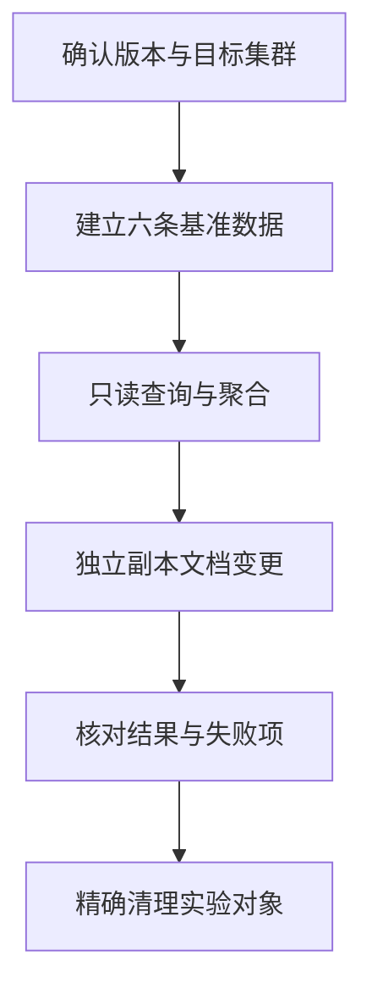

# Elasticsearch 命令与 API 操作导读

在 Elasticsearch 中，日常所说的“查询命令”多数是发给 HTTP API 的请求。`GET`、`POST` 是方法，`/_search` 是路径，JSON 中的 Query DSL 描述查询条件；它们不是直接粘贴到 Bash 就能执行的 Linux 命令。

本模块围绕常见开发与运维操作，使用同一组商品文档逐步演示请求、结果和错误。原理仍见 [Lucene 与请求路径](../01-search-storage/01-Elasticsearch-Lucene与一次请求的完整路径.md)和 [Query DSL 与 BM25](../01-search-storage/04-Query-DSL-BM25-Filter-Aggregation与Profile.md)。这里不复制全部官方端点和全部参数，而是把常用操作讲完整。

## 1. 按需求选择文章

| 需要完成的事 | 文章 | 主要接口或语法 |
| --- | --- | --- |
| 执行请求并建立数据集 | [请求、认证与实验数据](./01-HTTP请求认证响应与实验数据.md) | Console、curl、Mapping、Bulk、响应结构 |
| 按 ID 读写或批量写入 | [文档操作](./02-文档增删改查Bulk与并发控制.md) | `_doc`、`_create`、`_update`、`_mget`、`_bulk`、`_count` |
| 根据内容和条件查询 | [精确、全文与组合查询](./03-精确全文Bool与Nested查询.md) | term、terms、range、exists、match、bool、nested |
| 控制返回结果与翻页 | [排序、分页与高亮](./04-排序字段高亮分页与PIT.md) | sort、fields、highlight、search_after、PIT、`_msearch` |
| 分组统计或计算指标 | [聚合查询](./05-分组指标时间桶与Composite聚合.md) | terms、stats、date_histogram、cardinality、pipeline、composite |
| 修改字段、模板或索引入口 | [索引管理与迁移](./06-索引Mapping模板Alias与Reindex.md) | `_mapping`、`_settings`、template、alias、`_reindex` |
| 按条件修改很多文档 | [批量变更与任务控制](./07-按条件更新删除与异步任务控制.md) | `_update_by_query`、`_delete_by_query`、tasks、rethrottle |
| 查询集群状态与慢请求 | [集群诊断](./08-集群分片节点与慢查询诊断API.md) | health、CAT、allocation explain、stats、hot_threads、Profile |

备份和恢复继续使用 [SLM、Snapshot、CCR 专题](../04-security-operations/17-Elasticsearch-SLM-CCR与完整灾难恢复专项.md)，权限设计继续阅读 [TLS 与 RBAC](../04-security-operations/14-TLS-RBAC-API-Key审计与多租户安全.md)。

## 2. 版本与执行环境

示例面向自建 Elasticsearch 9.x，文档基线为 2026 年 11 月查阅的 9.5.6 稳定发行系列，采用常见 REST API。运行前用 `GET /` 保存实际版本，再检查该版本的支持情况；本模块不要求为学习而升级现有生产集群。[Elastic 发行说明](https://www.elastic.co/docs/release-notes)。

Kibana Console、Bash curl 和 SDK 是三种请求入口，不能混用它们的语法。Serverless、托管服务和不同权限账号可用的管理 API 也可能不同。请求返回 403 时先检查权限和服务边界，不通过关闭安全功能解决。

## 3. 固定实验数据，才能解释结果

先完成第 01 篇，建立 `es_api_lab_products_v1`，包含六条文档。查询与聚合文章默认这六条基准数据没有被修改。

文档操作使用额外的 `demo-*` 文档，演示后精确删除；批量更新删除使用单独的 `es_api_lab_mutation_v1` 副本。迁移实验写入 `es_api_lab_products_v2`。不要让前一篇的更新改变后一篇的预期结果。

图表示学习顺序，不是每个搜索请求的内部执行流程。

## 4. 根据副作用判断风险

| 操作 | 风险 | 需要注意 |
| --- | --- | --- |
| 小范围 `_search`、`_count` | 只读，但消耗资源 | 限定索引、字段、时间和返回数量 |
| Profile、hot_threads、大聚合 | 只读但可能昂贵 | 采样使用，不持续高频采集 |
| 建立 PIT | 创建临时搜索上下文 | 用完关闭，避免长期保留 Segment |
| 单文档写入、Bulk | 修改数据 | 检查每项结果、并发冲突和重试语义 |
| Reindex、按条件更新删除 | 大范围读写 | 先确认范围、备份、限速和结果对账 |
| 删除索引、强制分配旧主分片 | 高风险管理操作 | 不作为日常排障第一步 |

HTTP 方法不是风险等级。`POST _search` 可以只查询；`GET` 查询也可以消耗大量 CPU/Heap。不能看到 GET 就认为可以对整个集群无限次执行。

## 5. 从一次响应判断是否成功

先检查 HTTP 状态，再检查业务结构：搜索的 `timed_out`、`_shards.failed`，Bulk 的 `errors/items`，异步任务的 `completed/response/error`。HTTP 200 不是所有子操作都成功的证明。

结果为零时，依次检查索引/alias、时间范围、Mapping、分词、刷新可见性与权限。请求慢时，区分客户端总耗时、服务端 `took`、分片执行与节点资源；不要把所有问题归结为查询条件。

## 6. 练习与答案

**问题一：为什么不能把 `GET index/_search` 原样放到 Bash 中？**

答案：它是 Console 的 HTTP 请求记法。Bash 需要 curl 等客户端，并指定 URL、认证、方法和请求体。

**问题二：为什么所有文章使用同一数据集，却单独建立变更副本？**

答案：只读查询依赖固定数据。更新删除会改变命中数和聚合结果，独立副本可以让学习过程保持可重复。

**问题三：只读请求是否都安全且便宜？**

答案：不是。深分页、巨量聚合、Profile 和高频诊断可能占用 CPU、Heap、文件句柄与搜索上下文，只是不直接修改业务数据。

**问题四：本模块是否意味着掌握所有 Elasticsearch API 参数？**

答案：不是。它覆盖常见操作及关键边界；不常见端点、插件、托管服务和特定版本参数需要继续查对应文档。

## 7. 官方参考

- [Elasticsearch API 文档](https://www.elastic.co/docs/api/doc/elasticsearch/)
- [Query DSL](https://www.elastic.co/docs/reference/query-languages/query-dsl)
- [Elastic 发行说明](https://www.elastic.co/docs/release-notes)
