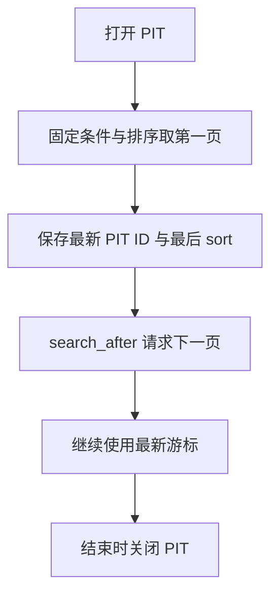

# Elasticsearch 排序字段高亮分页与 PIT

查对文档只是第一步。接口还要决定返回哪些字段、按什么顺序、一次返回多少，以及翻页时如何避免漏读和重复。**分页既依赖排序，也依赖查询期间的数据视图。**

以下使用 [六条基准文档](./01-HTTP请求认证响应与实验数据.md)。分页游标和 PIT ID 必须来自实际响应，不能把示意数字当作固定配置。

## 1. 控制返回字段，不等于改变查询

```http
GET es_api_lab_products_v1/_search
{"query":{"term":{"category":"gpu"}},"_source":["doc_id","name","price"],"size":3}

GET es_api_lab_products_v1/_search
{"query":{"term":{"category":"gpu"}},"_source":false,"fields":["doc_id","price",{"field":"created_at","format":"strict_date_time"}],"size":3}
```

第一项裁剪返回的 `_source`，第二项通过 `fields` 返回按 Mapping 理解的字段值，常表现为数组。它们都不改变命中条件，也不会永久删除其他字段。

`_source: false` 只表示不返回源文档，不保证取字段完全不读取 `_source`。`fields`、`docvalue_fields`、`stored_fields` 有不同取值路径与前提；需要直接读取可用 Doc Values 时才选择对应机制。字段裁剪更不是安全权限控制。

## 2. 明确排序字段与缺失值

```http
GET es_api_lab_products_v1/_search
{"query":{"match_all":{}},"sort":[{"price":{"order":"asc","missing":"_last"}},{"doc_id":"asc"}],"_source":["doc_id","price"],"size":6}
```

基准顺序是 p3、p6、p4、p1、p5、p2，对应价格 300、400、500、1200、1500、2000。第二字段 doc_id 为价格相同的文档提供稳定区分；跨多个索引时还要确保它在整个查询范围唯一。

不要默认对 text 字段或 `_id` 排序；优先使用合适的 keyword、numeric、date 字段。多值字段需要理解 sort mode，跨索引同名字段还可能类型冲突。按字段排序时 `_score` 可以不计算或返回 null，不代表搜索失败。[排序说明](https://www.elastic.co/docs/reference/elasticsearch/rest-apis/sort-search-results)。

## 3. from 与 size 适合有限的浅分页

```http
GET es_api_lab_products_v1/_search
{"query":{"match_all":{}},"sort":[{"price":"asc"},{"doc_id":"asc"}],"from":2,"size":2,"track_total_hits":true}
```

跳过前两条后，本页是 p4/p1，total 仍为 6。`from` 是跳过数量，不是页码；若每页 20 条，第三页的 from 是 40。

分布式查询的各分片通常需要处理 `from + size` 范围的候选，深度越大成本越高。常见默认 `index.max_result_window=10000` 是保护边界，不是鼓励调大后导出几百万条。交互分页、连续导出与随机跳页要分别设计。[分页官方说明](https://www.elastic.co/docs/reference/elasticsearch/rest-apis/paginate-search-results)。

## 4. search_after 传的是最后一条的排序值

游标不是最后一个 `_id`，而是响应里最后一条 hit 的完整 `sort` 数组，类型、数量与顺序都要保留。

只用 search_after 可以减少深 offset 的成本，但如果索引持续变化，文档的排序位置会变化。需要稳定视图时，将它与 Point in Time（PIT）配合使用；PIT 不阻止新写入，它为搜索保留相应视图。



## 5. PIT 的完整请求顺序

打开实验索引视图：

```http
POST es_api_lab_products_v1/_pit?keep_alive=1m
```

复制响应 `id` 后，在 `/_search` 使用它；使用 PIT 时不要再在请求路径指定索引：

```http
POST /_search
{"pit":{"id":"REPLACE_WITH_LATEST_PIT_ID","keep_alive":"1m"},"query":{"match_all":{}},"sort":[{"price":"asc"},{"doc_id":"asc"},{"_shard_doc":"asc"}],"size":2,"track_total_hits":false,"_source":["doc_id","price"]}
```

第一页应为 p3/p6。`_shard_doc` 是 PIT 范围的 tie-breaker；实际 hit.sort 可能类似下面结构，987 **只是示意**：

```json
{"_id":"p6","sort":[400,"p6",987]}
```

复制最后一条 hit 的真实完整数组，同时采用搜索响应中的最新 `pit_id`。下一页格式为：

```http
POST /_search
{"pit":{"id":"REPLACE_WITH_LATEST_PIT_ID","keep_alive":"1m"},"query":{"match_all":{}},"sort":[{"price":"asc"},{"doc_id":"asc"},{"_shard_doc":"asc"}],"search_after":[400,"p6",987],"size":2,"track_total_hits":false,"_source":["doc_id","price"]}
```

这里必须用真实 sort 替换示意数组，不能照抄 987。条件和排序保持不变，正确的第二页为 p4/p1，第三页为 p5/p2，直到 hits 为空。响应省略 total 是关闭精确计数的结果，不是丢失文档。

结束后关闭最新 PIT：

```http
DELETE /_pit
{"id":"REPLACE_WITH_LATEST_PIT_ID"}
```

`keep_alive` 只需覆盖两次请求之间的间隔，并由后续请求续期，不必一次覆盖整个导出时长。PIT 过期后不能假定原游标仍能无缝续用；新开 PIT 得到新视图，恢复策略需要考虑去重与一致性。长期 PIT 还会保留旧 Segment、消耗文件句柄和磁盘，务必关闭。

Scroll 仍有特定批处理用途，但普通深分页优先学习 PIT＋search_after；它不是任意页码随机跳转功能。

## 6. 高亮结果如何读取

```http
GET es_api_lab_products_v1/_search
{"query":{"match":{"name":"gpu"}},"_source":["doc_id","name"],"highlight":{"fields":{"name":{"number_of_fragments":0}},"encoder":"html","pre_tags":["<mark>"],"post_tags":["</mark>"]}}
```

高亮在 hit 的 `highlight.name` 中，不是改写 `_source.name`。本例匹配 p1/p2/p5；例如可能看到 `<mark>GPU</mark> server basic`。高亮片段不是查询布尔逻辑的完整证明，也不是新的评分结果。[高亮原理与限制](https://www.elastic.co/docs/reference/elasticsearch/rest-apis/highlighting)。

网页展示时仍需按应用安全策略处理标签与文本，不能把未受控内容当任意 HTML 注入。对所有大字段请求全文高亮也会显著增加取回和分析成本。

## 7. msearch 合并往返，不合并语义

```http
POST /_msearch
{"index":"es_api_lab_products_v1"}
{"query":{"term":{"category":"gpu"}},"size":0,"track_total_hits":true}
{"index":"es_api_lab_products_v1"}
{"query":{"term":{"category":"storage"}},"size":0,"track_total_hits":true}
```

与 Bulk 类似，正文是 header/body 成对的 NDJSON，末尾保留换行；curl 使用 `application/x-ndjson`。响应 `responses[0]`、`responses[1]` 对应两次查询，基准 total 分别为 3、2。

一个子查询可能失败而另一个成功，必须逐项检查；它不是一次关联查询，也不自动提供多个查询之间的共同快照。并发子查询增多仍会放大集群负载。[Multi search](https://www.elastic.co/docs/api/doc/elasticsearch/operation/operation-msearch)。

## 8. 练习与答案

**问题一：第二页 search_after 为什么不能只填 p6？**

答案：游标必须是最后一条 hit 的完整 sort 数组，与排序字段一一对应；ID 只是某个字段，不包含所有排序位置。

**问题二：PIT 是否会阻塞其他用户写入？**

答案：不会。它保留搜索视图，不是给业务索引加写锁，但会消耗保留历史 Segment 等资源。

**问题三：`_source: false` 能否作为字段权限隔离？**

答案：不能。它控制这次响应的内容，不是服务端授权；用户仍可能发其他请求，需要真正的权限策略。

**问题四：msearch HTTP 200 是否证明两个查询都成功？**

答案：没有。需要检查 responses 中每一项的状态、错误与搜索完整性，外层成功不代表每个子查询成功。

## 9. 官方参考

- [分页与 PIT](https://www.elastic.co/docs/reference/elasticsearch/rest-apis/paginate-search-results)
- [字段取回](https://www.elastic.co/docs/reference/elasticsearch/rest-apis/retrieve-selected-fields)
- [排序](https://www.elastic.co/docs/reference/elasticsearch/rest-apis/sort-search-results)
- [高亮](https://www.elastic.co/docs/reference/elasticsearch/rest-apis/highlighting)
- [msearch](https://www.elastic.co/docs/api/doc/elasticsearch/operation/operation-msearch)
