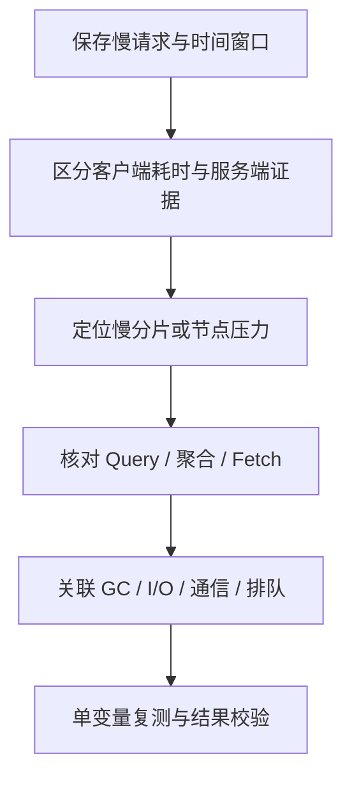

# Elasticsearch 集群分片节点与慢查询诊断 API

“ES 慢了”可能是查询本身、某个分片、节点内存/磁盘，或者客户端排队与网络。诊断要先保存请求、时间窗口和版本，再用接口把范围缩小，而不是一次执行所有管理操作。

本篇以只读诊断为主。Profile、hot_threads 和详细统计仍有成本，应限定采样窗口；不要为学习在生产制造红集群、取消陌生任务或强制分配旧主分片。

## 1. 先确定查询对象与影响范围

```http
GET /
GET /_cluster/health
GET /_cluster/health/es_api_lab_products_v1?level=shards
GET /_cat/indices/es_api_lab_products_v1?v&h=health,status,index,pri,rep,docs.count,store.size
GET /_cat/nodes?v&h=name,ip,node.role,master,heap.percent,ram.percent,cpu,load_1m
```

先保存 cluster_name、版本、节点角色和目标索引健康。green 表示相应主副分片都已分配，不证明请求满足 SLO；yellow 常见于副本未分配，不能直接等同完全不可用；red 表示有主分片未分配，仍要看具体请求涉及哪些数据。[Cluster health](https://www.elastic.co/docs/api/doc/elasticsearch/operation/operation-cluster-health)。

CAT 便于人工查看；自动化采集优先结构化统计 API。CAT 中的 docs.count 可包含 nested 隐藏文档，所以本模块的六条业务数据不一定显示为六个 Lucene 文档。[CAT indices](https://www.elastic.co/docs/api/doc/elasticsearch/operation/operation-cat-indices)。

## 2. 未分配分片先解释原因

```http
GET /_cat/shards/es_api_lab_products_v1?v&h=index,shard,prirep,state,node,unassigned.reason
GET /_cat/recovery/es_api_lab_products_v1?v&active_only=true
```

若实际发现 UNASSIGNED，复制对应 index、shard、primary 值再请求：

```http
POST /_cluster/allocation/explain
{"index":"REPLACE_WITH_UNASSIGNED_INDEX","shard":0,"primary":false}
```

这里是假设“副本分片 0 未分配”的格式示例，不是基准实验一定存在的故障。基准单节点零副本时不需要为了执行该请求而故意破坏分片。

看 `can_allocate`、`allocate_explanation` 和各节点的 deciders，分别判断磁盘水位、节点属性、tier、过滤条件、同节点副本或版本限制。[Allocation explain](https://www.elastic.co/docs/api/doc/elasticsearch/operation/operation-cluster-allocation-explain)。

先恢复真实约束，不首先执行 `allocate_stale_primary`、接受数据丢失或删除 data path。详细原理见 [分片分配与恢复](../02-cluster-data/07-Primary-Replica-Shard路由分配恢复与Rebalance.md)。

## 3. 节点统计、线程池与后台任务

```http
GET /_nodes/stats/jvm,process,fs,breaker,indices,thread_pool
GET /_cat/thread_pool?v&h=node_name,name,active,queue,rejected,completed
GET /_cluster/pending_tasks
GET es_api_lab_products_v1/_stats/search,indexing,refresh,merge,segments
```

| 观察项 | 如何解释 | 常见误读 |
| --- | --- | --- |
| JVM heap/GC | 看持续占用、回收与暂停，并关联工作负载 | Heap 低就排除所有内存问题 |
| Breaker | 估算/资源保护触发原因 | 等同操作系统 OOM |
| Thread pool queue | 某时刻等待队列 | 把 queue 当作累计请求数 |
| rejected/completed | 常见为累计计数，比较时间窗口内增量 | 只要历史 rejected 非零就认为当前故障 |
| fs 与索引 merge | 容量、I/O 与后台合并关联 | 删除文档后磁盘应立即下降 |
| pending_tasks | 集群状态相关待处理任务 | 等同用户搜索线程池队列 |

先查看当前版本实际线程池名称，不硬编码一套名称覆盖所有版本。`ram.percent` 是主机内存口径，不是 JVM Heap 百分比；Page Cache 与容器限额还要关联系统证据。具体指标见 [核心监控文章](../04-security-operations/18-Elasticsearch核心监控指标采集与告警.md)。

## 4. 热线程与长任务

```http
GET /_nodes/hot_threads?threads=3&type=cpu
GET /_tasks?actions=indices:data/read/search*&detailed=true&group_by=parents
```

hot_threads 是采样，不是完整 CPU 火焰图，也不能用一次采样排除间歇 GC、磁盘等待或网络问题。tasks 展示当前可见任务与父子关系；不是永久历史查询日志。

保存 task ID、action、running_time、cancellable 与追踪信息，避免查询内容泄漏。需要取消自己的请求时再使用 [异步任务篇](./07-按条件更新删除与异步任务控制.md)中的精确任务操作，不把全局任务列表接到批量取消脚本。

## 5. 先验证查询，再解释单文档评分

```http
POST es_api_lab_products_v1/_validate/query?explain=true
{"query":{"bool":{"filter":[{"term":{"category":"gpu"}}]}}}

POST es_api_lab_products_v1/_explain/p1
{"query":{"match":{"name":"gpu"}}}
```

Validate 用于检查查询是否合法及相关重写解释，不证明结果符合业务意图。Explain 用于“这条文档为什么匹配、分数如何组成”，不是完整请求性能分析。六条样例中 GPU 条件是否合法，与遗漏 status 条件导致返回 inactive p2，是两个不同问题。

出现零结果先回到 Mapping 与 `_analyze`；评分与召回关系见 [查询篇](./03-精确全文Bool与Nested查询.md)。

## 6. Profile 怎样使用才不误判

```http
GET es_api_lab_products_v1/_search
{"profile":true,"query":{"match":{"name":"gpu"}},"aggs":{"by_vendor":{"terms":{"field":"vendor","size":10}}},"size":3}
```

返回的 profile 按分片列出 Query/Collector、Aggregation 等执行信息；当前版本也可包含 Fetch 的分析部分。它不是从客户端开始到最后一个字节返回的完整 Trace。[Search Profile](https://www.elastic.co/docs/reference/elasticsearch/rest-apis/search-profile)。

父子执行器耗时可能包含嵌套关系，不要把所有 `time_in_nanos` 直接相加；多个分片可并行执行，也不能简单求和等同请求总耗时。Profile 自身增加开销，不能把开启它的请求当作正常业务压测结果。

比较客户端总时长、服务端 took、各分片执行、返回体积与节点指标。Profile 很快而请求很慢时，还要查排队、协调、网络、代理与客户端；即使 took 很小，也不能仅凭它精确锁定某一个环节。



## 7. 诊断与变更要分开

读取 Settings、诊断未分配原因、查询任务，不会自动修复它们。调整刷新/副本、修改水位、关闭索引、force merge、取消任务和恢复快照都属于变更，需要另外确认范围和后果。

备份只读观察可参考：

```http
GET /_slm/status
GET /_slm/stats
GET /_remote/info
```

这些能力取决于部署方式、权限和配套功能；接口不可用不应被解释成集群一定损坏。仓库、快照和 CCR 的完整请求见 [灾难恢复专项](../04-security-operations/17-Elasticsearch-SLM-CCR与完整灾难恢复专项.md)，不要在排查时临时恢复覆盖业务索引。

## 8. 练习与答案

**问题一：集群 green，为什么业务仍可能超时？**

答案：green 主要反映分片分配状态，不覆盖 CPU、GC、I/O、队列、查询成本、网络与客户端等全部服务质量因素。

**问题二：pending_tasks 很少，是否能证明搜索没有排队？**

答案：不能。它是集群状态相关任务的队列，搜索线程池和客户端连接池等需要分别观察。

**问题三：Explain 能否代替 Profile？**

答案：不能。Explain 关注单文档匹配与评分，Profile 分析搜索执行结构和耗时，二者目的不同。

**问题四：Profile 中出现 Fetch，为什么仍不是完整端到端耗时？**

答案：Fetch 分析只是服务端执行的一部分，无法覆盖全部请求排队、网络、协调与客户端处理；还存在并行和嵌套计时，不能直接求和。

## 9. 官方参考

- [Cluster health](https://www.elastic.co/docs/api/doc/elasticsearch/operation/operation-cluster-health)
- [Node stats](https://www.elastic.co/docs/api/doc/elasticsearch/operation/operation-nodes-stats)
- [Tasks](https://www.elastic.co/docs/api/doc/elasticsearch/operation/operation-tasks-list)
- [Search Profile](https://www.elastic.co/docs/reference/elasticsearch/rest-apis/search-profile)
- [故障排查](https://www.elastic.co/docs/troubleshoot/elasticsearch)
