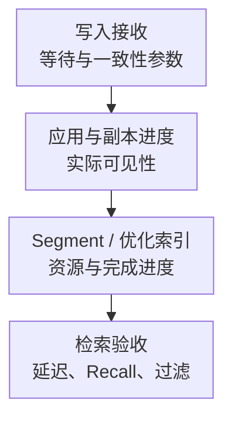

# Qdrant 核心监控指标采集与告警

Qdrant 接入监控后，要分别证明 API 能服务、写入的数据按预期可检索，以及召回质量没有退化。HTTP 200、向量数量增加、索引任务完成都不是 Recall 达标的充分条件。

以下固定 **Qdrant v1.14.0 原生 /metrics 实现**解释指标契约，不是生产版本推荐。后续版本、Cloud/Operator 指标与可配置前缀另行核对；不要把云平台的 `qdrant_*` 名称自动当作该版本原生指标。基础约定见[监控指标地图](../../sre/observability/01-主流组件监控指标地图.md)，示例 job 为 `qdrant`，target 标签 `qdrant_cluster` 标识部署。

## 1. 写入成功与检索完成度

Point 是带 ID、向量和 payload 的数据对象，Collection 定义一组数据及其向量配置。Shard 分布数据，Replica 复制 shard，Segment 则是节点内管理数据与索引的单元。分布到更多 shard 和保留更多副本会以不同方式改变物理计数与资源消耗。



图是验收层次，不表示只有建完 HNSW 才能搜索：部分未索引数据可能走其他搜索路径。数据量、过滤、named vectors、量化与 `indexed_only` 等策略都会改变吞吐、延迟和召回范围，必须固定查询参数再比较。

## 2. 接入与版本边界

按节点抓取 `:6333/metrics`，不能只抓一个随机转发的负载均衡地址；检查认证、TLS、网络限制与所有预期节点覆盖。`/telemetry`、集合信息和集群 API 提供诊断数据，但它们不是天然的 Prometheus 指标。

| 来源 | 用途 | 边界 |
| --- | --- | --- |
| 原生 /metrics | 请求、构建、内存和集群元数据 | 不一定包含逐 collection 的全部业务维度 |
| 集合/集群 API | points、索引、优化状态、shard 与 transfer | 按权限和频率采集；自定义导出要自有命名 |
| OS/容器 | RSS、文件缓存、CPU、磁盘、网络、OOM | allocator 内存不等于完整进程或容器记账 |
| 应用与评测 | 端到端延迟、写后可见时间、Recall、过滤正确性 | 固定数据、查询集、ground truth 和参数 |

当前[官方监控文档](https://qdrant.tech/documentation/ops-monitoring/monitoring/)还介绍后续版本的前缀与逐集合模式；这些能力不能反向套到 v1.14.0。升级时重新对照原始端点的名称、标签和样本范围。

## 3. 核心指标卡片

| 问题 | 固定版本指标 | 类型、单位与边界 |
| --- | --- | --- |
| 版本与恢复模式 | `app_info`、`app_status_recovery_mode` | G，信息/0 或 1；恢复模式不是普通业务就绪证明 |
| REST / gRPC 响应 | `rest_responses_total`、`grpc_responses_total` | C，响应次；只覆盖实现中的 endpoint 允许列表 |
| 失败响应 | `rest_responses_fail_total`、`grpc_responses_fail_total` | C，失败次；与 HTTP status、客户端失败口径分别检查 |
| 请求耗时 | `rest_responses_duration_seconds`、`grpc_responses_duration_seconds` | H，秒；展开为 bucket/sum/count，注意样本范围 |
| 摘要延迟 | `rest_responses_avg_duration_seconds`、min/max 对应项 | G，内部统计结果，不用 rate，不当作窗口 P99 |
| 集合/向量数 | `collections_total`、`collections_vector_total` | **G**，当前数量；名字带 total 不表示累计写入数 |
| 集群模式与成员 | `cluster_enabled`、`cluster_peers_total`、`cluster_voter` | G，状态/成员数；成员存在不代表所有 shard 可用 |
| 元数据进度 | `cluster_commit`、`cluster_term` | 暴露为 Counter 的位置/任期；不是用户写入完成量 |
| 元数据待处理 | `cluster_pending_operations_total` | **G**，当前待处理数量；不是向量索引积压量 |
| allocator 内存 | `memory_allocated_bytes`、`memory_active_bytes`、`memory_resident_bytes` | G，字节；并非 OS 全部 RSS，按平台支持核对 |

## 4. 源码分析与查询

[metrics.rs](https://github.com/qdrant/qdrant/blob/v1.14.0/src/common/metrics.rs)显式指定每个 MetricType，并将原始微秒转换成秒。因此不能凭 `_total` 判断 Counter，也不能再次把响应秒数除以一千。

该版本 REST 指标有 endpoint 白名单，并且只为 **status=200** 记录耗时直方图，其他状态仍可能有响应计数。只看 REST P99 可能漏掉失败/超时请求，必须与错误计数和客户端完整延迟并读。指标使用路由模板，不是任意原始 URL。

REST 响应速率，保留节点以便检查热点：

```promql
sum by (cluster, qdrant_cluster, instance) (
  rate(rest_responses_total{job="qdrant"}[5m])
)
```

REST HTTP 5xx 比例，与 fail_total 的定义分开；只对有足够样本的窗口计算：

```promql
(
  sum by (cluster, qdrant_cluster, instance) (rate(rest_responses_total{job="qdrant",status=~"5.."}[5m]))
  / sum by (cluster, qdrant_cluster, instance) (rate(rest_responses_total{job="qdrant"}[5m]))
)
and on (cluster, qdrant_cluster, instance)
(sum by (cluster, qdrant_cluster, instance) (rate(rest_responses_total{job="qdrant"}[5m])) > 1)
```

允许列表中成功 REST 响应的窗口 P99 秒数：

```promql
histogram_quantile(0.99,
  sum by (cluster, qdrant_cluster, instance, le) (
    rate(rest_responses_duration_seconds_bucket{job="qdrant",status="200"}[5m])
  )
)
```

不同 endpoint 的耗时分布差异很大，业务告警应进一步分 query/upsert 等请求类别，不把所有管理和业务请求混成一个 SLO。零流量的 NaN/缺失不是零延迟。

当前元数据待处理操作：

```promql
cluster_pending_operations_total{job="qdrant"}
```

不要对它求 rate 当作写入吞吐。`cluster_commit` 的推进只能说明集群元数据进展，不证明数据 shard 应用、索引和业务读取都追平。

## 5. 向量、索引与内存的判断边界

节点向量数可能受副本和 shard 分布影响，不能跨所有节点简单求和称为逻辑数据集大小。Point、dense/sparse/named vector、multi-vector 的数量也不是同一个单位。需要集合 API 和拓扑共同解释，索引数量与点数量不要求永远相等。

磁盘上的向量或索引仍可能通过 mmap 使用页缓存；allocator 指标低不代表内存压力低。结合 OS RSS、容器限额、回收压力、磁盘读放大和查询延迟，区分匿名内存与文件映射工作集。

Recall 需要代表性查询集和精确或可信 ground truth。只监控“搜索返回非空”无法发现量化参数、过滤、embedding 版本或数据可见范围变化造成的质量下降。

## 6. 示例告警与响应

对启用集群模式的节点，元数据待处理持续 10 分钟仍非零，提示检查进展；这不是数据索引滞后告警：

```yaml
groups:
  - name: qdrant-metadata-core
    rules:
      - alert: QdrantMetadataPending
        expr: |
          (cluster_pending_operations_total{job="qdrant"} > 0)
          and on (cluster, qdrant_cluster, instance)
          (cluster_enabled{job="qdrant"} == 1)
        for: 10m
        labels:
          severity: warning
        annotations:
          summary: "Qdrant 节点集群元数据操作持续待处理"
```

先核对节点、leader/voter、成员通信与元数据进度，再检查 shard 状态、transfer 和客户端影响。单机模式不适用；缺失序列由覆盖检查处理。不要直接删除 WAL、强行移除成员或重建集合。

## 7. 掌握检查

1. 为什么 collections_total 不能取 rate 作为新建集合速度？它是可能减少的当前数量 Gauge。
2. 为什么 REST 成功 P99 很低，用户仍可能大量失败？直方图样本范围不包含全部失败路径。
3. 为什么 Raft commit 推进不证明向量已可搜索？元数据一致性与数据/索引路径承担不同职责。
4. 如何宣布恢复？API、写后可见性、shard/副本状态、资源余量及固定查询集的质量都重新符合目标。
