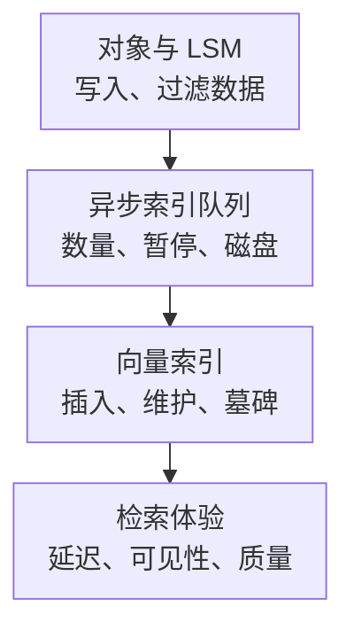

# Weaviate 核心监控指标采集与告警

Weaviate 的对象存储、倒排索引、向量索引和外部向量化服务不是同一条性能曲线。批量写入看似很快，向量索引可能仍有后台工作；搜索耗时增加，也可能来自向量化、过滤或生成服务，而不只是 HNSW。

以下以 **Weaviate v1.30.0 的原生 monitoring 实现**为指标契约，不是生产版本推荐。指标可能随 minor 版本发生不兼容变化，升级时需重新验收名称、类型和标签。基础约定见[监控指标地图](../../sre/observability/01-主流组件监控指标地图.md)，`job="weaviate"`，target 标签 `weaviate_cluster` 标识部署。

## 1. 写入与可查询性的分层

Collection 组织对象与向量，原生指标中的 class_name 延续历史命名，通常对应集合；shard_name 标识更细的数据分片。LSM 管理对象/倒排等存储，向量索引承担近邻检索，两者的容量、后台任务和耗时不能互相替代。



图针对启用异步索引的观测层次。队列消退不证明外部 embedding、复制或生成服务全部达标，检索路径与可见性还要结合实际配置和读写一致性检查。

## 2. 接入与基数预算

设置 `PROMETHEUS_MONITORING_ENABLED=true` 后通常在 `:2112/metrics` 暴露指标，端口可配置。按节点抓取，隔离网络并配置所需认证/TLS 入口，不假设数据 API 的认证策略自动保护监控端口。

| 事项 | 应验收的边界 |
| --- | --- |
| 版本 | 检查原始 TYPE、名称、单位与 namespace；不要盲用其他版本 Dashboard |
| 分片与租户 | 原生标签常有 class_name、shard_name；租户数增长会放大序列数量 |
| 分组配置 | `PROMETHEUS_MONITORING_GROUP` 可降低细粒度，但会改变可见维度；聚合后不能恢复单 shard 事实 |
| 后台能力 | 异步队列、压缩、备份等仅在相应能力启用时制定覆盖要求 |
| 端到端体验 | 客户端/网关延迟、embedding 与生成依赖、固定查询集 Recall 独立采集 |

本篇队列查询假设未合并 shard 维度；启用 group 后，应按实际标签和源码重新设计，不假设每条序列仍对应一个租户。配置说明见[官方监控文档](https://docs.weaviate.io/deploy/configuration/monitoring)。

## 3. 核心指标卡片

| 问题 | 指标 | 类型、单位与边界 |
| --- | --- | --- |
| 查询分布 | `queries_durations_ms` | H，**毫秒**，class_name/query_type；不直接等于网关或 embedding 总耗时 |
| 查询并发 | `concurrent_queries_count` | G，当前查询数，class_name/query_type |
| 请求状态 | `requests_total` | 此版本实际定义为 **GaugeVec**；不能因名称带 total 就当标准 Counter 模板使用 |
| 对象数量 | `object_count` | G，当前 shard 对象数；副本物理计数不直接等于逻辑对象总数 |
| 批处理量 | `batch_objects_processed_total` | C，处理对象次；重试/更新与唯一新增对象数分开 |
| 对象与索引分步耗时 | `objects_durations_ms`、`vector_index_durations_ms` | Summary，毫秒；分位数不跨节点直接平均 |
| 异步队列 | `queue_size`、`queue_disk_usage`、`queue_paused` | G，记录数/磁盘字节/暂停状态，class_name/shard_name |
| 队列处理分布 | `queue_partition_processing_duration_ms` | H，毫秒；单分区处理不是端到端导入年龄 |
| 索引容量 | `vector_index_size` | G，容量会预分配，不是精确已导入向量数 |
| 墓碑 | `vector_index_tombstones` | G，待清理墓碑数量；关联删除、清理进度和资源 |
| LSM 工作 | `lsm_active_segments`、`lsm_memtable_size` | G，按 strategy、class/shard/path 等维度；需要基数预算 |

Go 运行时、进程和 OS 指标补充 CPU、内存、GC、文件缓存与磁盘压力。LSM、向量索引和容器内存的范围不同，不能将它们各自的“使用量”机械相加。

## 4. 源码分析与查询

[prometheus.go](https://github.com/weaviate/weaviate/blob/v1.30.0/usecases/monitoring/prometheus.go)将查询时间注册为 HistogramVec，名称和桶采用毫秒；对象/索引分步时间则多为 SummaryVec。查询代码不能只按“都叫 duration”就混用。

同一个文件将 `requests_total` 注册成 GaugeVec。是否可以将某个 Gauge 解释成单调累计量，还需要更新路径的契约；本篇不依赖它计算错误率，业务成功/失败另由客户端或已核对的 API instrumentation 提供。

每秒被直方图记录的查询数：

```promql
sum by (cluster, weaviate_cluster, class_name, query_type) (
  rate(queries_durations_ms_count{job="weaviate"}[5m])
)
```

窗口查询 P99，结果显式转换为秒：

```promql
histogram_quantile(0.99,
  sum by (cluster, weaviate_cluster, class_name, query_type, le) (
    rate(queries_durations_ms_bucket{job="weaviate"}[5m])
  )
) / 1000
```

聚合时保留 query_type，不把不同检索模式混成一个目标。零流量没有有效分布，不能以 0 填补空图。Summary 的 quantile 也不能直接交给 histogram_quantile。

每个节点/shard 的当前队列：

```promql
queue_size{job="weaviate"}
```

批处理对象速率：

```promql
sum by (cluster, weaviate_cluster, instance, class_name, shard_name) (
  rate(batch_objects_processed_total{job="weaviate"}[5m])
)
```

这里保留节点维度，不将副本的物理处理次数误当作唯一新增对象数。导入年龄应通过业务时间戳或受控的写后查询探测测量，`queue_size / batch_rate` 不是严格的端到端等待时间。

## 5. 示例告警与容量判断

对本来应持续工作的异步索引队列，队列非空且暂停持续 5 分钟需要处理；计划暂停时应进入维护流程。示例保留同一个 shard 的对象键：

```yaml
groups:
  - name: weaviate-index-core
    rules:
      - alert: WeaviateIndexQueuePaused
        expr: |
          (queue_size{job="weaviate"} > 0)
          and on (cluster, weaviate_cluster, instance, class_name, shard_name)
          (queue_paused{job="weaviate"} == 1)
        for: 5m
        labels:
          severity: warning
        annotations:
          summary: "Weaviate 非空异步索引队列持续暂停"
```

先查是否人工暂停、维护/压缩、资源不足或后台任务错误，再检查队列磁盘与索引推进。队列非空本身不必立刻报警，短暂批量导入可能正常；持续增长、最老可见性年龄和服务 SLO 更有判断价值。

| 现象 | 优先关联 |
| --- | --- |
| 写入成功、检索覆盖不足 | 异步索引进度、写后可见探测、一致性配置和查询范围 |
| 索引容量很大、对象数不多 | 预分配、删除与墓碑、量化；不能直接认定重复数据 |
| 搜索快、结果质量差 | Recall/过滤正确性、embedding 版本、参数与量化，而不是只看 P99 |
| 某租户慢、整体正常 | shard 热点与租户分布；group 模式可能隐藏局部证据 |

不要因队列增长自动删除索引、强行清空队列或无限提高导入并发。先确认持久化、安全余量和可回滚的变更路径。

## 6. 掌握检查

1. 为什么 queries_durations_ms 的桶算完还要除以 1000？源码使用毫秒桶，Prometheus 不按名字自动换单位。
2. 为什么不能用 vector_index_size 当作精确向量数量？它包含容量预留，且物理副本和数据模型需分别解释。
3. 为什么两台机器的 Summary P99 不能平均？分位数不可直接合并，需要兼容桶或原始样本。
4. 恢复标准是什么？查询 SLO、可见性、队列与索引进度、磁盘/内存余量和固定评测质量共同达标。
