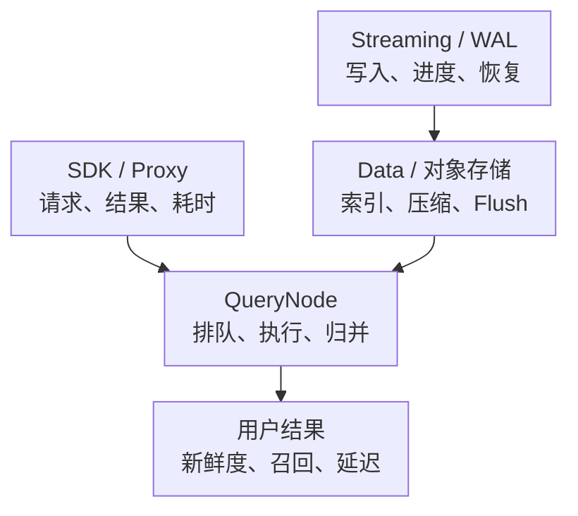

# Milvus 核心监控指标采集与告警

向量数据库不能只监控 CPU、内存和 QPS。一次 search 可以包含多个查询向量，写入成功不等于所有一致性模式下立刻可查，服务没有错误也不等于召回质量正确。

本文以 **Milvus v3.0.0 源码指标契约**为基线，与本系列 3.x 架构主线对应；它不是对所有 2.x 部署的无差别配置。升级需同步核对指标、状态标签、角色和 Dashboard。特别是 `cause` 标签、旧 collection latency 指标与后台任务指标存在版本差异。通用接入约定见[指标地图](../../../../sre/observability/01-主流组件监控指标地图.md)。

## 1. 沿查询和写入路径分层



这是监控关联图，不表示所有查询都要同步等待一次 Flush 或索引构建。Growing、Sealed 与不同一致性设置有不同路径；原理见[Segment、索引与数据路径](../00-Milvus从零到精通学习路线.md)。

## 2. 采集对象与接入条件

- 按部署发现所有应运行角色的原生 metrics 端点，而不是只抓 Proxy Service 后的一个随机 Pod。分布式与 Standalone 的角色/进程布局不同，按实际清单验收。
- 固定 `cluster` 和 Milvus 部署标识（本文约定额外 target 标签 `milvus_cluster`），保留 `node_id`、Pod 与角色标签。一个 Kubernetes 集群内可能部署多套 Milvus。
- 通常通过管理/监控端口暴露 `/metrics`，端口值以镜像与配置为准；metrics/管理端口只允许受信监控访问，不对公网暴露。
- 对 etcd、WAL 实现、对象存储和主机分别接入其原生/专用监控；Milvus `up` 不能代替依赖健康。
- 记录版本和采集样本基线。分层指标可能只有发生对应请求、创建 Collection 或启用某项能力后才出现，不用全局填零遮盖差异。

Collection、用户、字段、channel 等标签会随规模增长；不要再叠加原始查询向量、完整 filter、请求 ID 或任意业务标签。高基数与敏感查询内容更适合受控日志/Trace，而不是长期 metrics。

## 3. 核心指标清单

下表 C/G/H 分别表示 Counter/Gauge/Histogram。Histogram 的 `_bucket`、`_sum`、`_count` 按经典直方图规则使用。

| 维度 | v3.0.0 指标 | 类型/单位与关键标签 |
| --- | --- | --- |
| Proxy 请求 | `milvus_proxy_req_count` | C，次；`node_id,function_name,status,cause,db_name,collection_name` |
| gRPC 处理 | `milvus_proxy_grpc_latency` | H，**毫秒**；`node_id,function_name,status,cause` |
| 成功查询 | `milvus_proxy_sq_latency` | H，毫秒；`node_id,query_type,db_name,collection_name` |
| 成功搜索向量 | `milvus_proxy_search_vectors_count` | C，向量个数；`node_id,db_name,collection_name`，不是请求数 |
| 成功写入向量 | `milvus_proxy_insert_vectors_count` / `upsert_vectors_count` | C，向量个数；后者完整名称加 `milvus_proxy_` |
| 成功变更耗时 | `milvus_proxy_mutation_latency` | H，毫秒；`msg_type` 区分操作 |
| 查询排队 | `milvus_querynode_sq_queue_latency` | H，毫秒；`node_id,query_type,db_name,rg` |
| 核心执行 | `milvus_querynode_sq_core_latency` | H，毫秒；`node_id,query_type` |
| 查询归并 | `milvus_querynode_sq_reduce_latency` | H，毫秒；`node_id,query_type,reduce_level,reduce_type` |
| Segment 加载 | `milvus_querynode_load_segment_latency` | H，毫秒；`node_id` |
| 已加载 Segment | `milvus_querynode_segment_num` | G，个；`node_id,collection_id,segment_state,segment_level` |
| 消费进度线索 | `milvus_querynode_consume_tt_lag_ms` | G，毫秒；`node_id,msg_type,collection_id`；具体路径是否上报需按运行模式确认 |
| 后台任务 | `milvus_datacoord_task_num_in_scheduler` | G，个；`task_type,task_state` |
| Compaction | `milvus_datacoord_compaction_task_num` | G，个；`node_id,compaction_type,status` |

定义分别见 [Proxy metrics](https://github.com/milvus-io/milvus/blob/v3.0.0/pkg/metrics/proxy_metrics.go)、[QueryNode metrics](https://github.com/milvus-io/milvus/blob/v3.0.0/pkg/metrics/querynode_metrics.go)、[DataCoord metrics](https://github.com/milvus-io/milvus/blob/v3.0.0/pkg/metrics/datacoord_metrics.go)。这些是源码角色前缀，不要求存在同名独立 Pod；例如新架构中的角色可能合并运行。

## 4. 源码分析：请求、结果和向量数量为什么不能混用

### 4.1 total 与结果状态是两条计数

在 [`UnaryRequestStatsInterceptor`](https://github.com/milvus-io/milvus/blob/v3.0.0/internal/distributed/proxy/request_interceptor.go) 中，请求进入时增加 `status="total"`，处理结束后再增加一个结果状态，并记录一次 gRPC latency。定义中的状态包括 success、fail、rejected、cancel、retry 等；不同路径还可能有专门计数，不能把所有 status 相加当请求总量。

`cause` 与 status 正交：`user`、`system`、`cancel` 帮助区分输入/权限问题、系统问题和客户端放弃。没有有效 cause 的状态可能为空；升级旧版规则时要核对，不能把 `status!="success"` 全当失败，因为它还会选中 total。

```promql
sum by (cluster, milvus_cluster, function_name) (
  rate(milvus_proxy_req_count{job="milvus",status="total"}[5m])
)
```

这是特定入口/函数的服务端请求尝试速率，不是去重后的用户操作数。客户端重试可能产生多次请求，REST 与 gRPC 也不能无条件相加。业务侧仍需记录最终结果和重试次数。

### 4.2 搜索向量数是 nq，不是 QPS

[`Proxy.search` 的实现](https://github.com/milvus-io/milvus/blob/v3.0.0/internal/proxy/impl.go)在成功结果路径上累加返回的查询向量数量，并观察成功搜索耗时。若一次请求包含 100 个查询向量，向量速率可以是请求速率的 100 倍。

```promql
sum by (cluster, milvus_cluster, db_name, collection_name) (
  rate(milvus_proxy_search_vectors_count{job="milvus"}[5m])
)
```

输出向量/秒。不能把它直接命名为“请求 QPS”，也不能把成功向量数除以所有请求数得到错误率。容量评估应同时记录请求速率、nq、top-k、过滤选择性、向量维度与并发。

## 5. 延迟：毫秒、成功样本与分层诊断

### 5.1 指标卡：成功 Search 的 P99

```promql
histogram_quantile(0.99,
  sum by (cluster, milvus_cluster, db_name, collection_name, le) (
    rate(milvus_proxy_sq_latency_bucket{job="milvus",query_type="search"}[5m])
  )
) / 1000
```

结果转换为秒。毫秒的依据不仅是名字/文档，还包括埋点使用 `.Milliseconds()` 与[公共 bucket 定义](https://github.com/milvus-io/milvus/blob/v3.0.0/pkg/metrics/metrics.go)。`sq` 是 search/query，不是 SQL 数据库语句。

这条成功样本 P99 可能在大量请求失败时看起来很好；必须同时看结果状态和 SDK 端到端延迟。gRPC latency 含不同结果状态，可按 function/status 拆分，但同样不包含 SDK 排队、网络和所有客户端重试时间。

### 5.2 指标卡：QueryNode 排队 P99

```promql
histogram_quantile(0.99,
  sum by (cluster, milvus_cluster, node_id, query_type, rg, le) (
    rate(milvus_querynode_sq_queue_latency_bucket{job="milvus"}[5m])
  )
) / 1000
```

保留节点和资源组，先找局部热点。排队升、core latency 稳定，偏向到达速率/并发/调度资源问题；core latency 升则继续分析索引、过滤、Segment、CPU/内存或远端读取。归并时间升还需看 top-k、结果规模与 fan-out。

Proxy、QueryNode、segment/core/reduce 的观测范围不同，有并发和嵌套关系。它们的 P99 **不能相加**；要还原一次慢请求，应使用 Trace 或关联日志，在同一次请求内分解关键路径。

## 6. 错误告警：显式选择结果状态

```yaml
groups:
  - name: milvus-request-example
    rules:
      - alert: MilvusSearchHardFailures
        expr: |
          (
            sum by (cluster, milvus_cluster) (
              rate(milvus_proxy_req_count{job="milvus",function_name="Search",status=~"fail|rejected"}[5m])
            )
            /
            sum by (cluster, milvus_cluster) (
              rate(milvus_proxy_req_count{job="milvus",function_name="Search",status="total"}[5m])
            ) > 0.01
          )
          and on (cluster, milvus_cluster)
          (
            sum by (cluster, milvus_cluster) (
              rate(milvus_proxy_req_count{job="milvus",function_name="Search",status="total"}[5m])
            ) > 1
          )
        for: 5m
        labels:
          severity: warning
        annotations:
          summary: "Milvus Search 硬失败/拒绝比例持续升高"
          action: "先按 cause、Proxy、数据库和 Collection 分组，关联 SDK 错误、限流与组件日志"
```

1%/5 分钟/1 次每秒是教学参数，应按用户 SLO 和低流量保护调整。此分子不含 cancel/retry 等所有非成功结果，不应命名为“最终用户失败率”；它也会包含用户错误，应通过 cause 与日志区分告警路由。系统 cause 的失败更适合进入基础设施值班；参数、权限等 user 错误可能应通知调用方。

从未出现过的结果状态可能没有序列。若要显示为零，可在**已确认 total 存在、采集健康且标签契约有效**的基础上按相同对象键补零；不能用全局零替代缺失的服务监控。

## 7. 写入、后台任务与数据可见性

写入至少看三件事：API 是否成功、处理链是否推进、按业务一致性要求何时可查。Insert 向量速率/成功变更延迟只覆盖第一部分。

`consume_tt_lag_ms` 可提供某些消费路径的时间进度线索，但它不是所有 Collection 的完整端到端新鲜度 SLI，时钟异常也可能影响时间差。不同 3.x 运行模式、Streaming/WAL 路径是否更新某指标，应校对原始端点与对应日志，不能要求所有模式都暴露相同旧路径指标。

更贴近业务的新鲜度检查，是由受控任务写入带版本/时间标记的测试数据，再按实际读路由、一致性模式和查询条件确认可见，测量成功与时间。注意测试数据清理、权限和吞吐预算，避免监控探测本身变成负载源。

后台任务看队列深度、状态、完成进度和失败；新版本优先核对 scheduler/task 指标，不能继续把已标 Deprecated 的 `milvus_datacoord_index_task_count` 当唯一事实。持续非零不必然异常，**有工作且长时间不推进**更值得处理：

- 索引任务积压：关联 DataNode 资源、对象存储、构建参数和失败重试；
- Compaction 积压：关联 Segment 数量、数据增长、删除比例、存储空间与任务推进；
- 加载变慢：关联 load latency、对象存储下载、内存预算、缓存与副本迁移。

## 8. 容量、依赖与召回质量

`milvus_querynode_segment_num` 是节点已加载视图；同一 Segment 的多个副本会重复出现，求和不是全局唯一 Segment 数或磁盘唯一占用。Collection/entity 数也应先明确逻辑数据、物理副本、Growing/Sealed 与删除可见性的口径。

依赖最低清单：

| 依赖 | 必须补充的证据 | 与 Milvus 的关联 |
| --- | --- | --- |
| etcd | quorum/leader、fsync/commit、配额与探测 | 元数据、控制操作和状态收敛 |
| WAL/Streaming | 使用的实现、写入失败、持久化/消费进度、容量 | 写入可用、恢复与新鲜度 |
| 对象存储 | 请求错误、读写延迟、吞吐、容量、认证 | Segment/索引加载、Flush、Compaction |
| 节点/容器 | CPU/PSI、内存与 limit、磁盘/网络、重启 | 查询和后台任务的资源上限 |

Recall@K、NDCG、MRR 不能从 CPU 和请求成功率推导。即使存在 recall 相关内部计数，也不等于自动完成固定数据集与 ground truth 的质量评估。应把数据/Embedding/索引/检索参数版本与评测结果绑定，具体方法见[Benchmark 与 Recall](./13-Milvus-Benchmark-Recall监控与性能调优.md)。

## 9. Dashboard 与验收题

首页按“SDK 结果 → Proxy 请求与成功延迟 → QueryNode 排队/执行 → 数据可见性与后台进度 → 资源和依赖”排列，保留部署、节点、数据库与 Collection 的下钻关系。只看一张集群均值可能掩盖单 Collection 热点和资源组隔离问题。

**问：每秒 20000 个向量查询，能否证明服务支持 20000 QPS？** 不能；需知道每请求 nq，且区分请求尝试、成功请求和向量数。

**问：Proxy 成功 P99 降低，能否证明服务改善？** 不能；慢请求可能已经大量失败，或客户端重试时间增加，应同时看结果分布和 SDK 端到端耗时。

**问：插入成功、节点健康，但新数据查不到，先加 QueryNode 吗？** 先检查一致性、读路由、写入/消费进度、Collection 与过滤条件；容量不是唯一解释。

**问：集群全绿但 Recall 下降，监控是否足够？** 不够。服务健康、数据新鲜和检索质量是三个独立目标，都需要自己的证据。
