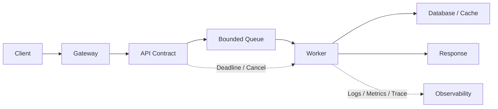

# 软件开发学习路线：从程序执行到可靠服务

Python、Go 或 Java 的语法只是表达工具。真正决定一个程序能否长期运行的是：数据怎样建模，依赖怎样隔离，错误怎样传播，并发怎样收敛，接口怎样演进，以及故障发生后能否定位。

本模块包含跨语言的软件开发主干，以及 Java、Spring Framework 和 Spring Boot 等具体技术系列。通用原理解释设计和资源边界，语言与框架系列通过可运行程序说明具体实现：

```text
源代码
→ 编译/解释、链接、装载与 Runtime
→ 数据结构、算法与资源成本
→ 模块、接口、依赖与错误模型
→ HTTP/gRPC 契约
→ 并发、背压、超时与取消
→ 配置、启动、健康检查与优雅退出
→ 测试、调试、Profiling 与性能验证
```

## 1. 目录结构

```text
development/
├── 00-软件开发学习路线.md
├── 01-foundations/
│   ├── 01-程序从源码到进程.md
│   ├── 02-数据结构算法复杂度与成本模型.md
│   └── 03-模块接口依赖与错误模型.md
├── 02-services/
│   ├── 01-HTTP-gRPC与API契约设计.md
│   ├── 02-并发异步背压与取消.md
│   └── 03-服务生命周期配置健康检查与优雅退出.md
├── 03-quality/
│   ├── 01-测试体系契约测试与故障注入.md
│   └── 02-调试Profiling与性能工程.md
├── java/                  # Java 与 JVM
│   ├── 00-Java与JVM学习路线.md
│   ├── 01-language/       # 语言、类型与面向对象
│   ├── 02-standard-library/ # 标准库、集合与 I/O
│   ├── 03-concurrency/    # 线程、并发与任务执行
│   ├── 04-jvm/            # JVM、内存与执行机制
│   ├── 05-build-testing/  # 构建、依赖与测试
│   └── 06-diagnostics/    # 诊断、性能与故障排查
├── spring/                # Spring Framework
│   ├── 00-Spring学习路线.md
│   ├── 01-container/      # IoC、Bean 与容器生命周期
│   ├── 02-aop-transactions/ # AOP、代理与事务
│   ├── 03-web/            # Servlet、MVC、异步通信与 WebFlux
│   └── 04-internals/      # 容器、代理、事务、Web 与测试源码
└── spring-boot/           # Spring Boot
    ├── 00-SpringBoot学习路线.md
    ├── 01-startup-configuration/ # 启动、依赖、自动配置与属性绑定
    ├── 02-web/            # HTTP、DTO、校验、流式通信与客户端
    ├── 03-data/           # JDBC、连接池、ORM、迁移与事务消息箱
    ├── 04-integrations/   # Redis、Kafka、RabbitMQ、任务与服务发现
    ├── 05-security/       # 过滤器、Session、JWT、OIDC 与多租户
    └── 06-production/     # 测试、观测、部署、容量、排障与升级
```

“程序设计基础”解释代码为何能运行以及如何划分边界；“服务与并发”解释多请求环境中的协议和生命周期；“质量与性能”解释如何证明程序正确、如何找到瓶颈。

Java 系列从工具链、类型和对象开始建立语言基础；Spring 系列沿容器、代理、事务与请求调用链理解框架；Spring Boot 系列将这些能力组织成可测试、可部署、可观测的服务。三个系列共有 126 篇技术正文与 3 篇路线文章，目录按实际专题组织。

| 技术系列 | 入口 | 起点 |
| --- | --- | --- |
| Java 与 JVM | [Java 与 JVM 学习路线](./java/00-Java与JVM学习路线.md) | JDK 安装、源文件执行、变量、对象和 Maven 工程 |
| Spring Framework | [Spring 学习路线](./spring/00-Spring学习路线.md) | 对象装配、生命周期、代理、事务与 Web |
| Spring Boot | [Spring Boot 学习路线](./spring-boot/00-SpringBoot学习路线.md) | 启动、配置、接口、数据、安全与生产运行 |

## 2. 学习顺序

| 阶段 | 文章 | 完成后的能力 |
| --- | --- | --- |
| 1 | [程序从源码到进程](./01-foundations/01-程序从源码到进程.md) | 区分编译、链接、装载、Runtime、系统调用和进程地址空间 |
| 2 | [数据结构、算法、复杂度与成本模型](./01-foundations/02-数据结构算法复杂度与成本模型.md) | 不只会写出结果，还能估算 CPU、内存、I/O 和扩容成本 |
| 3 | [模块、接口、依赖与错误模型](./01-foundations/03-模块接口依赖与错误模型.md) | 把变化隔离在边界，让调用方能够按错误语义做决定 |
| 4 | [HTTP、gRPC 与 API 契约设计](./02-services/01-HTTP-gRPC与API契约设计.md) | 设计可演进、可重试、可分页、可观测的远程接口 |
| 5 | [并发、异步、背压与取消](./02-services/02-并发异步背压与取消.md) | 区分并行与并发，控制队列、资源和取消传播 |
| 6 | [服务生命周期、配置、健康检查与优雅退出](./02-services/03-服务生命周期配置健康检查与优雅退出.md) | 让服务能可靠启动、接流量、排空和退出 |
| 7 | [测试体系、契约测试与故障注入](./03-quality/01-测试体系契约测试与故障注入.md) | 用分层测试证明关键契约和失败路径 |
| 8 | [调试、Profiling 与性能工程](./03-quality/02-调试Profiling与性能工程.md) | 用证据区分 CPU、锁、内存、I/O、队列和下游瓶颈 |

## 3. 与语言文章的关系

本模块回答“原理和设计为什么这样做”，语言模块回答“具体怎样实现”：

| 目标 | Python | Go |
| --- | --- | --- |
| 项目与依赖 | [解释器、虚拟环境、项目与依赖](../automation/python/01-language-project/01-解释器虚拟环境项目与依赖.md) | [工具链、Module、项目与依赖](../automation/go/01-工具链Module项目与依赖.md) |
| 类型和模块 | [类型、数据模型、函数、类与模块](../automation/python/01-language-project/02-类型数据模型函数类与模块.md) | [类型、接口、错误与包边界](../automation/go/02-类型接口错误与包边界.md) |
| 并发 | [线程、进程、asyncio 与有界并发](../automation/python/03-concurrency-quality/07-线程进程asyncio与有界并发.md) | [Goroutine、Channel 与内存模型](../automation/go/03-Goroutine-Channel与内存模型.md) |
| API | [HTTP API 客户端与可靠调用](../automation/python/02-cli-api-remote/06-HTTP-API客户端与可靠调用.md) | [Context、并发与可靠 HTTP 客户端](../automation/go/04-Context并发与可靠HTTP客户端.md) |
| 测试 | [pytest、Mock、契约测试与故障注入](../automation/python/03-concurrency-quality/11-pytest-Mock契约测试与故障注入.md) | [日志、指标、测试、Race 与 Fuzz](../automation/go/09-日志指标测试Race与Fuzz.md) |

同一原则会因 Runtime 不同而有不同实现。例如 Python `asyncio` 的取消通过异常传播，Go 通常通过 `context.Context` 和 Channel 协作；两者都不能依靠“杀掉线程”安全地回收任意业务状态。

## 4. 一次请求中的开发知识



这条路径同时涉及：

1. API 是否准确表达资源、错误和幂等语义；
2. 请求是否带 Deadline，取消是否能传播到数据库或上游；
3. 队列是否有上限，过载时是等待、拒绝还是降级；
4. Worker 是否正确管理事务、锁、连接和临时对象；
5. 结果是否能通过请求 ID、Trace 和结构化错误关联；
6. 服务退出时是否停止接流量并等待已接收请求结束。

## 5. 四种必须分开的正确性

| 类型 | 核心问题 | 典型失败 |
| --- | --- | --- |
| 功能正确性 | 输入是否得到预期输出 | 分支遗漏、边界值错误 |
| 并发正确性 | 多个执行单元同时运行是否仍正确 | Race、死锁、重复处理 |
| 分布式正确性 | 超时、重试、重复消息下是否仍正确 | 重复扣款、状态分叉 |
| 运维正确性 | 发布、扩缩容、重启和故障时是否可恢复 | 不优雅退出、配置漂移 |

单元测试通过只证明了有限样例中的功能行为，不能自动证明其他三类正确性。

## 6. 推荐的练习项目

建立一个“异步任务服务”，不要先堆框架：

```text
POST /jobs          创建任务，使用 Idempotency-Key
GET  /jobs/{id}     查询状态
DELETE /jobs/{id}   请求取消
GET  /health/live   进程是否存活
GET  /health/ready  是否可接收任务
```

逐步加入：

- 固定容量队列和并发 Worker；
- Deadline、取消传播与优雅退出；
- 状态机和幂等键唯一约束；
- OpenAPI/Protobuf 契约；
- 单元、集成、契约和故障注入测试；
- RED 指标、结构化日志和 Trace；
- CPU、Heap、Lock 与 I/O Profile。

同一项目分别用 Python 和 Go 实现一次，重点比较 Runtime、错误、取消和内存行为，而不是比较语法长短。

## 7. 掌握标准

- [ ] 能画出源文件到运行进程的完整路径。
- [ ] 能为主要数据结构写出时间复杂度和空间成本。
- [ ] 能说明模块公开契约、内部实现和依赖方向。
- [ ] 能区分 HTTP 方法幂等性与业务幂等性。
- [ ] 能区分超时、Deadline、取消和事务回滚。
- [ ] 能为队列、连接池、线程/Goroutine 和结果集设置上限。
- [ ] 能解释 Liveness、Readiness 与 Startup Check 的不同。
- [ ] 能让测试覆盖失败、重试、并发和部分成功。
- [ ] 能用 Profile 证明瓶颈，而不是按 CPU 利用率猜测。
- [ ] 能把一次失败关联到代码版本、配置、请求和依赖。

## 8. 练习与答案

### 8.1 练习 1：会 Python 和 Go，是否可以跳过本模块？ {/* #练习-1会-python-和-go是否可以跳过本模块 */}

答案：不建议。语言熟练度不能替代 API 语义、并发边界、服务生命周期和验证方法。会写 Goroutine 不代表会做背压；会发 HTTP 请求不代表知道哪些请求能够自动重试。

### 8.2 练习 2：为什么不按 Web、CLI、Operator 分三套基础文章？ {/* #练习-2为什么不按-webclioperator-分三套基础文章 */}

答案：它们共享构建、数据结构、模块、错误、并发、测试和性能原则。先建立共同主干，再在 Python、Go、Kubernetes Controller 等模块学习具体实现，可以减少重复和概念分叉。

### 8.3 练习 3：一个服务能返回正确结果，为什么仍可能不适合生产？ {/* #练习-3一个服务能返回正确结果为什么仍可能不适合生产 */}

答案：它可能没有资源上限、Deadline、取消、健康检查、优雅退出、可观测性和回归测试。在低并发正常路径上正确，不等于在过载、发布和依赖故障中仍可控。

## 9. 参考资料

- [GCC：编译过程与输出阶段](https://gcc.gnu.org/onlinedocs/gcc/Overall-Options.html)
- [RFC 9110：HTTP Semantics](https://www.rfc-editor.org/rfc/rfc9110.html)
- [OpenAPI Specification](https://spec.openapis.org/oas/)
- [gRPC Guides](https://grpc.io/docs/guides/)
- [Go Documentation](https://go.dev/doc/)
- [Python Documentation](https://docs.python.org/3/)
