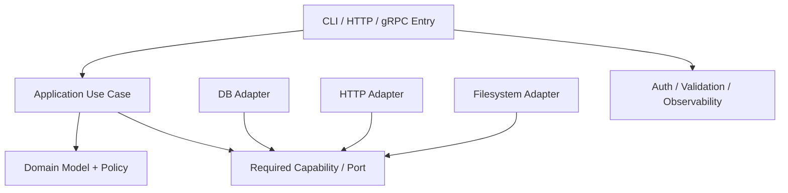

# 模块、接口、依赖与错误模型：让代码能够演进

代码能运行不代表边界合理。一个函数同时读取环境变量、访问数据库、拼 HTTP 请求、重试并打印日志，短期看起来方便，长期会让配置、协议和业务规则互相污染。

模块化的目标不是制造更多目录和接口，而是让变化停在应该变化的地方。

## 1. 模块边界回答四个问题

1. 这个模块负责什么，不负责什么；
2. 调用方可以依赖哪些稳定行为；
3. 它需要哪些外部能力，由谁提供；
4. 失败时向调用方表达什么语义。

```text
调用方只看到：输入类型 + 输出类型 + 错误契约 + 副作用
模块内部拥有：算法 + 存储细节 + 客户端 + 重试细节
```

如果调用方必须知道模块内部表结构、HTTP 状态码、临时文件路径和 SDK 异常层次，边界已经泄漏。

## 2. 高内聚与低耦合

### 2.1 Cohesion（内聚）

同一模块中的代码应该围绕同一变化原因。例如“任务状态转换”属于领域规则；“把任务写入 PostgreSQL”属于持久化适配。二者可能协作，但不必混在同一函数。

### 2.2 Coupling（耦合）

耦合不能消失，只能被控制。重点是依赖什么：

| 依赖对象 | 稳定性 | 影响 |
| --- | --- | --- |
| 小而明确的业务契约 | 较高 | 容易替换实现 |
| 巨型框架对象/全局容器 | 较低 | 测试和升级被框架绑住 |
| 具体数据库 Schema | 受迁移影响 | 业务层被存储细节污染 |
| 环境变量和单例 | 隐式依赖 | 无法从函数签名看出需求 |

低耦合不等于所有函数都创建接口。对稳定的纯函数和内部值对象，直接依赖通常更清晰。

## 3. 分层不是按技术名建文件夹

推荐先区分责任：



| 层次 | 负责 | 不应该负责 |
| --- | --- | --- |
| Entry/Transport | 协议解析、认证、输入映射、响应映射 | 数据库事务细节 |
| Application | 编排一次 Use Case、事务边界、权限策略 | HTTP Header、SQL Driver 细节 |
| Domain | 状态、不变量、计算规则 | 读取环境变量、发网络请求 |
| Adapter | 数据库、HTTP、文件、消息具体实现 | 决定业务状态转换 |

层数不是固定的。小工具可以合并层次，但依赖方向仍应清楚。

## 4. Interface（接口）是契约，不是语法

一个接口至少包含：

- 输入输出的类型和约束；
- 是否有副作用；
- 是否线程安全/并发安全；
- 是否可能阻塞；
- Timeout/Cancel 怎样生效；
- 错误分类和重试条件；
- 所有权与资源释放责任；
- 兼容性承诺。

只写：

```text
Store.Save(job) error
```

还不能回答：重复保存是覆盖、冲突还是成功？超时后操作是否可能已经提交？错误是否可重试？调用方能否并发调用？

## 5. 接口应该由使用方需要定义

如果业务只需要：

```text
LoadJob(id)
SaveResult(id, expectedVersion, result)
```

就不应把完整 ORM/Database Client 传入领域层。较小的 Consumer-oriented Interface 有三个好处：

1. 调用方的需求可见；
2. 测试替身只实现必要行为；
3. 数据库替换不会扩散到所有业务代码。

但每个函数一接口会造成 Indirection 爆炸。只有存在跨边界副作用、多个实现、独立测试或明显变化轴时才值得抽象。

## 6. Dependency Injection 不是某个框架

依赖注入只是由外部把依赖交给对象/函数：

```python
class JobService:
    def __init__(self, store, clock, id_generator):
        self.store = store
        self.clock = clock
        self.id_generator = id_generator
```

优点是依赖显式，可在测试中替换。代价是组合根需要负责构造顺序和生命周期。

```text
Composition Root
├── Config
├── Logger / Telemetry
├── DB Pool
├── HTTP Client
├── Repository Adapters
└── Application Services
```

不要在领域函数内部偷偷读取全局 Config 或创建客户端；这会绕过生命周期、连接池和测试边界。

## 7. 数据模型要表达不变量

弱模型把所有字段都表示成 String/Map：

```text
status = "runningg"
timeout = "abc"
gpu_count = -2
```

强模型在边界解析并尽早拒绝无效状态：

```text
JobStatus = Pending | Running | Succeeded | Failed | Cancelled
Timeout   = positive duration within configured maximum
GpuCount  = non-negative integer
```

状态机还要明确允许的 Transition：

```text
Pending → Running → Succeeded
                 └→ Failed
Pending/Running → Cancelled
Succeeded -X→ Running
```

不变量应该由唯一边界维护，不能让任意 Controller 直接修改任意字段。

## 8. DTO、Domain Model 与 Persistence Model

三者可以字段相似，但责任不同：

| 模型 | 面向 | 变化原因 |
| --- | --- | --- |
| Request/Response DTO | API 契约 | 协议版本、兼容性 |
| Domain Model | 业务规则 | 不变量和状态机 |
| Persistence Model | 存储 | Schema、索引、迁移 |

直接复用同一个结构会让数据库新增内部列意外进入 API，或 API 可选字段破坏领域不变量。无需机械复制所有对象，但跨稳定性边界时应显式映射。

## 9. 错误需要分类

调用方需要根据错误决定下一步，而不是解析字符串：

| 类别 | 含义 | 常见处理 |
| --- | --- | --- |
| Invalid | 输入永远不成立 | 修正请求，不重试 |
| NotFound | 目标不存在 | 返回 404/NOT_FOUND 或建立新状态 |
| Conflict | 版本/唯一约束冲突 | 重新读取并完成更高层操作 |
| Unauthenticated | 身份不可验证 | 获取凭据 |
| PermissionDenied | 身份已知但无权 | 不盲目重试 |
| ResourceExhausted | 配额/容量耗尽 | 退避、限流或扩容 |
| Unavailable | 短暂不可用 | 满足幂等前提后退避重试 |
| Internal/DataLoss | 不变量破坏或数据损坏 | 告警、隔离、人工处理 |

错误对象应保留 Cause Chain 和机器可判定 Code，同时提供安全的外部 Message。内部 SQL、Token、文件路径和 Stack 不应直接返回客户端。

## 10. Wrap 与 Translate

### 10.1 Wrap

在不丢失底层原因的情况下增加上下文：

```text
load job 42: query primary store: connection reset
```

### 10.2 Translate

跨模块边界时把底层错误转换为稳定语义：

```text
UniqueViolation(job_id)
→ JobAlreadyExists
→ HTTP 409 / gRPC ALREADY_EXISTS
```

不要让业务层根据 PostgreSQL 错误字符串或某 SDK Class 做决策，否则更换实现会破坏业务代码。

## 11. 重试属于哪一层

重试应由最了解操作语义且能控制预算的一层负责：

- Driver 可重试安全的连接建立；
- Client Adapter 可对幂等读取做受限退避；
- Application 才知道一次完整事务是否能重放；
- Gateway 的通用重试不能替代业务幂等。

多层都重试会形成放大：

```text
Gateway 3 次 × Service 3 次 × DB Client 3 次 = 最多 27 次下游尝试
```

应有单一 Deadline、Retry Budget、Backoff + Jitter 和可观测的 Attempt Count。

## 12. 资源生命周期也是接口

数据库连接、文件、锁、临时目录、Goroutine 和后台 Task 都有所有者：

```text
Create/Open
→ Use
→ Commit/Publish（可选）
→ Close/Cancel/Join
→ Observe result
```

需要明确：

- 谁创建，谁关闭；
- Close 是否幂等；
- 关闭能否阻塞，最大多久；
- 失败是否仍释放资源；
- 后台任务由谁取消和等待；
- Process Exit 是否可能跳过 Cleanup。

依靠 GC 最终关闭 Socket/File 不是可靠生命周期管理。

## 13. 版本兼容

接口演进的基本策略：

- 优先添加 Optional Field，而非改变旧字段语义；
- Reader 忽略未知字段，Writer 不擅自写新语义给旧服务；
- 删除字段经历 Deprecated、停止写、停止读、最终移除；
- 数据库 Migration 与应用 Rollout 要支持新旧版本重叠；
- Event Schema 不能假设所有消费者同时升级；
- 接口行为变化需要契约测试和变更说明。

Source Compatibility、Binary Compatibility、Wire Compatibility 和 Behavior Compatibility 是不同问题。

## 14. Code Review 的边界检查

审查模块时依次问：

1. 业务不变量在哪里维护；
2. I/O 和副作用是否集中在 Adapter；
3. 依赖是否从高层规则指向抽象契约；
4. 错误是否保留 Cause 又不泄露实现；
5. Timeout、Cancel、Retry 是否有唯一预算；
6. 资源创建和关闭是否成对；
7. 并发安全和所有权是否写进契约；
8. 新旧版本是否能在滚动发布期间共存；
9. 是否能不启动真实外部系统验证核心规则。

## 15. 常见误区

### 15.1 文件夹多就是分层架构

如果所有层都直接依赖 ORM 和全局 Config，只是把耦合分散到更多文件。

### 15.2 所有实现前都加接口

没有变化轴和测试边界的接口只增加跳转成本。抽象应来自调用方需要，不来自模板。

### 15.3 捕获所有异常再返回 `false`

这会丢失不可重试、权限、冲突和数据损坏等语义，使上层只能盲目重试或静默失败。

### 15.4 Repository 等于 CRUD 包装器

Repository 应围绕领域所需的聚合读取和原子变更，不必逐项暴露底层表的全部 CRUD。

## 16. 练习与答案

### 16.1 练习 1：为何把数据库 Client 直接传给所有 Service 会扩大耦合？ {/* #练习-1为何把数据库-client-直接传给所有-service-会扩大耦合 */}

答案：每个 Service 都能依赖任意查询、事务和 Schema 细节，领域不变量分散；测试必须模拟巨型 Client。传入面向 Use Case 的小契约可以限制能力和变化范围。

### 16.2 练习 2：超时错误为什么不能直接视为“操作失败”？ {/* #练习-2超时错误为什么不能直接视为操作失败 */}

答案：调用方只是没有在 Deadline 前得到结果，服务端可能已经提交。写操作必须通过幂等键、状态查询或版本检查确认结果，不能无条件重放。

### 16.3 练习 3：什么时候不需要把 DTO 和 Domain Model 分开？ {/* #练习-3什么时候不需要把-dto-和-domain-model-分开 */}

答案：小型、生命周期短、边界完全一致且无独立不变量时可以共用。但一旦 API 兼容、内部状态或持久化 Schema 有不同变化节奏，就应显式映射。

### 16.4 练习 4：为什么 Close 最好是幂等的？ {/* #练习-4为什么-close-最好是幂等的 */}

答案：错误路径、Deferred Cleanup 和上层收敛逻辑可能重复调用。幂等 Close 能简化所有权交接，但仍需记录首次关闭失败和未完成工作。

## 17. 参考资料

- [Python：异常、上下文管理与资源生命周期](../../automation/python/03-异常上下文管理与资源生命周期.md)
- [Go：类型、接口、错误与包边界](../../automation/go/02-类型接口错误与包边界.md)
- [gRPC：Status Codes](https://grpc.io/docs/guides/status-codes/)
- [RFC 9457：Problem Details for HTTP APIs](https://www.rfc-editor.org/rfc/rfc9457.html)
