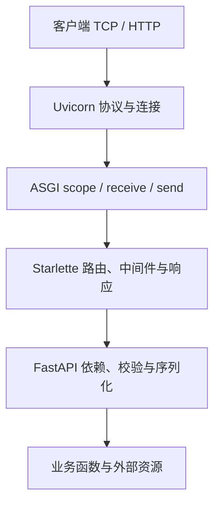

# Uvicorn、ASGI、Starlette 与 FastAPI

一个 HTTP 请求不直接跳进 Python 路由函数。Server 先处理连接和协议，再把请求转换成 ASGI 的 scope、receive、send 交互；FastAPI 在这层接口之上组织路由、校验和依赖。

## 1. 组件职责



Uvicorn 不替业务管理数据库事务；FastAPI 不直接等于网卡监听；Pydantic 不负责网络传输。边界分清后，故障才能按连接、协议、应用与依赖分层。

## 2. 直接观察 ASGI

```python title="api_asgi.py"
import asyncio
import httpx

async def application(scope, receive, send):
    if scope["type"] != "http":
        raise RuntimeError("HTTP only")
    message = await receive()
    body = (scope["method"] + ":" + scope["path"]).encode()
    await send({"type": "http.response.start", "status": 200,
                "headers": [(b"content-type", b"text/plain")]})
    await send({"type": "http.response.body", "body": body})

async def main():
    transport = httpx.ASGITransport(app=application)
    async with httpx.AsyncClient(transport=transport,
                                  base_url="http://test") as client:
        response = await client.get("/jobs")
        print(response.status_code, response.text)

if __name__ == "__main__":
    asyncio.run(main())
```

```text title="api_asgi.out"
200 GET:/jobs
```

这是仅用于演示的 HTTP ASGI 应用，不处理完整的分块、断开和 lifespan。真实请求体可能分多条消息到达，不能只接收一次就声称支持任意请求。

## 3. 三种 scope

HTTP、WebSocket 和 lifespan 有不同事件协议。HTTP 响应通常先发 start 再发 body，body 可以分块；WebSocket 需要握手、收发与关闭；lifespan 管理应用启动与关闭，不是每个请求都执行一次。

响应开始发送后，应用通常不能再把状态码改成一个新的正常错误响应。流式输出中途失败，应通过日志、协议约定与客户端重连处理，而不是期待自动变成完整 JSON 500。

## 4. 断开与背压

客户端断开后，应用是否已经收到 disconnect、发送是否失败、后台计算是否继续，取决于执行路径。不要只看客户端超时，就断定服务器工作被终止。

send 可能等待下游，读取请求体也可能消耗时间。代理缓冲、连接池与流式消费决定背压传到哪一层；应用仍需限制数据量与总预算。

## 5. 练习与答案

### 5.1 ASGI 是一种 HTTP Server 吗？

答案：不是，它是应用与服务器之间的接口规范。Uvicorn 实现服务器一侧，框架实现应用一侧。

### 5.2 receive 调用一次能拿到全部上传内容吗？

答案：不能保证，请求体可能分块，需要按 more_body 等协议状态持续处理并限制总量。

### 5.3 已发送响应头后抛异常，还能改成四百吗？

答案：通常不能重新发送另一个状态码。必须区分响应开始前与流式传输中途的失败语义。

## 6. 参考资料

- [ASGI Specification](https://asgi.readthedocs.io/en/latest/specs/main.html)
- [ASGI HTTP 协议](https://asgi.readthedocs.io/en/latest/specs/www.html)
- [Uvicorn Server Behavior](https://www.uvicorn.org/server-behavior/)
