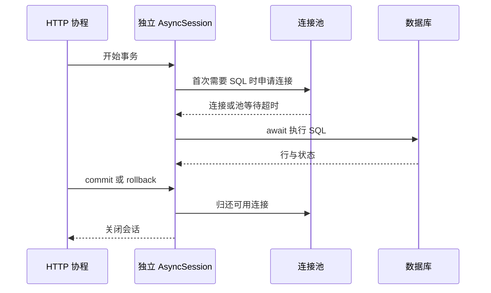

# AsyncSession 与异步数据库访问

异步数据库访问的价值是让等待数据库的协程把事件循环让给其他工作，不是让同一条 SQL 自动执行得更快。驱动、连接池、Session 和事务必须一起分析，不能只在旧代码前面加 await。

## 1. 一次请求占用哪些资源



创建 Session 不一定立即占有物理连接，进入事务也不意味着 SQL 已经完成。连接通常在实际需要时取得，持有时间受事务范围影响；在事务里等待慢 HTTP，会把数据库连接一起占住。

## 2. 完整工程中的创建方式

`task_service/database.py` 使用 `create_async_engine` 创建 Engine，以 `async_sessionmaker(..., expire_on_commit=False)` 创建会话工厂。每个操作使用：

```python
async with database.sessions.begin() as db:
    row = Job(tenant=tenant, idempotency_key=key, name=name)
    db.add(row)
    await db.flush()
    # 此处可以取得主键，但事务尚未提交。
    result = job_data(row)
# 正常离开后提交完成，再返回成功结果。
```

add 操作 ORM 本地状态，因此不加 await；flush、commit、execute、refresh 和关闭可能涉及异步资源，因此按 API 等待。遇到异常，事务上下文执行回滚，再由调用方判断是否应转换错误或重试。

expire_on_commit=False 防止提交后属性自动过期带来意外加载，但不保证数据永远最新，也不会预先加载关系。请求响应只返回明确准备好的数据，不让序列化器在资源关闭后再隐式查库。

## 3. 一项并发工作一个会话

```python
async def query_one(factory, job_id):
    async with factory() as db:
        return await db.get(Job, job_id)
```

多个 query_one 可以各自创建会话。不要把同一个 AsyncSession 交给 gather 中的多个任务；Session 包含事务、身份映射和连接使用状态，不是无状态查询客户端。需要同一事务的一组动作，通常在一个顺序执行的工作范围完成。

对象返回后应在会话内转换为输出模型，尤其存在关系和延迟字段时。可用 selectinload 等显式加载所需关系，或者通过适当的异步属性机制显式等待；不要把 MissingGreenlet 只当成“没安装 greenlet”，它也可能说明访问触发了不允许的隐式 I/O。

## 4. 驱动与池的预算

工程支持 `sqlite+aiosqlite` 和 `postgresql+asyncpg`。aiosqlite 通过工作线程处理 SQLite 调用，便于本机学习，但不是 PostgreSQL 的锁与网络模型。异步 SQLAlchemy 的相应适配依赖 greenlet，环境中应明确安装并锁定。

PostgreSQL 配置每进程 pool_size=5、max_overflow=0、pool_timeout=2；这些是实验预算，不是通用推荐。四个进程、三个副本可能申请六十条连接，还要给迁移、Worker 和其他服务留空间。

池等待、建立连接、SQL 执行和整个请求的超时是不同计时器。驱动 command_timeout 不能替代入口总 Deadline；语句取消后也要等待驱动完成清理，失效连接不应直接回池给下一位请求。

## 5. 如何运行与观察

按照[完整服务运行](../07-task-service/04-任务服务运行配置迁移与部署.md)安装深化依赖、设置环境、迁移，再启动 API。测试 `test_async_http_lifespan_is_explicit` 使用 AsyncClient，显式进入应用 lifespan；`test_parallel_idempotent_submission` 让四项工作同时提交同一个键，每项持有自己的会话。

调试时观察池等待、事务时间、实际 SQL 次数和数据库活动会话。若接口需要读取二十个对象，不应因隐藏的关系加载产生二十次额外往返。开启 SQL 日志前要处理绑定参数中的个人信息与凭证。

## 6. 练习与答案

### 6.1 把同步 Session 放进 async 路由，是否已经是异步访问？

答案：不是。同步 SQL 仍会占用当前线程；应使用明确的异步驱动与 AsyncSession，或把完整同步工作放到受控线程边界，不能随意跨线程共享会话。

### 6.2 flush 后主键已产生，客户端可以认为任务持久化了吗？

答案：不能。后续记录事件或提交仍可能失败并回滚；成功响应要在事务提交之后。

### 6.3 四个并发查询共用一个 AsyncSession，可以省连接吗？

答案：这会混淆事务与连接使用状态。应明确是否真的需要并发：同一事务内顺序执行，独立并发工作各自管理会话，并在池容量以内限制并发。

## 7. 参考资料

- [SQLAlchemy 异步并发与隐式 I/O](https://docs.sqlalchemy.org/en/21/orm/extensions/asyncio.html)
- [asyncpg 文档](https://magicstack.github.io/asyncpg/current/)
- [aiosqlite 工作方式](https://aiosqlite.omnilib.dev/en/stable/)
