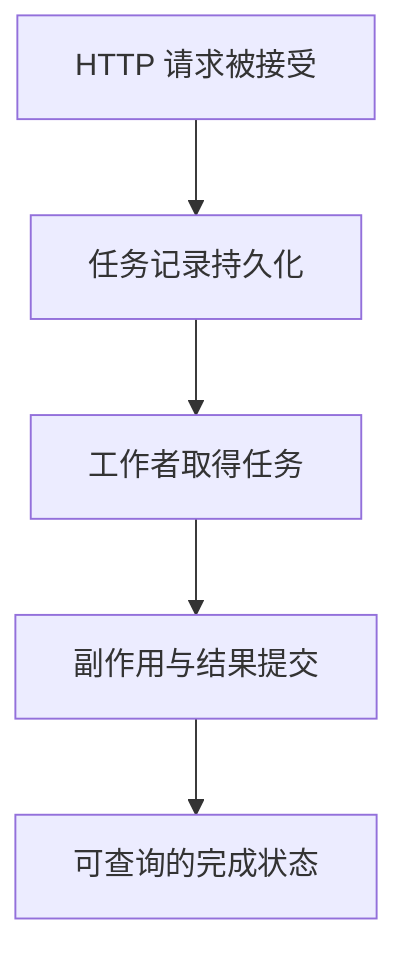

# BackgroundTasks 与持久化任务

BackgroundTasks 方便在响应处理后执行小型工作，但它依附当前应用进程，不是持久化队列。进程退出、发布和工作异常，都可能让“已经返回二零二”的任务没有完成。

## 1. 四个不同事件



具体系统可能用 Outbox/队列连接这些阶段，但不能只靠返回一个 task_id 就跳过持久化与恢复设计。

## 2. 进程内任务实验

```python title="api_background.py"
from fastapi import BackgroundTasks, FastAPI

def create_app():
    app = FastAPI()
    app.state.events = []

    def record(job_id):
        app.state.events.append(job_id)

    @app.post("/jobs/{job_id}", status_code=202)
    async def submit(job_id: int, background: BackgroundTasks):
        background.add_task(record, job_id)
        return {"accepted": job_id}

    return app

def main():
    from fastapi.testclient import TestClient
    app = create_app()
    with TestClient(app) as client:
        print(client.post("/jobs/1").status_code)
    print(app.state.events)

if __name__ == "__main__":
    main()
```

```text title="api_background.out"
202
[1]
```

TestClient 的调用会观察到这个应用调用周期完成，示例不能用于证明客户端真实收到响应时后台任务已经结束。事件存在内存中，重启会丢失。

## 3. 哪些工作适合

小规模、允许丢失或可轻易补做的附属动作可以考虑进程内任务。长计算、必须执行的订单、可恢复批处理和跨机器工作，应使用持久化任务记录与执行系统。

任务实现需要幂等、重试预算、超时、租约/可见性、失败状态、死信与取消规则。队列保证的“至少一次”往往意味着可能重复，需要业务消重而不是承诺不会重复。

## 4. 资源与退出

后台任务创建自己的 Session/客户端使用范围，不复用已结束的请求资源。异步后台函数中的同步阻塞仍会影响事件循环，同步任务则有线程资源上限。

响应已经发送后，后台失败不能改回一个新的 HTTP 状态。必须独立记录并让调用方通过状态接口了解结果，而不是依赖请求错误码。

### 4.1 与可恢复 Worker 的具体区别

[综合任务服务](../07-task-service/02-Worker租约重试与幂等执行.md)不再只保存任务编号：API 提交持久化记录，独立进程领取、续租并提交结果。可以停止 Worker 后继续提交，再启动它处理原记录；这与重启后内存 events 列表变空具有可观察的区别。

执行进程可能在提交后、确认前消失，任务协议需要处理重复和未知结果。租约让过期工作可以被接手，所有权条件阻止旧执行者写回，但不保证任意远端副作用撤销；数据库结果原子提交与外部至少一次执行要分开表述。

小型附属动作仍可使用 BackgroundTasks，不必把每次日志整理都变成分布式任务。选择依据是丢失是否可接受、执行是否有界、是否需要恢复及跨进程调度，而不是所有后台工作一律用同一个工具。

## 5. 练习与答案

### 5.1 返回二零二后进程崩溃，BackgroundTasks 保证恢复吗？

答案：不保证，它没有自动持久化任务。必要工作需要外部可恢复状态与执行机制。

### 5.2 任务队列至少一次投递，为什么仍需幂等？

答案：失败重试与确认丢失可能导致重复执行，副作用必须能识别重复。

### 5.3 后台任务能继续使用请求 Session 吗？

答案：不应依赖它仍有效，应建立独立资源边界，并在任务完成后释放。

## 6. 参考资料

- [Background Tasks](https://fastapi.tiangolo.com/tutorial/background-tasks/)
- [Starlette Background Tasks](https://starlette.dev/background/)
