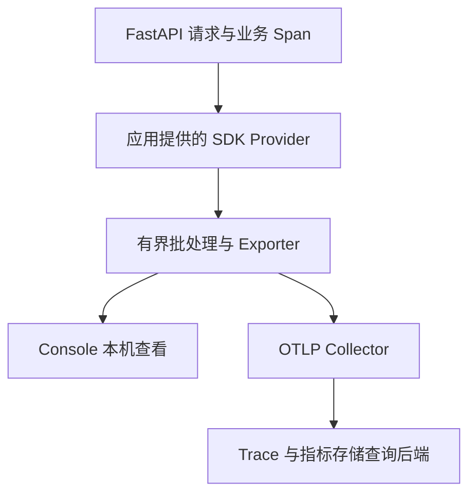

# OpenTelemetry 导出与请求耗时分析

中间件里保存一个计数器能解释聚合维度，但还不能回答“这次慢请求等在哪里”。本篇实际生成并导出 Trace 和指标，区分应用埋点、SDK、Exporter、Collector 与查询后端。

## 1. 数据经过哪些组件



FastAPI 0.150.0 已有原生遥测。不要再无条件叠加另一套自动请求埋点，否则同一次工作可能重复生成 Span。示例传入自己的 tracer_provider、meter_provider，并由创建者关闭它们；请求到达才产生数据，安装 SDK 本身不意味着已经有可查询的后端。

## 2. 先验证确实产生了数据

安装 `examples/fastapi/deepening.lock`，进入 framework-lab，执行：

```bash
python api_telemetry_export.py
```

输出：

```text
business span: True
same trace: True
metrics exported: True
```

这不是自己把三个布尔值写成 True。程序使用 SDK 的 InMemorySpanExporter 接收已经结束的真实 Span，通过 MetricReader 取得聚合数据，并检查业务 load-job Span 与请求 Span 使用同一 trace_id。测试验证这三项关系。

内存导出适合验证埋点；它不经过网络，不证明 Collector、存储和权限已经配置好。下一步把相同数据送到可见出口。

## 3. 查看 Console 导出

```bash
python -m uvicorn api_otel_live:create_app --factory --host 127.0.0.1 --port 8000
curl http://127.0.0.1:8000/jobs/1
```

未设置 OTLP 端点时，程序使用 ConsoleSpanExporter 与 ConsoleMetricExporter。终端会出现结构化记录；trace_id、时间、时长与指标值随本次运行变化，重点观察：

| 字段或关系 | 应怎样读 |
| --- | --- |
| trace_id | 同一次请求及其子工作之间的关联 |
| span_id / parent_id | 哪项工作属于哪项上层工作 |
| start_time / end_time | Span 的测量区间，不是所有系统通用的完整等待区间 |
| http.route | 应按路径模板聚合，而非每个实际 job_id |
| resource 的 service.name | 区分来自哪个服务实例或服务名称 |

原生遥测还可以产生依赖求解、端点执行与序列化等操作 Span。例子中的 prepare-job 包围一次异步等待，因此其时间主要是等待，不是 CPU 使用量。

## 4. 改为 OTLP 传输

`otel-collector.yaml` 提供接收 traces/metrics 并输出 debug 摘要的学习配置。在受控测试主机启动相应 Collector，只向本机或可信网络开放 4318；若用容器，主机端口绑定 `127.0.0.1:4318:4318`。

PowerShell 配置：

```powershell
$env:OTEL_EXPORTER_OTLP_ENDPOINT = 'http://127.0.0.1:4318'
python -m uvicorn api_otel_live:create_app --factory --host 127.0.0.1 --port 8000
```

本例使用 HTTP/protobuf，自动补上 /v1/traces 与 /v1/metrics，不能把 gRPC 4317 地址直接当成同一个配置。Collector debug 输出只用于确认接收，不提供历史检索界面；长期分析还要接入合适的存储后端。

Exporter 采用有限超时和批处理队列。后端不可达时检查导出错误与丢弃，不让观测队列无界增长。关闭应用时排空有界队列并关闭 Provider；不能只等进程被杀再期待所有末尾记录一定发送成功。

## 5. 用一条慢请求做判断

先确认根 Span 的测量边界，再看业务、数据库和下游子跨度。父子 Span 可能重叠，不能把所有 duration 相加；异步并行的两个下游各耗时一秒，不意味着请求至少耗时两秒。

数据库 execute Span 很长，需要继续区分取连接、锁等待、执行与取结果。只有根 Span 慢、子工作都短时，还应检查未埋点工作、线程池等待、序列化和发送。流式响应的首块时间与完整发送时间也要分开。

不要把令牌、完整请求体、文件内容和任意用户 ID 塞进属性。高基数信息适合按需关联日志/Trace，不应成为无限增长的指标标签。采样后的 Trace 也不能直接当成所有请求的完整计数。

## 6. 练习与答案

### 6.1 子 Span 都很短，根 Span 很长，能立即断定是网络吗？

答案：不能。可能遗漏队列、线程池、序列化、响应发送或其他工作。先核对边界和未覆盖时间，再增加有针对性的观测。

### 6.2 Console 有记录，为什么查询后端仍没有数据？

答案：Console 是另一种出口。依次验证 OTLP URL、协议、Collector 接收、导出、后端权限与采样；不能用进程内测试代替整条链路。

### 6.3 加两个并行下游 Span，怎样证明它们确实并行？

答案：观察父子关系、两个子区间的重叠与实际任务启动方式，再比较请求总区间；只看两个数值不能证明并发。实验需保持输入与等待时间可控。

## 7. 参考资料

- [FastAPI 原生遥测配置](https://fastapi.tiangolo.com/advanced/opentelemetry/)
- [OpenTelemetry Python Exporters](https://opentelemetry.io/docs/languages/python/exporters/)
- [OTLP 协议](https://opentelemetry.io/docs/specs/otlp/)
