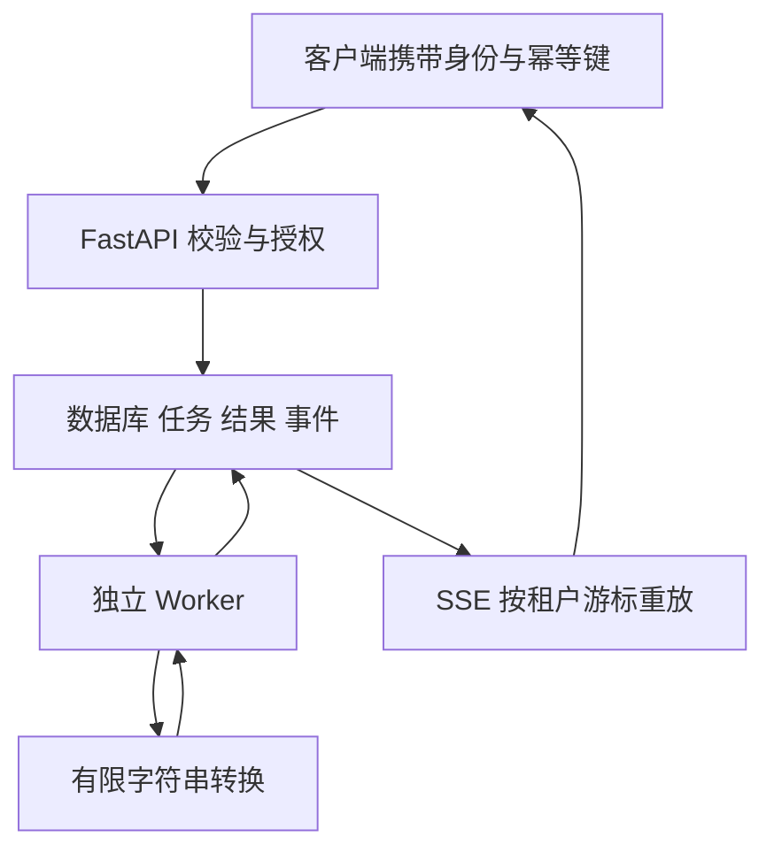

# 任务服务的数据模型与接口实现

这个项目接收字符串转换任务，由独立 Worker 把名称转成大写，保存结果并发送状态事件。计算本身很简单，便于把注意力放在并发、事务、恢复和请求生命周期，而不是复杂业务算法上。

前置阅读是 [Python 任务工具](../../python/06-engineering/04-从输入到文件持久化的任务工具.md)、[项目组织](../01-startup-http/05-APIRouter应用工厂与多文件工程.md)与[异步数据库](../03-data-security/05-AsyncSession与异步数据库访问.md)。完整代码在 [task-service](https://github.com/newswitch/newswitch.github.io/tree/main/examples/fastapi/task-service)，[运行文章](./04-任务服务运行配置迁移与部署.md)提供完整命令。

## 1. 系统里分别有什么

API 和 Worker 不共享 Python 字典。共同状态在数据库中，API 重启不意味着任务消失；Worker 重启也不需要客户端重新提交相同工作。这里没有第二个 Web 框架，也没有把 BackgroundTasks 当作持久化执行器。

## 2. 四张表的职责

| 表 | 保存什么 | 关键约束 |
| --- | --- | --- |
| async_jobs | 输入、状态、版本、尝试次数和租约 | tenant 与 idempotency_key 唯一 |
| async_results | 任务执行结果 | job_id 主键，每任务最多一条 |
| async_events | 可重放的状态变化 | tenant 与 sequence 唯一 |
| async_streams | 每租户的事务事件计数器 | tenant 主键 |

Job 从 pending 进入 running，最后为 done、failed 或 cancelled。revision 表达资源版本；attempts 表达领取次数；lease_token 表达本次执行所有权，三者不能混用。

事件与任务变化在同一事务里写入，否则可能状态成功但事件没有记录。事件计数器还约束同租户可见顺序，详见[事件重放](./03-事件重放断线恢复与慢消费者.md)。

## 3. 一个创建请求经历什么

客户端发送 `POST /jobs`，请求体为 `{"name":"import"}`，附带 Authorization 与 Idempotency-Key。依赖先验证凭证，把签名声明转换为 Principal；路由检查 jobs:write，租户取自可信身份，不从 body 接收。

CreateJob 拒绝额外字段、空白名称和超长输入。业务代码使用归一化后的名称，因此 `" import "` 与 `"import"` 视为同一语义输入；如果将来增加参数，幂等比较必须包含全部影响工作的规范化输入，而不是继续只比较 name。

repository.create_job 在事务中查询已有键：同租户同键同内容返回已有任务，不同内容返回 409。不存在时创建 Job，flush 获得 id，再记录事件，最后提交；只有提交成功才返回 201。

两个并发请求都可能先查到不存在，所以查询不是防重复的最终保障。唯一约束决定只能提交一个；另一个捕获约束冲突后结束失败事务，用新会话查询胜者。如果错误并非该幂等记录冲突，不能把任意 IntegrityError 都伪装成成功。

## 4. 查询与取消

`GET /jobs/{id}` 同时按 id 与 tenant 过滤，不先按 id 查到别人数据再决定是否展示。不存在和不属于当前租户都返回 404。结果表查询只发生在确认任务属于当前租户之后。

GET /jobs 使用 after 与 limit 做主键游标分页，每页上限一百，避免无界全表读取。分页保证的是按 id 前进，不承诺每页之间的全库快照；并发新增会影响之后看到的内容。

DELETE 需要 expected_revision。数据库在同一 UPDATE 中检查租户、版本和可取消状态，成功后清空租约并记录取消事件；旧 Worker 即使仍在计算，也不能再提交本地结果。终态或过期版本返回 409，调用方应重新读取状态，而不是无限重试旧版本。

## 5. 身份链路与工程边界

本地 token 命令是受控实验签发者，不是公开登录接口。API 固定 HS256、issuer、audience，并验证时间与必要声明；缺失/无效凭证返回 401，已知身份权限不足返回 403。测试固定密钥只存在测试代码中，运行配置通过 Secret 注入。

接企业身份时，应使用相应身份系统的可信签发配置和验证流程。JWT 验证不自动解决用户禁用、刷新、撤销和密钥轮换；不能把这个有限项目直接开放成通用认证平台。

本项目把 HTTP 错误转换放在较小工程范围里；业务规则复杂后，可用独立领域异常，再在路由边界转换。是否增加 service 层取决于规则复用，不要求为每个数据库调用都多建一个同名转发函数。

## 6. 练习与答案

### 6.1 增加 priority 字段后，幂等比较要改哪里？

答案：输入模型、数据库/迁移、规范化输入比较和测试一起修改。相同键不同 priority 应明确冲突，不能因为 name 相同就静默复用旧任务。

### 6.2 两个并发请求都没查到记录，为什么仍只能创建一个？

答案：数据库唯一约束负责最终仲裁。测试要真正同时提交并确认只有一个任务和一个创建事件；只顺序请求两次不能证明该窗口已覆盖。

### 6.3 把 tenant 放到查询参数，接口是否更方便？

答案：查询方便不代表可信。普通请求的租户应来自验证后的身份；跨租户管理操作需独立权限与审计，不能让任意参数改变资源边界。

## 7. 参考资料

- [SQLAlchemy AsyncSession](https://docs.sqlalchemy.org/en/21/orm/extensions/asyncio.html)
- [HTTP 语义与幂等](https://www.rfc-editor.org/rfc/rfc9110.html)
