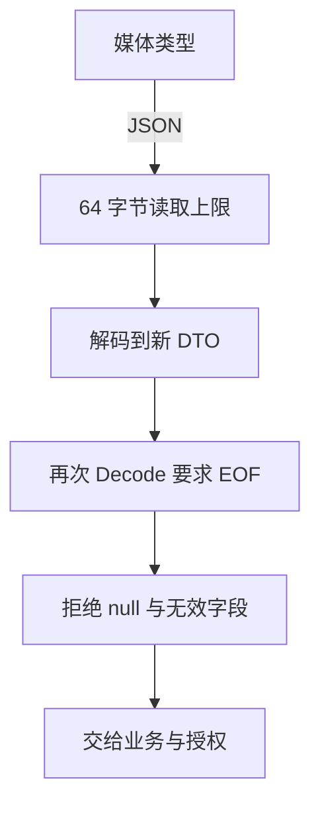

# Gin 参数绑定、验证与大小限制：从合法 JSON 到合法业务输入

请求处理至少有四个独立判断：字节能不能读、能不能解码、字段是否有效、当前身份是否有权操作。绑定只负责其中一部分。本章使用 Gin 1.12.0、Go 1.27.3、默认 encoding/json 编码器，通过独立协议实验说明各层边界；原 taskd 的输入错误策略保持不变。

## 1. 先规定数据来自哪里，而不是先写 Tag

Path、Query、Header、JSON、Form 有不同的协议位置。一个字段应该有明确来源，例如任务 ID 来自 Path，分页来自 Query，认证来自受信凭证，创建参数来自 JSON。

不要把租户、创建者、任务状态等内部字段直接暴露给绑定。即便请求体含 tenant 字段，也不能用它代替已认证身份里的租户。数据库模型适合表示存储状态，写入 DTO 适合表示客户端可以提供什么，二者职责不同。

先确定媒体类型策略：JSON-only 接口可以通过 mime.ParseMediaType 检查 application/json，接受 charset 参数，不符合则返回 415。`ShouldBindJSON` 的作用是强制使用 JSON binder，它本身不是检查媒体类型的策略。

## 2. ShouldBind、ShouldBindJSON 与 BindJSON 的差别

ShouldBind 根据方法和 Content-Type 选择 binder。固定版本 binding.Default 对 GET 优先选择 Form，其他请求按媒体类型选择；默认 Form 还可能组合查询参数，不应把它理解为“只读表单正文”。

ShouldBindJSON 明确调用 JSON binder，不再按媒体类型猜测。Should 系列只返回绑定错误，不负责统一响应；由调用方选择 400、422 等状态并结束当前 Handler。

BindJSON 经 MustBindWith：错误会加入 c.Errors，并 Abort；普通错误提交 400，能识别到 *http.MaxBytesError 时提交 413。注意 Gin 1.12.0 的这一分类不能沿用旧文章“一律 400”的结论；某些替代 JSON 编码器不透传该错误时行为也可能不同。

Abort 不等于当前函数 return。BindJSON 返回错误后仍需 return，不能继续执行业务或追加另一份响应。

## 3. DTO 如何表达必填且允许零

```go
type Input struct {
    Name  string `json:"name" binding:"required,max=20"`
    Count *int   `json:"count" binding:"required,min=0,max=10"`
}
```

如果 Count 使用 int 加 required，值为 0 通常也会被看作未满足 required；这会错误拒绝合法零值。改成 *int 后，required 检查非 nil，min/max 再验证指向值，实验中明确输入 0 可以成功。

这套 DTO 把缺失与 null 都按无值拒绝，正好符合创建接口；若 PATCH 需要区分“不改”“清除”“设为零”，还需要 [三态 Optional](../../go/03-library-io/03-JSON缺失Null零值与协议演进.md)，不能仅靠指针恢复全部信息。

required 对字符串也不等于“去掉 Unicode 空白后仍有内容”，因此实验另用 strings.TrimSpace 检查 Name。授权、资源是否存在、当前状态是否允许修改仍然是业务逻辑。

## 4. 一次 Decode 后，究竟检查了多少

固定版本 binding/json.go 的 decodeJSON 创建 Decoder，按两个全局开关选择 UseNumber 和 DisallowUnknownFields，执行一次 Decode，然后调用 validate。它不会再 Decode 到 EOF。

因此默认设置下，未知字段可能被忽略；正文第一个对象后还有第二个对象，也可能绑定成功。配套实验明确验证这两种行为，不能把 ShouldBindJSON 称为“严格验证整个 JSON 请求”。

这两个解码开关是进程级变量，不是某次请求的临时配置。需要使用时在启动期统一设置，不能在并发 Handler 中来回切换。若不同路由有不同协议，可用独立 Decoder 与本路由策略。

## 5. 把媒体类型、字节上限和 EOF 组合起来

配套 `internal/protocol/input.go` 中的 ReadInput 按以下顺序处理：



64 字节只是便于复现实验的边界，不是通用生产推荐值。正文通过 MaxBytesReader 包装，读取时遇到 MaxBytesError 返回 413；其他解码错误返回 400，媒体类型不符返回 415。第一次解码成功后仍检查 EOF，所以超长尾部空白也会触发边界。

解码目标使用 *Input，整个正文为 null 时得到 nil 并明确拒绝，否则“解码成功”可能让空对象进入业务。未知字段拒绝不等于拒绝重复字段；当前独立实验仍采用 encoding/json 的兼容语义，不宣称满足任意严格 JSON 规范。

字节上限不是读取超时。实际服务器还需正文读取预算、并发准入与代理限制；也不要假定 MaxBytesReader 会自动替你返回错误 JSON。

## 6. 为什么第二次绑定可能只得到 EOF

Request.Body 通常是消费型流。连续两次 ShouldBindJSON，第一次已读完或预读了正文，第二次不能从头重新开始；实验的有限正文第二次返回 EOF。

ShouldBindBodyWith 会先 ReadAll，把 []byte 缓存在 Context 的 BodyBytesKey，再从缓存多次 BindBody。这能复用正文，但会保留整段字节，且多个 DTO 各自还可能分配；并发请求越多，额外内存越明显。

需要重复绑定时，在第一次 ReadAll 之前设置实际正文上限；只绑定一次时优先普通流式读取。缓存正文也不意味着可以随意把敏感原文完整写日志，更不提供请求结束后安全共享 Context 的能力。

## 7. 运行并解释实验结果

```bash
cd examples/gin/service-lab
go run ./cmd/protocol-lab -mode binding
go test ./internal/protocol -v -count=1 -timeout=20s
```

```json
{"should_written":false,"should_status":422,"must_written":true,"must_status":400,"default_unknown_ok":true,"default_tail_ok":true,"second_bind_eof":true,"cached_rebind_ok":true,"cached_bytes":23,"zero_accepted":true,"strict_oversize_code":413}
```

should_written=false 表示还可由调用方选 422；must_written=true 表示 400 已提交，随后 c.Status(422) 不会改变它。缓存重复绑定成功，缓存大小为该实验正文的 23 字节；这不是框架的固定缓冲大小。

表驱动测试覆盖合法 0、charset、媒体类型、空正文、null、缺失、类型、范围、空白名称、未知字段、多对象、尾部垃圾、合法空白与超限尾部。原 `cmd/webdemo -case binding` 继续保留基础示例。

## 8. 错误契约与现有服务要保持一致

原 taskd 的 decode 限制 4096 字节，拒绝未知字段并检查 EOF，但当前对输入错误与超限统一返回 400。新增 protocol 模块是独立的 400/413/415 分层示例，没有悄悄改变 taskd 对外契约。

生产中可采用更细错误码，但必须同步实现、测试、客户端与监控。对外给出稳定类别和必要字段说明，内部保留 request ID 与阶段；不要把底层解码器、SQL、连接信息或整个请求体直接回传。

## 9. 练习与答案

### 9.1 Count=0 是有效值，为什么 binding required 可能拒绝

普通 int 的 0 是其零值，required 通常将其视为未满足。创建协议可用 *int 表达存在性，再验证数值范围；缺失与 null 是否等价则要另外定义。

### 9.2 ShouldBindJSON 成功是否证明没有尾部对象

不证明。固定版本 JSON binder 只调用一次 Decode，随后验证字段；完整正文契约需要再次解码并要求 EOF，同时限制读取大小和时长。

### 9.3 为什么 BindJSON 失败后不能再输出一份 422

MustBindWith 已中止链并提交错误状态，后改状态不能覆盖已提交的响应；继续 JSON 还可能追加正文。需要自定义响应时选择 Should 系列，并在错误分支明确 return。

## 10. 参考资料

- [Gin 1.12.0 Context 绑定方法](https://github.com/gin-gonic/gin/blob/v1.12.0/context.go)
- [Gin 1.12.0 JSON binder](https://github.com/gin-gonic/gin/blob/v1.12.0/binding/json.go)
- [Gin 1.12.0 binder 选择](https://github.com/gin-gonic/gin/blob/v1.12.0/binding/binding.go)
- [配套协议实验](https://github.com/newswitch/newswitch.github.io/tree/main/examples/gin/service-lab/internal/protocol)
