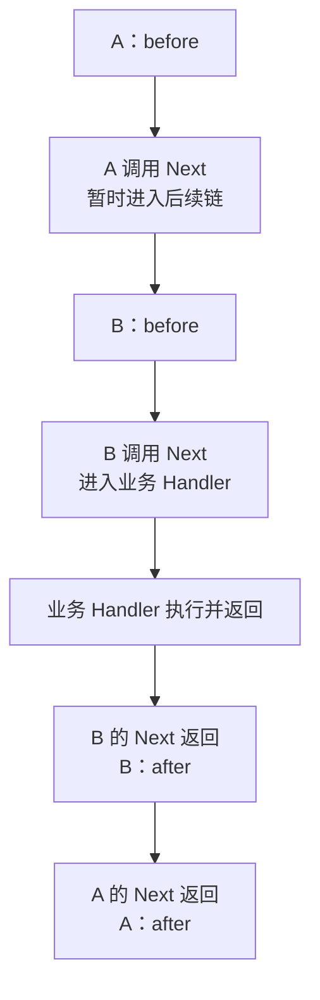

# Gin 中间件、Next、Abort 与错误处理：读懂执行顺序

中间件不是隐形过滤器。它们与业务 Handler 组成有序函数链，Next 推进后续执行，Abort 改变后续调度，而当前函数仍遵循普通 Go 控制流。

## 1. 进入与返回

中间件在 Next 前执行进入逻辑，Next 推进剩余链，返回后执行后置逻辑。典型顺序是外层 before → 内层 before → handler → 内层 after → 外层 after。

链中的 index 被多个 Next 调用共同推进，不是每次 Next 都重新从第一个 Handler 开始。注册顺序影响认证、日志、Recovery 与指标是否能够看到最终状态。

假设注册顺序为 A、B、业务 Handler，A/B 都在 before 与 after 之间调用 Next，且没有 Abort 或 panic，实际执行顺序如下：



after 的反向顺序来自普通 Go 调用栈返回，不是 Gin 把 Handler 列表倒序重跑。Abort 会阻止尚未执行的后续 Handler，但不会跳出当前函数，也不会抹掉外层已经存在的调用栈。

## 2. 顺序与中止实验

```bash
cd examples/gin/service-lab
go run ./cmd/webdemo -case middleware
```

```text
before -> handler -> after
```

完整代码与断言见 [service-lab](https://github.com/newswitch/newswitch.github.io/tree/main/examples/gin/service-lab)。

```bash
cd examples/gin/service-lab
go run ./cmd/webdemo -case abort
```

```text
status=401
{"error":"unauthenticated"}
```

完整代码与断言见 [service-lab](https://github.com/newswitch/newswitch.github.io/tree/main/examples/gin/service-lab)。

Abort 阻止剩余 Handler，但不会立即 return 当前函数。认证失败路径用 AbortWithStatusJSON 后仍应 return，避免下面继续执行敏感逻辑或再次写响应。

## 3. 错误传播的两种方式

可由边界直接写统一错误，也可把错误加入 c.Errors 再由专门中间件处理。选定一种一致策略，避免既直接写 500 又在后置逻辑写另一份 JSON。

错误中间件需要检查响应是否已提交。流式输出开始后，不能再把整个响应替换成常规 JSON 错误；只能按流协议结束或记录失败。

## 4. defer 与 panic

中间件的普通 after 代码在后续 panic 时未必执行；要保证记录最终状态可使用 defer，并把 Recovery 的位置设计清楚。Recovery 捕获当前请求调用栈的 panic，不自动捕获任意后台 Goroutine。

对已写部分内容后的 panic，不能承诺客户端收到干净完整的 500。测试未写、已写和流式三类路径。

## 5. Next 推进索引，普通 return 只结束当前调用

Gin 的链调度不要求每个 Handler 都显式调用 Next 才继续。外层调度器仍可能推进后续索引；在一个中间件里仅 return，不等于中止业务 Handler。

调用 c.Next 则在当前位置进入后续链，返回后可以执行后置逻辑。Abort 把后续调度推到中止状态，但当前 Go 函数继续执行，所以鉴权失败要 Abort 并 return。

已有 requestflow 测试把“嵌套 Next”“Abort 不 return”“仅 return”分开验证。源码细节见 Context 池化专题，避免把三种控制语句画成相同流程。

## 6. Recovery 的位置决定哪些 after 能运行

若 Recovery 在外层，内部中间件调用 Next 后发生 panic，内部普通 after 不会执行，但其 defer 会在展开时执行；外层 Recovery 捕获后，自己的调用边界才能继续。

配套 TestRecoveryOrderAndCommittedResponse 记录 before、defer，而不记录 after。若需要外层观测看到恢复后的最终状态，可把观测包装在合适外层，并同时考虑 defer 的执行顺序。

不要为了强行让 after 运行就把 panic 吞掉并当成功。请求日志、锁释放与事务回滚有不同责任，适合放在对应作用域的 defer；错误分类仍由明确边界完成。

## 7. 错误中间件不应拥有无限的重写权

c.Error 记录错误并不自动提交响应，Abort 也不自动决定 JSON 结构；Render 编码失败与业务显式写错还有不同路径。统一策略应先区分错误类别，再检查 Writer.Written。

未提交时可以输出稳定错误；已有部分响应时不能追加另一份完整错误 JSON。流式协议需要自己的错误事件或结束策略，不能把一套普通 REST 错误中间件无条件套到所有响应。

运行 requestflow 与 protocol 的对应测试，分别验证链顺序和提交状态。只在日志里看到一条 error，不足以知道客户端实际收到了哪个状态和正文。

## 8. 练习与答案

### 8.1 Abort 相当于当前函数的 return 吗

不是，仍要按控制流显式返回。

### 8.2 每次 Next 都从头重跑吗

不会，它沿共享 index 推进。

### 8.3 响应已写后还能随意改成另一种 JSON 错误吗

不能，协议已提交，需按实际状态处理。

## 9. 参考资料

- [Gin 官方文档](https://gin-gonic.com/en/docs/)
- [Gin 1.12.0 源码](https://github.com/gin-gonic/gin/tree/v1.12.0)
- [Gin 1.12.0 路由与链组合](https://github.com/gin-gonic/gin/blob/v1.12.0/routergroup.go)
- [请求链机制测试](https://github.com/newswitch/newswitch.github.io/tree/main/examples/gin/service-lab/internal/requestflow)
