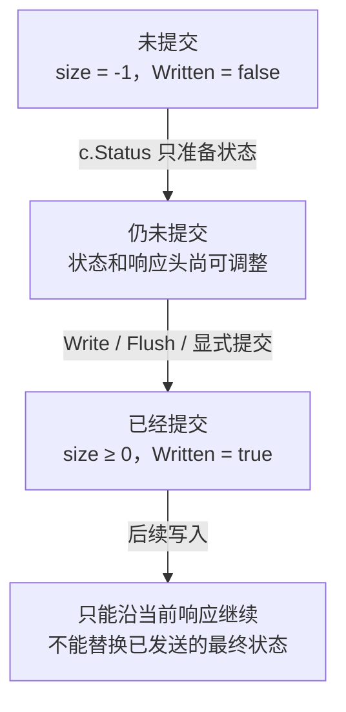

# Gin 响应、状态码与 JSON 契约：错误不只是一个字符串

响应状态码、响应头与正文不是一次无条件成功的赋值。它们经历准备、编码、提交和传输等阶段，错误出现在不同阶段，可做的补救完全不同。本章用 Gin 1.12.0 和真实回环 HTTP/1.1 对照实验，解释“日志说 500，客户端却收到 202”以及“编码失败仍返回空 201”。

## 1. 状态码表达哪一件事已经完成

200 表示当前请求成功；201 表示资源已创建；202 表示请求已接受但处理尚未完成。原 taskd 在事务创建任务记录后返回 201，只确认任务资源存在，不声称 Worker 已完成业务。

400 表示请求输入问题；401 用于身份凭证缺失或无效，403 用于身份有效但无权限；404 可以隐藏跨租户资源；409 表达状态或幂等冲突。根据契约还可使用 413、415、429、503、504 等区分大小、媒体类型、准入和依赖问题。

状态码不会替业务提供幂等或事务。写数据库成功但发送响应时连接断开，客户端可能不知道结果，应通过幂等键或查询确认，不能把“客户端没收到 201”直接理解为“服务端没创建”。

## 2. Gin 的 Status 是准备状态，不一定已发送

标准 net/http ResponseWriter 的最终 WriteHeader 会提交响应；但 Gin 外面还包了一层 responseWriter。固定版本 `c.Status(code)` 调用包装层 WriteHeader，通常只更新待发送的 status。

初始时 Gin 的 size=-1，Written=false；c.Status(202) 后仍可能保持这个状态。首次 Write、WriteString、WriteHeaderNow 或 Flush 才触发对底层 ResponseWriter 的提交；Handler 链结束时框架也会提交尚未写出的状态。

所以在没有提前提交时，c.Status(202) 后再 c.JSON(201, value) 可以最终返回 201。不要把“调用过一次 Status”与“客户端已经收到响应头”混为一谈。

普通最终响应可按“准备—提交—继续写入”理解。提交是一条不可倒退的边界，不以正文是否非空为判断依据。



处理链正常结束也会提交尚未写出的状态；Flush 可以只提交响应头，所以 size=0 仍属于已提交。这里的“提交”只到响应 Writer 边界，不表示网络传输或客户端业务处理已经成功。

## 3. Flush 后 Size 为零，为什么已经不能改状态

Written 依据 size 是否仍为 -1，而不是 size 是否大于 0。只发出响应头但没写正文时，size=0、Written=true。

实验先设 202 和 X-Stage: before，再 Flush，然后设 500 和 X-Stage: after。客户端仍收到 202 和 before。包装层可能还允许你访问 Header Map，但已经发送到对端的内容不会被这些后续修改改写。

Flush 是推动当前层提交，不是客户端已处理的业务确认；代理缓冲和网络传输仍可能继续。流式响应在第一次 Flush 后发生错误，需要协议内的错误事件、结束标记或终止流，不能再假装换成一份完整 JSON 500。

## 4. JSON 编码失败为什么可能得到空 201

默认 c.JSON 经过 render.JSON.WriteJSON：先准备 Content-Type，再 Marshal 整个对象，编码成功才 Write 字节。自定义 Marshaler 返回错误、unsupported 类型或无效数值都可能使编码失败。

Gin 1.12.0 的 Context.Render 在 Render 返回错误后，把错误加入 c.Errors 并 Abort；它不会自动把待发送状态改成 500。若原本传给 c.JSON 的状态是 201、编码前没有提交，链结束时可能提交空的 201。

这不是 Recovery 应对的 panic：Render 返回的是普通 error。统一错误中间件可在 c.Next 后检查 c.Errors，且仅在 !c.Writer.Written() 时输出稳定错误响应。已提交时应记录阶段和传输结果，不追加另一份错误 JSON。具体源码路径见 [Binding 与 Render](../05-internals/03-Binding-Render与ResponseWriter源码.md)。

## 5. 给未提交错误一个明确策略

```go
c.Next()
if len(c.Errors) > 0 && !c.Writer.Written() {
    c.JSON(500, gin.H{"error": "internal_error"})
}
```

这是最小形态，不是把所有业务错误统一变成 500 的完整处理器。实际项目应区分验证、授权、冲突与内部错误，按稳定类别映射状态；还要避免业务已经输出正确响应后，中间件再写第二份。

对普通小 JSON，可以在提交前完成编码，从而保留错误响应空间；但这意味着持有编码缓冲，不适合无限列表。超大输出应分页或设计流式协议。数据库提交与响应提交也没有自动组成分布式事务。

## 6. DTO、零值与 HTTP 正文规则

输出使用专用 DTO，排除 tenant、lease token、密钥与内部错误。0、false、null、[] 是否存在具有协议含义，不能因为 omitempty 省字节就任意改变。

204/304 等响应不能随意携带业务正文。Gin 的 Render 在 bodyAllowedForStatus 不允许时只准备头并提交，实验对 c.JSON(204, ...) 的客户端正文检查为空；它并不先证明传入对象可编码。HEAD 则还涉及 net/http 的请求方法语义，不能只从 Recorder 的字节缓存猜测线上结果。

分页需有界，排序与游标语义保持一致。taskd 的随机 ID keyset 是词典序分页，不等于创建时间排序；需要按时间分页时使用时间与唯一 ID 的稳定联合键。

## 7. 运行真实 HTTP 对照

```bash
cd examples/gin/service-lab
go run ./cmd/protocol-lab -mode response
go test ./internal/protocol -run TestResponsesOverHTTP -v -count=1
```

关键结果如下：

```json
{
  "status_only_written":false,"status_only_size":-1,"revised_status":201,
  "flushed_written":true,"flushed_size":0,
  "late_status":202,"late_header":"before",
  "encoding_errors":1,"encoding_aborted":true,"encoding_written":false,
  "no_policy_status":201,"no_policy_body":"","policy_status":500,
  "no_content_body":""
}
```

实验分别请求未提交改状态、Flush 后改状态、编码错误无策略、编码错误有策略与 204 五个路由。客户端通过真实回环 HTTP 读取，服务端状态记录用 Mutex 同步；服务与连接在结束后关闭。

这证明本版本的本机 HTTP/1.1 行为，不替代反向代理、HTTP/2 或生产网络断连验证。基础的 `cmd/webdemo -case json` 仍用于观察普通成功 JSON。

## 8. 排查二次响应先找第一次提交点

遇到 headers already written，先按请求路径找第一次 Write、Flush、AbortWithStatus 或 WriteHeaderNow，而不是只搜索最后一次 c.Status。

记录请求 ID、待发送/已提交状态、Size、错误阶段和传输错误。只有状态码而没有提交阶段，容易出现“应用以为改成 500，客户端其实保留原状态”的误判。响应提交成功也不等于全部字节送达，日志和业务结果要分别表达。

## 9. 练习与答案

### 9.1 c.Status(202) 后一定不能再改成 201 吗

在 Gin 包装层尚未提交时可以改；判断要看 Written 和真实路径。首次写正文、显式提交或 Flush 后，才不能重写已经发送的最终状态。

### 9.2 Written=true 但 Size=0 是否矛盾

不矛盾。仅提交响应头就会使 size 从 -1 变成 0；Written 检查是否仍是 -1，不是检查有没有正文。

### 9.3 c.JSON 编码失败后为什么 Recovery 没返回 500

Render 返回错误不是 panic。固定版本把错误记入 c.Errors 并 Abort，但不自动改状态；应在尚未提交时由错误策略输出，已提交后不能追加替代响应。

## 10. 参考资料

- [Gin 1.12.0 ResponseWriter](https://github.com/gin-gonic/gin/blob/v1.12.0/response_writer.go)
- [Gin 1.12.0 JSON Render](https://github.com/gin-gonic/gin/blob/v1.12.0/render/json.go)
- [Gin 1.12.0 Context.Render](https://github.com/gin-gonic/gin/blob/v1.12.0/context.go)
- [HTTP ResponseWriter 契约](https://pkg.go.dev/net/http#ResponseWriter)
- [真实 HTTP 实验](https://github.com/newswitch/newswitch.github.io/tree/main/examples/gin/service-lab/internal/protocol)
