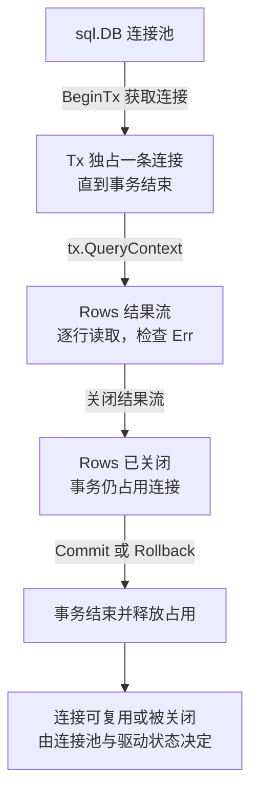

# Gin 与 database/sql：连接池、事务、Rows 关闭与取消

数据库慢不一定是 SQL 慢，也可能是在等连接。理解 sql.DB、事务与 Context 的边界，才能正确处理超时、回滚和容量。

## 1. DB 不是一条连接

sql.DB 是并发安全的连接池句柄，Query/Exec 可能先等待池中资源，再使用驱动连接。MaxOpenConns 限制活动连接总量，MaxIdleConns 管理空闲，ConnMaxLifetime 控制复用寿命；不应在每请求重新 Open。

事务会在生命周期内占用连接。池很小时，在事务未结束前又调用 DB.Query，可能等不到空闲连接；事务内的操作应使用 tx。Rows 必须 Close，并检查遍历后的 Rows.Err。

以“事务内查询并处理结果”为例，连接的占用范围比一次 SQL 函数调用更长：



关闭事务内的 Rows 不会顺便结束 Tx；直接通过 DB 查询时，又有不同的归还路径。连接损坏、取消或达到寿命时也未必回到空闲池，不能把“释放占用”理解成保证复用同一条网络连接。

## 2. 本工程的事务范围

创建任务和插入 Outbox 处于同一事务；取消任务也在条件更新成功后同事务写入事件。任一失败都回滚，避免业务已创建但事件永远丢失。

BeginTx 后立即 defer Rollback，成功时 Commit。Rollback 在已提交后返回的状态通常可按具体路径处理，但 Commit 错误不能当作普通输入失败；网络中断时提交结果可能未知，需要幂等查询确认。

## 3. 失败注入实验

```bash
cd examples/gin/service-lab
go test ./internal/store -run 'TestRollbackOutboxFailure|TestInboxFailureRollsBackDedup' -count=1 -v -timeout=30s
```

第一类测试通过 SQLite trigger 拒绝 Outbox 插入，再查询任务不存在；第二类拒绝通知落库，验证 Inbox 也没有留下“已处理”标记。它们证明本机事务不变量，不代表 PostgreSQL 的网络提交失败已验证。

## 4. 池与取消观测

将 Request.Context 传入 QueryContext、ExecContext、BeginTx。超时会影响等待与执行，实际中断行为也取决于驱动；不能把 Context 取消当作数据库所有副作用必然消失。

观察 DB.Stats 的 InUse、Idle、WaitCount/WaitDuration 增量，再看事务时间和数据库本身的锁、慢查询。服务扩容后总池容量是副本数乘每副本上限，要与数据库全局预算共同规划。

## 5. 从 DB 到连接，再到事务与结果集

sql.DB 是共享池，Open 不一定已经完成真实连接；入口的 Ping 才为当前时刻建立相应连通证据。MaxOpenConns 限制总打开连接数，包含正在使用和空闲连接；不是仅限制当前执行 SQL 数。

DB.Conn 获取固定连接，事务通常在单个连接上完成；DB 级 Stmt 可以在连接池中按需要管理底层准备状态。使用哪种对象，应匹配连接亲和性与事务原子性，不要把它们都叫“数据库连接”。

当前 Store 默认池上限 4，SQLite 实验设为 1。这个约束使池等待容易观察，也不能代表 PostgreSQL 多连接下的锁、隔离级别与并发行为。

## 6. Rows 是一段尚未结束的资源生命周期

QueryContext 成功仅说明获得结果流，Rows.Next 还可能在后续读取出错。通常登记 Close，并在循环结束检查 Rows.Err；提前 return、只读第一行或跨多个结果集时，显式关闭尤其重要。

QueryRow 的错误通常在 Scan 时暴露，不能只检查调用 QueryRow 的那一行。事务里的查询使用 tx，不要在事务占住唯一连接时再向 DB 池申请另一条连接。

先完成需要读取的有限数据并关闭 Rows，再执行后续阶段，可以缩短连接占用；但全部 ReadAll 又会增加内存，所以还需分页与结果上限。池治理不是只调大一个数字。

## 7. 取消能缩短等待，但提交结果仍需确认

BeginTx 的 Context 与事务生命周期相关，取消后 database/sql 会组织相应回滚；驱动执行中的取消与网络提交确认仍有实现差异。Commit 返回错误时，不能无条件断言对端一定未提交。

创建接口通过 tenant+幂等键建立唯一约束，并在重复请求时核对内容，让客户端有机会重新查询同一个逻辑结果。普通重试三次不等于幂等，跨多个副作用也不是本地事务自动覆盖。

运行连接池诊断用例，先持有唯一连接，观察请求 504 与 WaitCount 增量，再归还后恢复 200。它证明的是执行 SQL 前的等待，不是“数据库执行慢”，应与慢查询和锁等待指标分别看。

## 8. 练习与答案

### 8.1 sql.DB 是一条长连接吗

不是，它管理连接池。

### 8.2 Query 返回 Rows 后可以不 Close 吗

不能，可能长期占用连接等资源。

### 8.3 Commit 超时一定没有提交吗

不能断言，需要按幂等与确认机制处理未知结果。

## 9. 参考资料

- [database/sql](https://pkg.go.dev/database/sql)
- [事务使用](https://go.dev/doc/database/execute-transactions)
- [配套服务与状态实现](https://github.com/newswitch/newswitch.github.io/tree/main/examples/gin/service-lab/internal)
