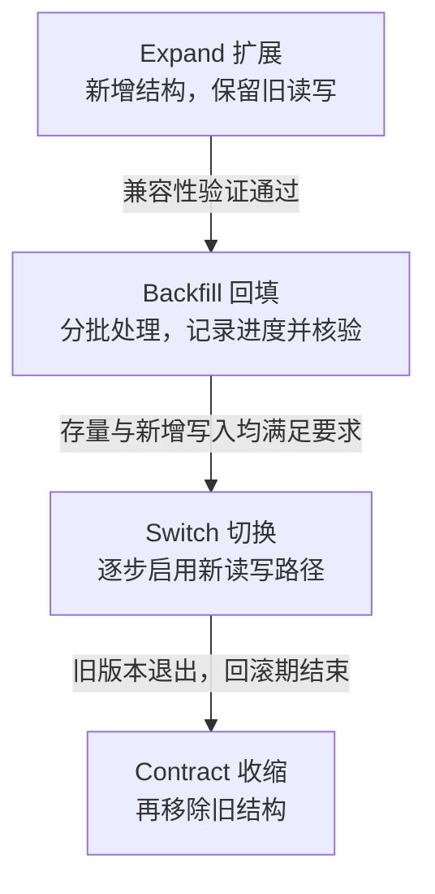

# Gin 数据模型、Schema 迁移、乐观锁与幂等提交

可靠写入要解决三个不同时间尺度的问题：一个请求内事务是否原子，并发请求是否遵守不变量，以及多版本发布时 Schema 是否兼容。唯一约束、条件更新与版本化迁移各有职责。

## 1. 先把业务不变量放到原子边界

tasks 用 tenant+request_key 唯一约束处理重复提交。相同键与相同内容返回原 Task，相同键不同内容返回冲突，不使用进程内 Map 代替数据库约束。

取消用 tenant、ID、version 与 state=NEW 共同约束 UPDATE；检查和变更发生在同一原子语句中。受影响行数为零后区分不存在与冲突，不能先查状态、解锁后再无条件更新。

乐观锁 version 不是数据库事务隔离级别的替代品。多表不变量、事件写入和条件变更仍需适当事务组织。

## 2. IF NOT EXISTS 不是迁移系统

Task Store 的自动 DDL 是原始隔离实验的启动便利，不能检查旧字段类型、索引和约束是否符合新程序。新增会话工程把迁移作为显式步骤，构造 Handler 不执行建表。

迁移至少需要版本顺序、已执行内容校验、并发执行协调、有限预算和失败后可判断状态。只记“最高版本=2”而不核验具体内容，会掩盖被改写的旧脚本。

## 3. 一个最小的可审计迁移器

internal/migrate 的 Step 保存连续版本号与固定 SQL 语句列表，checksum 对语句列表编码计算。执行前检查已应用历史是当前计划的前缀；已应用语句变化立即拒绝。

SQL 是随代码审核的固定内容，不接受 HTTP 提交任意迁移文本。语句以列表组织，而不是用分号简单拆分包含函数、字符串或触发器的任意脚本。

实验 ledger 表为 lab_schema_versions，记录版本、校验和与时间。历史顺序与 checksum 都一致时，重复运行是 no-op；不能因应用重启就重复执行 ALTER。

## 4. 为什么必须固定同一连接

迁移先从 sql.DB 取得一个 sql.Conn，在这个固定连接上开始、锁定、读历史、执行 DDL、写 ledger 和提交。否则连接池可能把不同语句分派到不同连接，事务或锁就不再覆盖预期操作。

SQLite 使用 BEGIN IMMEDIATE 提前取得写事务，避免两个迁移者都读到相同旧历史后才争写。它会影响写并发，要在适当维护窗口执行。

PostgreSQL 分支使用同事务 advisory lock，锁随事务结束释放。所有合作迁移者必须采用一致的锁命名协议；它不阻止另一个绕过该协议的管理员随意执行 DDL。

## 5. DDL 与版本记录怎样一起失败

实验把支持事务的 DDL 和版本 ledger 放入同一个事务。只有全部成功才 COMMIT；中途失败执行 ROLLBACK，不能留下“版本已增加但列未创建”或相反状态。

回滚清理使用独立的有限 Context，避免调用方超时后再用已取消 Context 发送 ROLLBACK。若提交阶段网络失败，结果可能未知，先重新读取可信数据库状态，不自动执行破坏性 down。

本迁移器仅演示小规模、可事务化 DDL。PostgreSQL 的 CREATE INDEX CONCURRENTLY 等有不同事务限制；大表回填、在线索引和分阶段发布不能塞进这一个通用事务冒充完成。

## 6. Expand Backfill Switch Contract

先 Expand：新增兼容的可空字段或结构，使旧读写仍可工作。Backfill：有限批次回填、记录进度与核验；Switch：新代码开始使用新字段，并与旧版本共存；最后 Contract：确认旧调用者退出后收缩旧结构。



箭头上的条件是阶段之间的门槛，不是四条 DDL 连续执行。回填期间仍可能有新写入，需要兼容读写、双写或增量追赶等明确方案；未满足门槛时应停留在可兼容阶段。

示例先有 migration_notes(id,body)，再增加 optional_label。旧 INSERT 不带该列仍可执行，旧 SELECT body 仍可读取，新程序看到 NULL 必须有明确含义。新增 NOT NULL 且无兼容默认值则可能立即破坏旧写入。

代码回滚与数据回滚不同。新版本写入的新语义未必能被旧程序理解，删除列也无法自动找回丢弃的数据；上线前要定义兼容窗口和恢复办法。

## 7. 运行四组迁移验证

```bash
cd examples/gin/service-lab
go test ./internal/migrate -count=1 -v -timeout=30s
go test ./internal/store -run 'TestCreateIdempotency|TestConcurrentIdempotency|TestCancelVersion' -count=1 -v
```

关键结果：

```text
applied=1 rerun=no-op changed-checksum=rejected
failed-version=2 ledger-version=1 partial-column=absent
concurrent-runners=2 applied-once=true
expand=nullable-column old-reader=works old-writer=works backfill=still-required
```

失败测试先成功增加一列，再故意访问不存在的实验表，检查新增列与 ledger 都回滚。它证明的不是“出错有 error”，而是失败后的数据库事实仍一致。

并发测试使用两个调用者和独立可用连接。SQLite 路径可在本机执行；PostgreSQL 还需在隔离数据库验证其锁和 DDL 行为。

## 8. 权限与生产发布位置

迁移账号与普通 API 账号分离，API 不持有不必要的 DDL 权限。由受控发布步骤执行迁移，保留版本、校验和、耗时与结果，再放行兼容应用。

连接等待、锁等待和 DDL 执行都要有预算；超时后确认数据库状态再决定继续。维护任务不能把所有实例同时启动迁移、无限等待，或以删库重建掩盖历史不一致。

## 9. 练习与答案

### 9.1 为什么迁移要用 sql.Conn 而不是随意调用 DB.Exec

因为数据库事务与连接级行为具有作用范围。把操作固定在同一连接才能让锁、历史检查、DDL 和提交处于一致协议内；连接池句柄本身不代表一条连接。

### 9.2 失败后 ledger 仍为旧版本是否已经足够

还不够，需要确认部分 DDL 也未留下。测试同时检查新列不存在，才能证明此实验的原子回滚。对非事务 DDL 则需另外设计恢复。

### 9.3 为什么不能先删旧字段再部署新代码

旧实例或回滚版本可能仍读写旧字段，会立即失败。应先扩展、回填与切换，确认兼容窗口结束后再收缩。

## 10. 参考资料

- [迁移源码与测试](https://github.com/newswitch/newswitch.github.io/tree/main/examples/gin/service-lab/internal/migrate)
- [PostgreSQL 锁](https://www.postgresql.org/docs/current/explicit-locking.html)
- [SQLite 事务](https://www.sqlite.org/lang_transaction.html)
