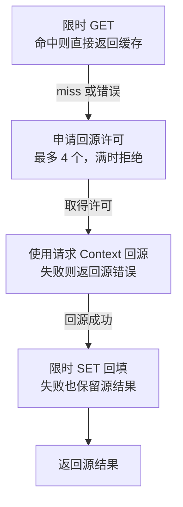

# Gin 与 Redis：Cache-Aside、连接池、租户键与降级保护

缓存降低读取成本，也引入过期、失效、热点和依赖故障。必须先确定缓存哪些数据以及允许多旧，而不是给每个查询加一层 Redis。

## 1. 缓存数据的边界

service-lab 只缓存演示用不可变模板，任务状态始终从数据库读取。原因是任务版本和权限状态变化快，不能把一个三十秒旧缓存误认为真实执行结果。

可变数据采用 Cache-Aside 时，需要设计写库后失效、并发回填旧值、TTL 与版本键。删除缓存失败、DB 提交成功的窗口不能靠一次 GET/SET 自动解决。

## 2. 连接池与有限退化

transport.Cache 长期复用 go-redis 客户端，普通 GET/SET 池设置 PoolSize=4 与 MaxActiveConns=4，并显式启用 ContextTimeoutEnabled，连接与读写有短超时，MaxRetries=-1 明确禁止隐式重试。失败时回源也受四个并发许可限制，避免缓存宕机直接放大成数据库洪峰。

即便 Context 有预算，也应核对客户端是否对所有网络阶段遵守它；配置 Dial、Read、Write、PoolTimeout 使等待路径有界。例子允许缓存写失败不影响已取得的源结果，适用于可退化读取，不适用于认证或余额等强约束。

当前不可变模板读取的降级路径如下。GET 失败和 miss 可以进入同一回源路径，但观测时仍应区分错误类型。



箭头只连接继续处理的路径；命中、许可耗尽和回源错误均在所在节点提前返回。取得的许可由 defer 释放，成功与失败路径都会归还。400 ms 缓存子预算不等于整个请求预算，回源和回填仍消耗剩余时间。

## 3. 隔离 key 与验证

```bash
cd examples/gin/service-lab
go test ./internal/transport -run 'TestCache' -count=1 -v -timeout=30s
```

本机测试将客户端指向刚关闭的回环端口，验证依赖失败后仍在预算内回源；这不是 Redis 命中测试。真实命中与跨租户隔离由 -tags integration 的 Redis 用例验证，未连接服务就不会假装通过。

key 由 JSON 编码的 [tenant,id] 组成，避免简单冒号拼接产生歧义。TTL 30 秒只是实验值，需按业务新鲜度与流量选择。

## 4. 热点、穿透和锁

同一 key 并发回源可用 singleflight 类机制合并，但要区分调用者取消与共享加载任务，不能让第一个请求取消所有等待者。不存在项可短暂负缓存，但需控制基数和错误类型。

Redis 分布式锁还涉及过期、续约、持有者 token 与 fencing，不应把 SETNX 成功就等同于跨系统严格互斥。生产还需 TLS、ACL、连接恢复和命中率/池等待观测。

## 5. 先决定源数据真相，再决定缓存协议

Cache-Aside 的源数据通常仍在数据库。缓存 miss、缓存服务失败与缓存中存在旧值是三种状态，应分别观测；不能只统计一次 GET 错误便断定“需要扩容 Redis”。

当前只缓存不可变演示模板，任务状态与权限仍从可信持久层读取。可变数据写库后失效缓存，仍会遇到旧读者回填、删除失败和并发更新窗口，需要版本键、失效重试或业务容忍度等策略。

TTL 是最长陈旧窗口的一部分，不会在多系统之间制造强一致。短 TTL 也可能增加回源，必须与请求量、热点分布及源站容量共同估算。

## 6. 固定版本中 PoolSize 不是严格连接上限

go-redis v9.23.0 的 PoolSize 是基础池规模，连接不足时可继续分配，严格数量限制要核对 MaxActiveConns。示例现在同时设置 PoolSize=4、MaxActiveConns=4，针对当前普通 GET/SET 路径建立清楚边界。

新版客户端还存在单独的 pipeline 池等配置。不能把某个普通池参数扩大为“未来所有 Pipeline 和后台功能加起来永远只有四条连接”的保证；增加用法时要重新审视完整客户端资源。

TestCachePoolAndContextConfiguration 直接检查普通池限制、ContextTimeoutEnabled 与回源许可数，防止文章写了硬上限而代码仅配置基础规模。真实 Redis 连接数与池争用仍要在对应服务环境验证。

## 7. 每个等待阶段都要消耗自己的预算

示例显式启用 ContextTimeoutEnabled，并设置 Dial、Read、Write 和 PoolTimeout，命令子 Context 为 400 ms、关闭隐式重试。Context 不是实时抢占器，不能据此承诺任何驱动和调度条件下精确在 400 ms 返回。

缓存读取失败后，回源最多四个并发，满时拒绝；取得源结果后缓存写入失败不阻止返回。这适合可降级读取，不适合会话撤销、余额或必须强一致的授权结果。

观察 miss、连接错误、超时、池等待、源并发、拒绝与回填错误，才能知道是在优化命中率还是保护源站。缓存宕机时无条件回源，可能使原本局部故障变成全站依赖雪崩。

## 8. 合并热点请求也要定义共享任务的取消

同一 key 的请求可合并回源，但共享加载生命周期不能无意依附第一个请求。一个调用者取消后，其他等待者是否继续、全部等待者离开后是否取消加载，都应有清楚协议。

负缓存只缓存可明确判定的不存在，不把数据库超时当不存在；TTL 与 key 数也要受控。租户、schema 版本与资源身份应进入键模型，避免内容碰撞和升级误读。

本地 outage 测试验证关闭回环端口后的有限退化，配置测试验证选项；真实命中、TTL 和隔离由显式 Redis 联调验证。三者分别给出证据，不互相冒充。

## 9. 练习与答案

### 9.1 Redis 故障时无条件回源最安全吗

不一定，可能压垮源站，要有并发与预算限制。

### 9.2 真实 Redis 不在线时替身测试能证明缓存命中吗

不能。关闭回环端口的测试只验证退化路径，配置断言只验证选项；命中、TTL、连接恢复与真实服务隔离需连接 Redis 验证。

### 9.3 任务状态默认缓存越久越好吗

不是，需要按一致性和新鲜度需求决定。

## 10. 参考资料

- [go-redis](https://github.com/redis/go-redis)
- [Redis 连接池](https://redis.io/docs/latest/develop/clients/go/)
- [go-redis v9.23.0 选项定义](https://github.com/redis/go-redis/blob/v9.23.0/options.go)
