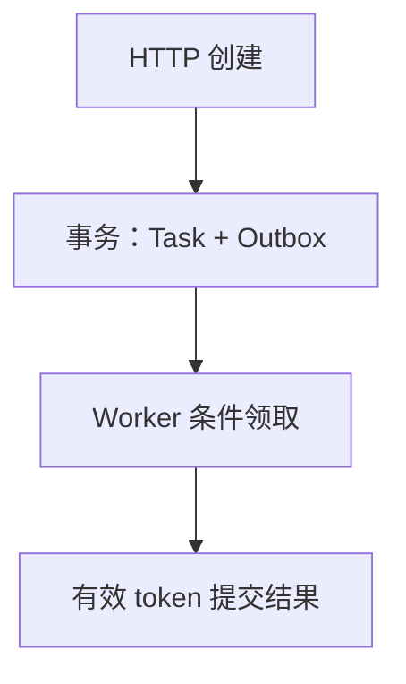
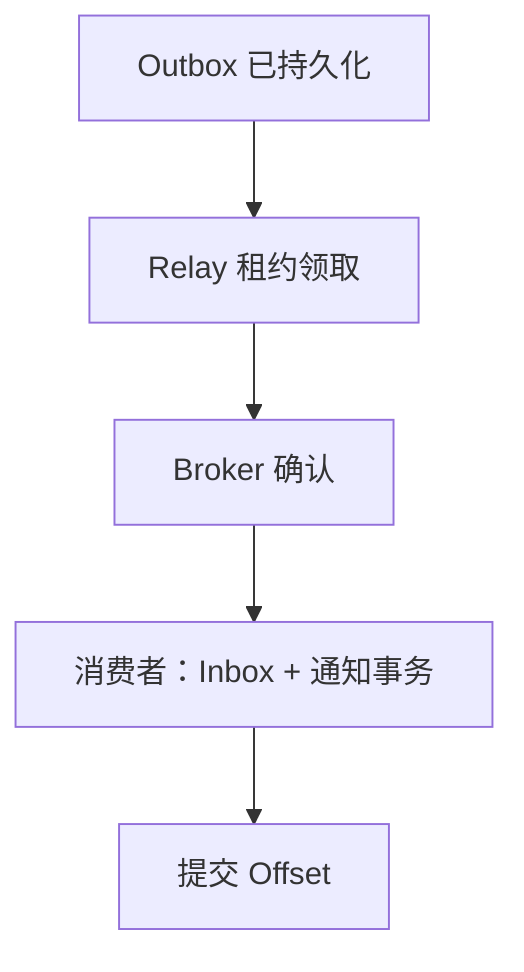

# Gin 可靠异步任务：Outbox、Inbox、租约与 fencing token

可靠异步不是“把逻辑放进后台”。需要把任务接收、领取、执行、事件发送与消费分别持久化，并允许任何进程在任意阶段崩溃。

## 1. 两条相关但独立的链路



任务执行与事件传递从同一份已提交状态出发，下面是独立的事件链路：



任务执行与事件传递不是同一事务。Outbox 消除业务写入与产生事件之间的本地双写窗口，不能自动让 DB 与 Kafka 形成一个全局原子提交。

## 2. Worker 的状态协议

NEW → RUNNING → SUCCEEDED；NEW 可按 version 取消。领取时增加 attempts/version 并写随机 lease_token、lease_until。过期任务可由新 Worker 重新领取；Finish 必须匹配当前 token 且租约未过期，旧持有者不得覆盖新结果。

示例最多三次领取，预算耗尽且租约过期后，恢复流程将其变为 FAILED 并同事务写 TaskFailed。实际任务只做有限字符串转换，不执行任意外部命令；长任务需要续租与单独的执行超时。

这里的随机 lease_token 是数据库条件提交的所有权凭证，起到本数据库内的提交栅栏作用；它不是可供任意外部资源比较大小的全局递增 fencing 序号。若 Worker 会写外部文件或调用其他系统，对方也必须验证有效 epoch/token 或支持业务幂等，仅在本库拒绝旧结果不能撤销外部副作用。

## 3. Relay 与 Inbox 的故障窗口

Relay 在短事务领取后提交，再进行有限 Broker 发送，不持有数据库事务等待网络。发送成功后更新 sent；若此时进程崩溃，下次仍可能重复发送同一 event ID。

消费者在一笔事务内写 Inbox 和通知。事件 ID 已存在且正文相同即去重，不同正文则冲突。这样覆盖重复投递，不承诺所有外部副作用都恰好一次；支付或第三方调用仍需对方幂等与对账。

## 4. 故障注入验收

```bash
cd examples/gin/service-lab
go test ./internal/store -run 'TestExpired|TestExhausted|TestRelay|TestInbox|TestPersist' -count=1 -v -timeout=30s
```

测试包括旧 token 提交失败、超时后重领、三次耗尽进入 FAILED、Broker 已接收但确认丢失、通知失败回滚 Inbox 和文件数据库重开。

生产还需租约时间源、续租、毒消息隔离、事件保留清理、多 Relay 争用与有序投影等设计。文章明确这些扩展，不把教学工程说成通用工作流引擎。

## 5. 练习与答案

### 5.1 Outbox 可以消除所有重复消息吗

不能，它允许至少一次发送，消费端仍需去重。

### 5.2 旧 Worker 处理完后还能提交吗

只有 token 与租约仍有效才允许提交。

### 5.3 Inbox 能保证外部支付恰好一次吗

不能，外部系统需要自己的幂等与确认协议。

## 6. 参考资料

- [本工程事务与恢复实现](https://github.com/newswitch/newswitch.github.io/tree/main/examples/gin/service-lab/internal/store)
