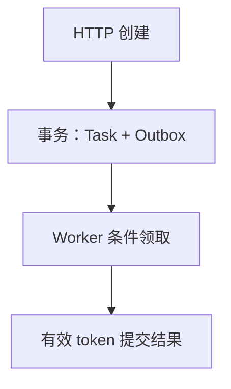
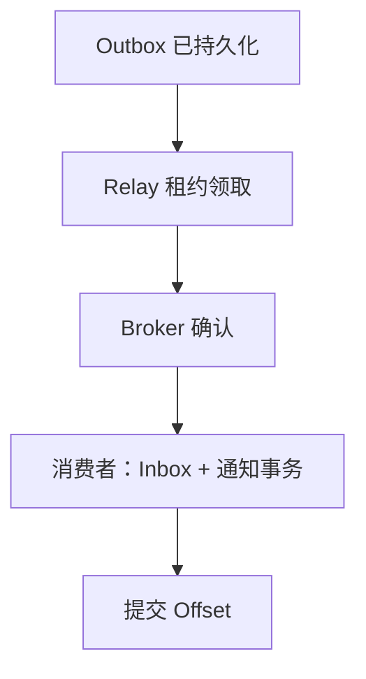

# Gin 可靠异步任务：Outbox、Inbox、租约与 fencing token

可靠异步不是“把逻辑放进后台”。需要把任务接收、领取、执行、事件发送与消费分别持久化，并允许任何进程在任意阶段崩溃。

## 1. 两条相关但独立的链路



任务执行与事件传递从同一份已提交状态出发，下面是独立的事件链路：



任务执行与事件传递不是同一事务。Outbox 消除业务写入与产生事件之间的本地双写窗口，不能自动让 DB 与 Kafka 形成一个全局原子提交。

## 2. Worker 的状态协议

NEW → RUNNING → SUCCEEDED；NEW 可按 version 取消。领取时增加 attempts/version 并写随机 lease_token、lease_until。过期任务可由新 Worker 重新领取；Finish 必须匹配当前 token 且租约未过期，旧持有者不得覆盖新结果。

示例最多三次领取，预算耗尽且租约过期后，恢复流程将其变为 FAILED 并同事务写 TaskFailed。实际任务只做有限字符串转换，不执行任意外部命令；长任务需要续租与单独的执行超时。

这里的随机 lease_token 是数据库条件提交的所有权凭证，起到本数据库内的提交栅栏作用；它不是可供任意外部资源比较大小的全局递增 fencing 序号。若 Worker 会写外部文件或调用其他系统，对方也必须验证有效 epoch/token 或支持业务幂等，仅在本库拒绝旧结果不能撤销外部副作用。

## 3. Relay 与 Inbox 的故障窗口

Relay 在短事务领取后提交，再进行有限 Broker 发送，不持有数据库事务等待网络。发送成功后更新 sent；若此时进程崩溃，下次仍可能重复发送同一 event ID。

消费者在一笔事务内写 Inbox 和通知。事件 ID 已存在且正文相同即去重，不同正文则冲突。这样覆盖重复投递，不承诺所有外部副作用都恰好一次；支付或第三方调用仍需对方幂等与对账。

## 4. 故障注入验收

```bash
cd examples/gin/service-lab
go test ./internal/store -run 'TestExpired|TestExhausted|TestRelay|TestInbox|TestPersist' -count=1 -v -timeout=30s
```

测试包括旧 token 提交失败、超时后重领、三次耗尽进入 FAILED、Broker 已接收但确认丢失、通知失败回滚 Inbox 和文件数据库重开。

生产还需租约时间源、续租、毒消息隔离、事件保留清理、多 Relay 争用与有序投影等设计。文章明确这些扩展，不把教学工程说成通用工作流引擎。

## 5. 用故障窗口解释为什么需要三个持久标记

Task 的状态表示业务执行，Outbox 的 sent/claim 表示发送责任，Inbox 表示消费幂等。三者分别存在，是因为执行、发送与消费可能在不同进程、不同时间失败。

创建 Task 与写 Outbox 同事务，消除“业务已经提交却根本没有待发事件”的本地窗口；发送与标记 sent 之间仍有窗口，所以需要至少一次重发；消费事务内写 Inbox 与通知，消除“标记已处理但业务未完成”的窗口。

每个标记都必须能在重启后读取。把任务放在一个 Goroutine、把待发事件放在 Channel、把已处理 ID 放在 Map，不会获得同等可靠性。

## 6. 租约过期不是进程已停止的证明

旧 Worker 可能只是暂停、网络分区或长时间等待，并未真正退出。新 Worker 领取后，旧 Worker 仍可能继续计算，所以提交必须核对当前所有权，而不只判断“我已经执行完”。

当前 Claim 用条件更新竞争任务版本和状态，Finish 同时检查 tenant、ID、RUNNING、token 和未过期租约；受影响行数不是 1 就拒绝。过期但尚未重领，也不能继续提交。

随机 token 提供本库中的所有权比较，不是可按大小比较的全局 epoch。若执行触及外部文件、支付或其他服务，对方也需要有效 fencing 或稳定幂等键；拒绝本库结果不能撤销已经发生的外部动作。

## 7. 领取事务短，网络与计算在事务外

长事务会占连接与锁。Relay 在短事务取得发送责任后提交，再进行最多五秒的 Publish；发送失败则按 token 安排重试，成功后按 token 标记 sent。

Worker 的实际计算也不应把数据库事务一直挂着。长任务需要续租、执行预算与取消协议，续租失败后旧执行者不应继续假设拥有提交权。时间来源和时钟偏差必须进入租约设计。

本实验最多三次领取，耗尽且过期后 RecoverExhausted 将其转为 FAILED，并同事务写失败事件。这个终态恢复由 Claim 流程触发，不是后台自动清理守护程序。

## 8. 验收按不变量，而不是只看最终成功

测试旧 token、仅过期未重领、耗尽、发送确认丢失、通知写失败与文件 DB 重开，分别验证不同窗口。发送成功一次的 happy path 无法覆盖这些不变量。

多 Relay、多 Worker 与多 Consumer 的并发策略还要在真实数据库与 Broker 上测试；SQLite 单连接不能替代 PostgreSQL 锁争用。事件保留与清理需保证重放和审计所需窗口，不因 sent=1 就立刻抹掉全部证据。

可靠性结论应限制在已经设计的副作用边界内。本库 Task+Outbox 原子、本库 Inbox+通知原子，不等于整个外部世界的 exactly-once。

## 9. 练习与答案

### 9.1 Outbox 可以消除所有重复消息吗

不能，它允许至少一次发送，消费端仍需去重。

### 9.2 旧 Worker 处理完后还能提交吗

只有 token 与租约仍有效才允许提交。

### 9.3 Inbox 能保证外部支付恰好一次吗

不能，外部系统需要自己的幂等与确认协议。

## 10. 参考资料

- [本工程事务与恢复实现](https://github.com/newswitch/newswitch.github.io/tree/main/examples/gin/service-lab/internal/store)
- [配套服务与状态实现](https://github.com/newswitch/newswitch.github.io/tree/main/examples/gin/service-lab/internal)
