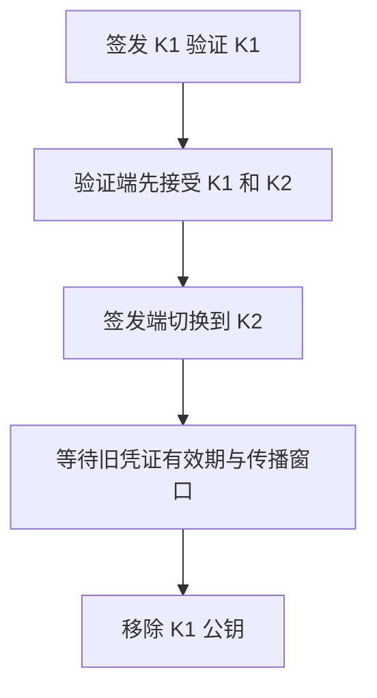

# Gin JWT 认证：签名、算法、Issuer、Audience 与过期

JWT 认证需要明确谁签发、谁验证、凭证给谁用，以及轮换时旧凭证何时失效。签名算法正确只是起点，受信密钥集合和声明验证同样决定安全边界。

## 1. 先把签名和声明分开

JWT 的 Header 与 Payload 通常可以读取，签名不等于加密。Payload 里的 subject、tenant 与 scope 只有在签名及必要声明都通过后才成为可信输入。

服务端固定允许算法，验证 issuer、audience、exp、必要身份与时间边界。不能按客户端 Header 自由选择密钥种类，更不能只做 Base64 解码就读取身份。

HS256 使用共享秘密，持有该秘密的验证者也具备签发能力；RS256 使用公私钥分离，API 可以只持公钥。选择取决于信任拓扑，而不是把一种算法简单叫作“更高级”。

## 2. 保留基础工程与轮换实验的边界

taskd 基础工程仍使用受控 HS256 实验，便于理解 Bearer、scope 和租户过滤。新增 internal/keyauth 提供独立 RS256 验证器及 Gin middleware，用于演示公钥分发和轮换。

不要在同一个入口为了兼容而随意混合两种信任模型。真实替换时需要独立 issuer/受众规则、密钥配置与回归，而不是把算法列表无限扩大。

RS256 Sign helper 属于签发方，Verifier 不保存私钥。私钥由测试临时生成，不写入 Git 或日志。

## 3. kid 是索引 不是外部下载指令

kid 用来在服务端已受信的公钥集合里选择一把钥匙。未知 kid 应拒绝或触发受控刷新，不能把它拼成任意文件路径、SQL 或远端地址。

实验 Replace 先校验完整 key set，复制公开模数，再以 atomic.Pointer 发布不可变快照。验证请求只读一份快照，更新失败保留旧集合，不先清空再逐把加入。

JWK/JWKS 获取属于独立信任管理：固定发行方与地址，设置超时、大小、缓存和刷新并发。Token 中的 jku/x5u 等值不能成为任意信任来源。实验不实现联网 JWKS 客户端。

## 4. 一轮平滑轮换的顺序



先分发新公钥，使所有验证者有能力接受新凭证，再切换签发。立即删除旧钥匙会让尚未过期的合法用户失败；先签发新钥匙但验证者还没更新，则新登录失败。

退役窗口要覆盖最后一枚旧 Token 的剩余最大寿命、允许时钟偏差及缓存传播。密钥泄露时可以主动缩短窗口并强制旧凭证失效，这是可用性与安全的明确取舍。

## 5. 过期 撤销和退役不能混为一谈

exp 控制一枚凭证的时间边界，删除公钥可以否认该 kid 的全部凭证，账户权限变化则是主体或资源状态的改变。三者影响范围不同。

“退出时删除本机 Token”不能撤销已泄露副本。需要即时撤销时，可选择短期凭证、会话/权限版本、受控撤销表或其他明确协议；缓存这些状态又会引入失效窗口。

验证允许有限 leeway，应计入实际可接受寿命，不能到处各加几分钟而不计算总窗口。

## 6. 运行轮换与错误更新测试

```bash
cd examples/gin/service-lab
go test ./internal/keyauth -count=1 -v -timeout=30s
go test ./internal/app -run 'TestIssuer|TestWrongSignature|TestExpired|TestScopeDenied' -count=1 -v
```

轮换测试摘要：

```text
overlap=old+next expired=rejected retired=rejected new-request=200
invalid-update=rejected previous-trust=preserved
```

测试先验证旧钥匙，再发布新旧双钥匙；分别签发短、长寿命旧凭证。推进测试时钟后，短凭证因过期失败，仍在有效期内的长凭证先被接受，再在旧公钥退役后被拒绝。这样才能分别证明时间校验和密钥退役，而不是用同一个过期 Token 混淆原因。

最后用新钥匙签发凭证通过 Gin /me，确认轮换后请求链仍可用。

## 7. 验证身份后仍需授权

subject 不是任意资源的访问许可。scope 限制接口能力，tenant 和对象归属限制数据范围；批量操作、下载、SSE 与消息消费都要贯穿检查。

不要把内部 claims 结构体全部序列化回客户端，也不要把 Token 当日志关联 ID。日志可记录脱敏主体、受信 issuer、错误类别和请求 Trace，而非完整凭证。

## 8. 发布与运行观测

观察未知 kid、签名失败、受众/发行方失败、过期和刷新错误的分布。轮换窗口内旧 kid 的请求量能帮助判断传播与存量，但不能单凭“最近没有请求”就省略最大有效期约束。

签发与验证配置分开管理，限制谁能发布受信集合。新 key set 必须全部验证后原子替换，失败保留上一份；若原信任已被确认泄露，则需走显式紧急撤销路径，而不是盲目保留。

## 9. 练习与答案

### 9.1 为什么正常轮换要先分发公钥再切签发

验证方必须先具备接受新 Token 的能力，同时保留尚未到期的旧凭证。颠倒顺序会产生可预测的登录或访问失败窗口。

### 9.2 怎样证明测试确实验证了密钥退役

使用退役时仍未过期的旧凭证，先确认在双钥匙集合中可接受，再移除旧公钥后确认失败。否则过期就足以解释失败，无法归因到退役。

### 9.3 kid 存在是否就能下载同名公钥验证

不能。kid 只能索引已经建立的信任集合，任意下载会把客户端输入升级为信任来源，破坏认证边界。

## 10. 参考资料

- [JWT Best Current Practices](https://www.rfc-editor.org/rfc/rfc8725)
- [golang-jwt 验证](https://golang-jwt.github.io/jwt/)
- [轮换实现](https://github.com/newswitch/newswitch.github.io/tree/main/examples/gin/service-lab/internal/keyauth)
