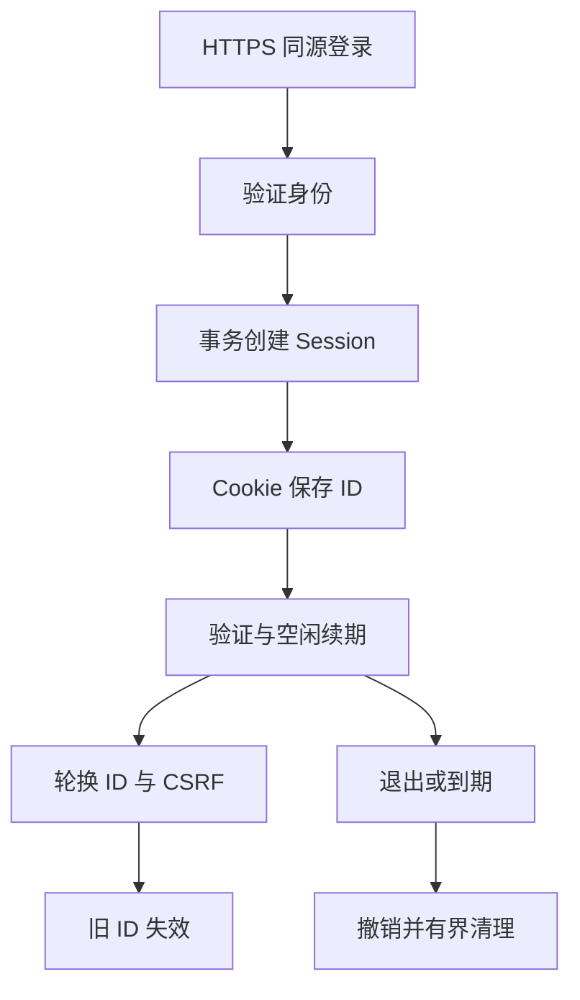

# Gin Session、Cookie、CSRF 与 CORS：浏览器凭证的四个边界

浏览器自动携带 Cookie，服务端验证会话，CSRF 保护写操作，CORS 决定部分跨源读取行为。下面实现一条可验证的 HTTPS 会话生命周期：登录、查询、轮换、退出、超时和清理，而不是只给 Cookie 加几个属性。

## 1. 凭证 状态和身份来源分开设计

Cookie 只携带不可预测的 session ID，服务端存储 subject、tenant、空闲截止、绝对截止和撤销状态。session ID 是持有即授权的敏感凭证，不记录到日志，也不放入 URL。

登录前的账号校验是另一个边界。实验 Handler 接受 Authenticate 回调，由它返回已验证身份；HTTPS 测试使用受控测试身份，不把硬编码密码包装成生产登录。实际接入密码库或身份提供方时，需要密码散列、错误处理、账户限速和恢复策略。

跨副本不能依赖各自内存 Map 作为登录事实。实验使用 SQL 表，两个独立连接池访问同一数据库文件验证共享状态；更大规模共享数据库需单独验证目标产品与容量。

## 2. 表结构为什么保存摘要

lab_sessions 保存 id_hash，而不是明文 session ID；CSRF token 也只保存摘要。原始值由 crypto/rand 产生 32 个随机字节，再用无填充 Base64URL 编码，返回长度 43 的字符串。

数据库只有摘要时，读取者不能直接把摘要当作 Cookie 重放。但数据库写权限仍十分敏感，摘要并不能抵御任意篡改身份或过期时间。不要把这个性质扩大为“数据库泄漏完全无害”。

session.New 不自动建表。先显式运行 migrate.Up 的会话迁移，再创建 Store 与 Handler，避免每个请求偷偷执行 DDL。

## 3. 登录到退出的状态变化



登录成功即生成新 ID，若浏览器带着旧实验 Cookie，同事务撤销旧会话后插入新记录。轮换不是只修改客户端 Cookie，必须改变服务端接受状态。

/renew 在一笔事务中验证旧会话仍有效、撤销旧 ID、插入新 ID 与新 CSRF。插入失败时全部回滚，旧会话仍可使用；测试通过数据库 trigger 强制失败验证这个不变量。

## 4. Cookie 属性与缓存边界

实验使用 __Host-go_lab，Secure=true、HttpOnly=true、Path=/，不设置 Domain，SameSite=Lax。服务只接受明确的 HTTPS Origin。__Host 前缀的浏览器约束是纵深保护，不替代服务端检查。

HttpOnly 限制脚本直接读取 Cookie，但同源 XSS 仍可能发起带凭证请求。Secure 控制 HTTPS 发送，不等于服务端数据库状态已经安全。SameSite 依浏览器站点语义判断，也不是全部 CSRF 防线。

所有会话响应设置 Cache-Control: no-store，避免凭证和身份响应被普通共享缓存保存。退出清除 Cookie 时必须使用匹配的名称和 Path，同时撤销服务端状态。

## 5. 写请求为什么同时检查 Origin 和 CSRF

登录也可能受到跨站状态干扰，因此实验所有 POST 都要求精确匹配配置 Origin。受保护的 renew/logout 还要求 X-CSRF-Token 与服务端摘要匹配，使用恒定时间比较固定长度摘要。

CSRF token 通过登录 JSON 返回，客户端在同源脚本内使用，不放 HttpOnly Cookie 再要求脚本读取。攻击者不能仅凭浏览器自动附带的 Session Cookie 完成这个自定义请求头协议。

CORS 主要约束浏览器对跨源响应的读取，不是服务端认证。这个同源实验不开放跨源 credentials，也没有把任意 Origin 反射为允许项。实际需要跨源时，额外设计预检、受控白名单与 credentials 规则。

## 6. 空闲期限与绝对期限

空闲期限随有效请求续期，绝对期限在此次身份认证后固定；续期取两者较早值，不能让持续调用的会话无限存活。实验 idle=30 秒、absolute=2 分钟，时间通过注入时钟验证，不真实等待数分钟。

轮换 ID 不延长原有绝对期限。重新完成身份认证可以建立新的会话周期，但必须重新经过登录边界。

过期会话立即失去授权，与删除记录是两个步骤。PurgeExpired 显式接受 1..1000 的批大小，按 absolute_until 索引清理；由维护任务决定运行节奏，构造 Handler 不会暗中启动永久 Goroutine。

## 7. 依赖故障与并发边界

Store 读取失败返回 503，不降级为“已登录”。无效/过期凭证返回 401，缺少 CSRF 或 Origin 不匹配返回 403。不同错误应保持明确，不把数据库宕机误当用户密码错误。

会话撤销阻止后续授权，但不能自动撤回此前已获授权并已提交的请求；高风险操作还需在事务/执行边界重新验证权限版本或业务条件。

每次请求更新空闲期限会增加写压力。生产可按受控间隔更新，但需证明不会把已撤销状态重新激活，并重新计算允许的空闲误差。登录只设每进程四个并发槽，不等于全局账户防爆破体系。

## 8. 运行完整 HTTPS 与失败回归

```bash
cd examples/gin/service-lab
go test ./internal/session ./internal/migrate -count=1 -v -timeout=30s
```

关键输出节选：

```text
https-login=200 me=200 no-csrf=403 renew=200 old-session=invalid logout=204 after=401
idle-expiry=enforced active-requests-cannot-extend-absolute=true
renew-insert-failure=rolled-back old-session=still-valid
```

测试使用本机 TLS Server、HTTP 客户端及 Cookie Jar，验证凭证传递、轮换、清除和服务端状态；另测不同 Origin 在身份回调前被拒绝、后端关闭时不授予身份，以及过期记录的有界清理。

Cookie Jar 不是完整浏览器，跨源脚本、浏览器 SameSite 与真实代理拓扑仍需在目标客户端验证。完整实现见 internal/session，原来的 cookie 小实验仅用于属性入门。

## 9. 练习与答案

### 9.1 只删除浏览器 Cookie 为什么不等于退出完成

持有该凭证的其他副本仍可能被服务端接受，因此还要撤销服务端会话。客户端清除与服务端撤销共同组成退出；对于已经执行的请求，还要区分后续授权和已提交副作用。

### 9.2 为什么续期不能无限推迟绝对过期

若只刷新 idle，持续持有凭证者可以长期维持授权。绝对期限限定一次认证的最长寿命，轮换 ID 不应绕过它，达到期限需要重新认证。

### 9.3 会话库故障时为什么不是返回 200 并暂信任 Cookie

随机 Cookie 只是索引凭证，身份与有效性以服务端状态为准。无法读取授权事实时不能凭旧字符串授予权限，应按依赖不可用失败并保留可恢复性。

## 10. 参考资料

- [会话实现与 HTTPS 测试](https://github.com/newswitch/newswitch.github.io/tree/main/examples/gin/service-lab/internal/session)
- [HTTP Cookie RFC](https://www.rfc-editor.org/rfc/rfc6265)
- [net/http Cookie](https://pkg.go.dev/net/http#Cookie)
