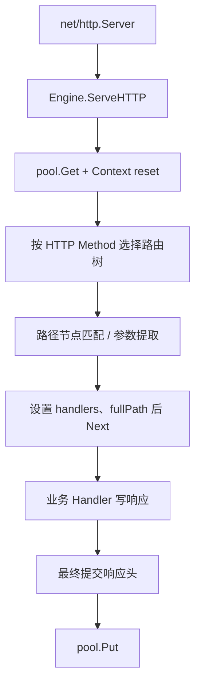

# Gin 源码：从 Engine.ServeHTTP 到路由树和 Handler 链

沿一次 GET /api/tasks/t1 的实际调用路径阅读源码，比逐个背框架对象更有效。本文固定 Gin 1.12.0，只抽取控制与数据流，不堆整段源码。

## 1. 入口与对象关系

Engine 实现 http.Handler。net/http 调用 Engine.ServeHTTP 后，Engine 从自己的 pool 取得 *Context，重置响应包装器、Request 与每请求字段，随后进入 handleHTTPRequest。

请求 URL、Header 和 Body 仍由 *http.Request 承载；Context 添加参数、Handlers、索引和错误等框架状态。Engine 是长期共享对象，Context 是短生命周期对象。

## 2. 匹配路径



路由在注册阶段形成树和 Handler 链。请求时按方法选择对应树，再查路径；这不是每请求把全部正则表达式从头扫描一遍。静态段、参数段与捕获段匹配规则由 tree.go 实现。

## 3. 匹配失败如何走

找到 Handler 后设置 Params、fullPath 并执行 Next；未找到时可能根据尾斜杠/规范化配置重定向，或进入 NoRoute。启用 HandleMethodNotAllowed 后还可能计算允许方法并执行 405 路径。

这里解释的是控制流，不应把树查找成本等同于完整接口成本。认证、JSON、SQL、消息和网络等待通常远大于一次简单路由。

## 4. 阅读与实验

```bash
cd examples/gin/service-lab
go run ./cmd/webdemo -case routing
```

```text
status=200
id=t1
```

完整代码与断言见 [service-lab](https://github.com/newswitch/newswitch.github.io/tree/main/examples/gin/service-lab)。

按固定 tag 阅读 gin.go 的 ServeHTTP、handleHTTPRequest，再转到 tree.go 的匹配函数。对照 routing 实验观察 Params，而不是从 master 分支复制新布局解释旧版二进制。

框架对象可复用不等于可任意并发修改注册表。路由与中间件在启动期装配，运行期变更必须按框架契约及并发测试处理。

## 5. 练习与答案

### 5.1 Engine 与 Context 生命周期相同吗

不同，Engine 长期共享，Context 为请求借用并可能复用。

### 5.2 Gin 每次请求都线性匹配全部正则吗

不是，它使用按方法组织的路由树等结构。

### 5.3 路由基准能说明 SQL 接口容量吗

不能，完整路径成本不同。

## 6. 参考资料

- [gin.go 固定版本](https://github.com/gin-gonic/gin/blob/v1.12.0/gin.go)
- [tree.go 固定版本](https://github.com/gin-gonic/gin/blob/v1.12.0/tree.go)
