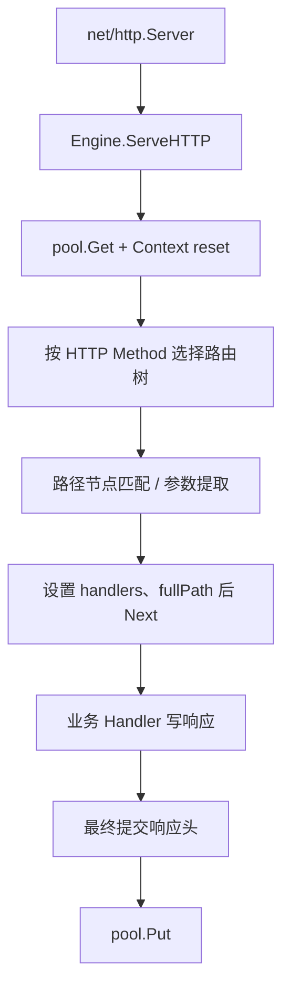

# Gin 源码：从 Engine.ServeHTTP 到路由树和 Handler 链

沿一次 GET /api/tasks/t1 的实际调用路径阅读源码，比逐个背框架对象更有效。本文固定 Gin 1.12.0，只抽取控制与数据流，不堆整段源码。

## 1. 入口与对象关系

Engine 实现 http.Handler。net/http 调用 Engine.ServeHTTP 后，Engine 从自己的 pool 取得 *Context，重置响应包装器、Request 与每请求字段，随后进入 handleHTTPRequest。

请求 URL、Header 和 Body 仍由 *http.Request 承载；Context 添加参数、Handlers、索引和错误等框架状态。Engine 是长期共享对象，Context 是短生命周期对象。

## 2. 匹配路径



路由在注册阶段形成树和 Handler 链。请求时按方法选择对应树，再查路径；这不是每请求把全部正则表达式从头扫描一遍。静态段、参数段与捕获段匹配规则由 tree.go 实现。

## 3. 匹配失败如何走

找到 Handler 后设置 Params、fullPath 并执行 Next；未找到时可能根据尾斜杠/规范化配置重定向，或进入 NoRoute。启用 HandleMethodNotAllowed 后还可能计算允许方法并执行 405 路径。

这里解释的是控制流，不应把树查找成本等同于完整接口成本。认证、JSON、SQL、消息和网络等待通常远大于一次简单路由。

## 4. 阅读与实验

```bash
cd examples/gin/service-lab
go run ./cmd/webdemo -case routing
```

```text
status=200
id=t1
```

完整代码与断言见 [service-lab](https://github.com/newswitch/newswitch.github.io/tree/main/examples/gin/service-lab)。

按固定 tag 阅读 gin.go 的 ServeHTTP、handleHTTPRequest，再转到 tree.go 的匹配函数。对照 routing 实验观察 Params，而不是从 master 分支复制新布局解释旧版二进制。

框架对象可复用不等于可任意并发修改注册表。路由与中间件在启动期装配，运行期变更必须按框架契约及并发测试处理。

## 5. 注册与查询是两种不同阶段

routergroup.go 计算完整路径并合成 handlers，gin.go 的 addRoute 将其放入按 Method 组织的树；请求阶段 handleHTTPRequest 再选择对应树并匹配路径。很多“中间件没执行”实际上来自注册阶段已有快照。

tree.go 使用压缩路径节点与子节点选择，而不是把全部路由都编译成正则后线性扫描。参数与 catch-all 有自己的匹配和冲突规则，静态路径与动态路径的关系应以固定版本实现和测试为准。

按源码读时，先找注册时数据写入的位置，再找请求时读取的位置。这样能区分“树里没有这个方法”“路径没匹配”“找到链但被 Abort”三种问题。

## 6. 一次匹配产出参数、模板和执行链

匹配结果不只是一个 Handler 函数，还包括 Params、fullPath 与已组合 handlers。Params 面向实际输入，fullPath 面向注册模板，handlers 决定认证、准入和业务如何执行。

启动后的 Engine 长期共享；Context 则从 pool 借出并重置。请求结束后不能保存 Params 或 Context 的临时引用供任意后台继续使用，Copy 的隔离边界要结合独立专题理解。

链完成后框架会提交未写出的响应头，再归还 Context；已提交的流或错误路径也要按真实 Written 状态解释，不能简单认为执行到最后一行就一定返回完整 JSON。

## 7. 回退、重定向与方法树实验

未匹配时，框架可能先按配置处理尾斜杠或规范化重定向，再走 405 或 NoRoute。NoRoute 不是一个可以随意把所有未知请求重写为成功的业务分支，它仍需稳定错误与低基数观测。

TestMethodTreesAndRedirects 逐项核对参数模板、404、405/Allow、HEAD 与 301/307；TestMiddlewareRegistrationSnapshots 核对注册时机。二者把源码推导变成可运行的行为约束。

新版本内部节点字段变化，不一定改变公开语义；升级时先重跑这些契约，再判断是否需要更新源码解读。不要用 master 分支的新布局解释一个固定旧二进制。

## 8. 练习与答案

### 8.1 Engine 与 Context 生命周期相同吗

不同，Engine 长期共享，Context 为请求借用并可能复用。

### 8.2 Gin 每次请求都线性匹配全部正则吗

不是，它使用按方法组织的路由树等结构。

### 8.3 路由基准能说明 SQL 接口容量吗

不能，完整路径成本不同。

## 9. 参考资料

- [gin.go 固定版本](https://github.com/gin-gonic/gin/blob/v1.12.0/gin.go)
- [tree.go 固定版本](https://github.com/gin-gonic/gin/blob/v1.12.0/tree.go)
- [Gin 1.12.0 路由注册](https://github.com/gin-gonic/gin/blob/v1.12.0/routergroup.go)
- [路由行为回归](https://github.com/newswitch/newswitch.github.io/tree/main/examples/gin/service-lab/internal/requestflow)
